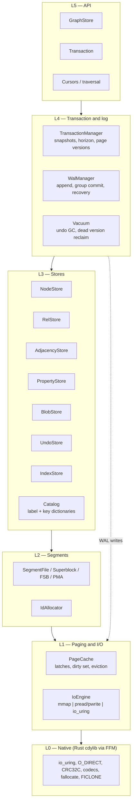
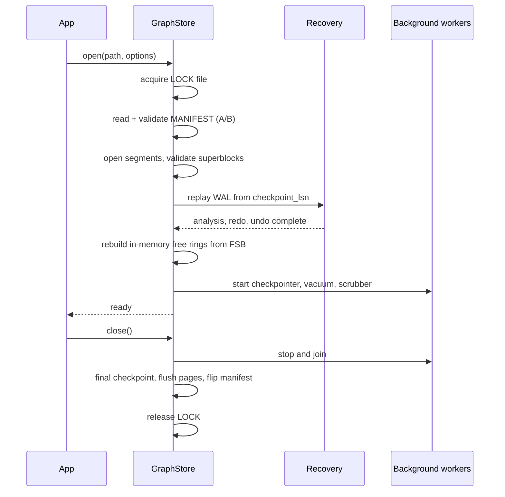

# Target Architecture

Layering, component responsibilities, threading and lifecycle for the target engine. Byte-level
formats are in [FILE_FORMAT.md](FILE_FORMAT.md); the as-is picture is in
[CURRENT_STATE.md](CURRENT_STATE.md).

---

## 1. Design Goals, in Priority Order

1. **O(1) element access.** An id decodes to an offset. Nothing on the read path probes an index.
2. **Crash safety.** A power loss leaves a store that recovers to the last committed transaction,
   always, with detection of any physical corruption.
3. **Space efficiency.** Bytes on disk are dominated by payload, not by pointers and padding. The
   PoC spends 98 percent of a node record on an unused array.
4. **Sequential-friendly access.** Traversal reads adjacency in large contiguous runs; random reads
   are single-page and 4 KiB aligned.
5. **Concurrency.** Many readers, several writers, no global lock on the read path.
6. **Native where it pays.** Rust via FFM for io_uring, `O_DIRECT`, SIMD checksums and codecs —
   never for things the JVM already does well.

Explicit **non-goals** for the foreseeable phases: distribution, replication and graph algorithms.
This is a storage layer.

A query language was on that list and is no longer, but the boundary it protected still holds: the
openCypher subset lives in a **separate module** that depends on this one's public `api` package and
cannot reach inside it — [CYPHER.md](CYPHER.md). The storage layer has no query language in it. It
also gained one API method as a result, `forEachNode`, which is the sort of gap only a real consumer
finds.

**Remote access was never on the non-goals list**, and there is now a binary streaming port with a
Java client — [WIRE.md](WIRE.md). The same boundary applies one layer further out, and more strictly:
`graph-protocol` and `graph-client` depend on **neither** the storage engine nor the query engine, and
`ClientDependencyTest` fails by *loading* if either ever appears on the client's classpath. That is
not tidiness. graph-core is an FFM module with a native library behind it, so a client that dragged it
along would make every application embedding it grant native access and ship a shared object it will
never call, in order to read rows off a socket. The server module is the only place the three layers
meet, and it meets them by converting values at its edge rather than by sharing types.

---

## 2. Layering



**Strict downward dependency.** A store never talks to the `IoEngine` directly; the segment layer
never knows about transactions. The one deliberate exception is that the WAL manager writes through
L1 directly, because a WAL append is a different access pattern (pure sequential, `O_DIRECT`) than a
page write.

---

## 3. Component Responsibilities

| Component | Owns | Does not own |
|-----------|------|--------------|
| `GraphStore` | Store lifecycle, open/close, manifest, background workers | Any per-transaction state |
| `Transaction` | The write set, as private page copies | Durability |
| `TransactionManager` | Active read views, the reclamation horizon, the retention budget | The log format |
| `WalManager` | Log record encoding, LSN allocation, group commit, recovery driver, retention | Element semantics |
| `NodeStore` / `RelStore` | Record encode/decode, generation checks, cascade rules on delete | Page I/O |
| `AdjacencyStore` | Inline edges, adjacency blocks, edge codec, degree maintenance | Relationship properties |
| `PropertyStore` / `BlobStore` | Property blocks, value typing, overflow to blobs | Key interning |
| `Catalog` | Label and key dictionaries, id interning, reverse lookup | Element storage |
| `UndoStore` | Before-images, version chains | Visibility rules (those live in `Transaction`) |
| `SegmentFile` | One file: mapping, superblock, FSB, PMA, slicing | Record semantics |
| `PageCache` | Page latches, dirty tracking, write-back ordering, eviction | What is in a page |
| `IoEngine` | Reads, writes, flushes, prefetch, allocation hints | Correctness of ordering |

---

## 4. Target Package Layout

```
io.metaloom.graph.core
  api/            GraphStore, Transaction, Node, Relationship, Cursor, exceptions
  id/             ElementId, Kind, StaleIdException
  segment/        SegmentFile, Superblock, FreeSlotBitmap, PageMetadataArray, IdAllocator
  page/           PageCache, PageLatch, PageRef, WriteBackScheduler
  io/             IoEngine, MmapIoEngine, DirectIoEngine, UringIoEngine, IoRequest
  store/
    node/         NodeStore, NodeRecord
    rel/          RelStore, RelationshipRecord
    adj/          AdjacencyStore, AdjacencyBlock, EdgeCodec
    prop/         PropertyStore, PropertyBlock, ValueCodec
    blob/         BlobStore
    index/        BTree, IndexCatalog
  catalog/        Catalog, Dictionary
  txn/            TransactionManager, Snapshot, SnapshotHolder, PageVersions, TransactionImpl
  wal/            WalManager, WalRecord, WalWriter, WalReader, Recovery, Checkpointer
  native/         NativeLib, NativeBindings, FallbackImpl
  util/           Bits, Crc, VarInt, Preconditions
```

The PoC's `internal.*` split (`internal.node`, `internal.rel`, `internal.prop`) maps onto `store.*`;
`internal.tree` is deleted along with `LongBinaryTree` (D21).

---

## 5. Read and Write Paths

### 5.1 Reading a node by id — the path that must stay short

```
ElementId  ->  kind, segment, slot, gen          3 shifts, 3 masks
           ->  SegmentFile                       one array index
           ->  byteOffset = DATA_START + slot*stride    one multiply, one add
           ->  MemorySegment.asSlice(offset, 64) no allocation
           ->  read PMA epoch                    cache-resident
           ->  copy 64 bytes                     one cache line
           ->  re-read PMA epoch, retry if changed
           ->  check gen and LIVE                one branch
           ->  visibility check                  skipped entirely with no read view open;
                                                 otherwise one compare per page, and a rebuild
                                                 only for a page the writer has since changed
```

Zero locks, zero allocations, one potential page fault. This sequence is the reason for every
decision in [ID_ENCODING.md](ID_ENCODING.md) and [FILE_FORMAT.md](FILE_FORMAT.md).

### 5.2 Writing a node

```
txn.begin                        -> snapshot ts
allocate slot                    -> bump cursor or free ring; WAL: ALLOC_SLOT
encode property block            -> PropertyStore; WAL: PROP_WRITE
build the 64-byte record         -> in a confined arena, off the page
acquire page write latch
copy record into the page, bump PMA epoch, mark dirty
release latch
WAL: NODE_INSERT (physiological: segment, slot, after-image)
txn.commit                       -> WAL: COMMIT, group fsync, publish commit ts
```

The page is *not* written back at commit. Write-back is asynchronous and governed only by the WAL
rule; this is the standard steal/no-force policy and it is what keeps commit latency at one
sequential log append.

---

## 6. Concurrency Model

| Level | Mechanism |
|-------|-----------|
| Element reads | Lock-free. Optimistic page read via the PMA `epoch`: read epoch, copy the record, re-read epoch, retry on change. |
| Reads | No lock in the common case. The commit apply step is the only thing a reader must be excluded from, so a read runs under an optimistic `StampedLock` stamp and is repeated under a real read lock only if an apply happened underneath. **Built:** a `ReentrantReadWriteLock` here was measured making reads *slower* as threads were added — acquiring a read lock writes to a shared counter — and replacing it was worth 1.4x at two threads. |
| Element writes | Per-page write latch (a `VarHandle` CAS on a 64-bit latch word held in an off-heap latch array, one per page). **Not built, and not needed:** a writer mutates a private copy of the page, so no two writers ever touch the same bytes of the mapping. |
| Transaction conflicts | Optimistic, and **detected at commit rather than at write time**. The plan's striped `(id -> txn)` intent table would fail faster; what was built compares the byte ranges each transaction changed against the version chains of the pages it changed them on, which the engine is already keeping and which costs nothing until a commit happens. First committer wins. See [TRANSACTIONS.md §6](TRANSACTIONS.md). |
| Writers | **Concurrent.** They exclude each other for slot allocation and for the commit point — validate, log, apply — and nothing else. Maintenance (`verify`, `checkpoint`, `reclaim`, compaction, `close`) excludes them outright, through a shared/exclusive gate writers hold shared for a transaction. |
| WAL append | A single append lock protecting LSN allocation and buffer reservation, held for tens of nanoseconds; the copy into the buffer happens outside it. |
| Commit | Group commit: committers queue, one thread performs the fsync for the batch. |
| Page cache | Striped clock/LRU with per-stripe locks. Eviction never blocks a reader holding an optimistic read. |
| Background | Checkpointer, vacuum, compactor and scrubber each run on their own single thread, coordinated through the manifest. **Built: none of them run on a thread.** Compaction is a foreground call that excludes writers one batch at a time, so a concurrent writer waits for one batch rather than for the whole run; `pauseBetweenBatchesMillis` widens the gap. That is the entire scheduling policy, and it keeps the caller in control of when maintenance happens. |

**Rule**: no lock is ever held across an I/O operation or across a call into native code that can
block. Violating this is how a storage engine acquires unexplainable latency spikes.

---

## 7. Threading and Lifecycle



`close()` is a real operation with real work, unlike the PoC's empty
`AbstractMMapFileStorage.close()` (D2). A clean close writes a checkpoint so the next open replays
nothing.

The `LOCK` file holds pid and boot id so a stale lock from a crashed process on a rebooted machine is
distinguishable from a live one.

---

## 8. Configuration

| Option | Default | Effect |
|--------|---------|--------|
| `page.size` | 8192 | Fixed at creation. 4096 for random-heavy, 16384 for scan-heavy workloads. |
| `cache.size.bytes` | 25 percent of RAM | Page cache budget. |
| `io.engine` | `auto` | `mmap`, `direct`, `uring`, or `auto` (uring where available, else mmap). |
| `wal.sync.mode` | `fsync_on_commit` | `fsync_on_commit`, `group_commit(ms)`, `async` (durability off, testing only). |
| `wal.segment.bytes` | 64 MiB | Preallocated log segment size. |
| `checkpoint.interval.sec` | 60 | Fuzzy checkpoint cadence. |
| `checkpoint.wal.bytes` | 1 GiB | Force a checkpoint after this much log. |
| `vacuum.interval.sec` | 30 | Undo reclamation cadence. |
| `compaction.liveness.threshold` | 0.5 | Segment liveness below which compaction is eligible. |
| `compaction.index.fill.threshold` | 0.25 | B+tree entries per page, over the fan-out, below which the indexes are rebuilt. Lower than the liveness threshold on purpose: see [FILE_FORMAT.md §9.3](FILE_FORMAT.md#93-adjacency-and-index-compaction). |
| `compaction.batch.records` | 4096 | Records relocated per transaction. Bounds both compaction's memory and how long a foreground writer waits. |
| `verify.batch.size` | 4096 | Elements a throttled `verify(FULL)` scans before dropping the read latch. |
| `native.enabled` | `true` | Set false to force the pure-Java fallback path. |
| `slot.retirement` | `false` | Never reuse a slot; makes dangling ids always detectable. |
| `edge.inline.count` | 2 | Fixed by the record layout; listed for documentation only. |

All options are recorded in the manifest where they affect the format, and rejected on reopen if
they conflict.

---

## 9. Error Model

| Exception | Meaning | Recoverable |
|-----------|---------|-------------|
| `StaleIdException` | Generation mismatch: the id refers to a slot that has been freed and reused | Yes, application-level |
| `PageCorruptException` | Checksum mismatch on a data page or a PMA entry | No, requires restore or repair |
| `FormatVersionException` | Store written by a newer version | No |
| `SnapshotTooOldException` | Reading a view whose retained versions have been reclaimed | Yes, retry with a fresh view |
| `StoreClosedException` | Use after close | No |
| `OutOfSegmentsException` | Kind exhausted its 2^24 segments | No |

Corruption is always reported with segment, page and slot. Never swallow a checksum failure — the
PoC's habit of returning `null` for "outside the file" and for "marked free" and for "does not
exist" makes three different conditions indistinguishable.

---

## 10. Conventions and Gotchas

- **The layering is enforced by package structure and reviewed, not by the module system** — until
  Phase 6, when `module-info.java` makes it explicit.
- **No component allocates on the read path.** Records are decoded into caller-supplied structures or
  returned as slices. `MemorySegment.asSlice` is free; `MemorySegment.toArray` is not.
- **All `VarHandle`s are `static final`.** This is D17; it is the single easiest large win over the
  PoC.
- **Background workers are opt-out, not opt-in.** A store opened without a checkpointer will grow its
  WAL without bound; tests that disable them must say so explicitly.
- **`Arena` discipline**: one `Arena.ofShared()` per open store for mappings, `Arena.ofConfined()`
  per operation for scratch. Never `Arena.ofAuto()` for a mapping — it defers unmapping to the GC,
  which is exactly how the PoC reaches `vm.max_map_count`.
- **Native calls are never in a latched section.** See §6.

---

## 11. Test Setup

- **Layer isolation tests**: each layer has a test that constructs it over an in-memory or temp-dir
  fixture without the layers above it. `SegmentFile` tests must not need a `GraphStore`.
- **Lifecycle test**: open, write, kill -9, reopen, assert the last committed transaction is present
  and nothing after it is. See [TESTING.md §6](TESTING.md#6-crash-and-fault-injection).
- **Concurrency test**: N reader threads traversing while M writer threads mutate; assert no reader
  observes a torn record (checked by an internal record checksum in debug builds) and no writer loses
  an update.
- **Lock discipline test**: an assertion mode that fails if an I/O call or a native downcall happens
  while a page latch is held.

---

## 12. Progress Assessment

- [x] Package skeleton per §4 (`page/`, `io/`, `txn/`, `wal/`, `native/` arrive with their phases)
- [x] `GraphStore` open/close lifecycle with LOCK file and manifest validation
- [x] Configuration object, manifest-recorded and validated on reopen
- [x] Exception hierarchy per §9
- [x] PMA epoch maintained by every writer (the read side of the optimistic protocol lands with
      concurrency in Phase 5)
- [ ] `PageCache` with striped eviction and per-page latches (Phase 5)
- [ ] `IoEngine` interface with the mmap implementation (Phase 6)
- [x] `Compactor` and `MaintenanceRunner`, as a foreground batched call rather than a worker thread
- [x] Optimistic `StampedLock` read path; the dictionary made lock free on the read side
- [x] Observability: `StoreMetrics` and `IoStats`, with a striped counter on the hot path
- [ ] Background worker framework (checkpointer, vacuum, scrubber) (Phase 5 onwards)
- [ ] Lock-discipline assertion mode (Phase 5)
- [ ] `module-info.java` (Phase 6)

---

## 13. Key Classes Reference (target)

| Class | Package | Purpose |
|-------|---------|---------|
| `GraphStore` | `io.metaloom.graph.core.api` | Store lifecycle and transaction factory |
| `Transaction` | `io.metaloom.graph.core.api` | Unit of write work: page overlay, commit/rollback |
| `ReadTransaction` | `io.metaloom.graph.core.api` | A view fixed at one LSN across many reads |
| `TransactionManager` | `io.metaloom.graph.core.txn` | Active views, the horizon, the retention budget |
| `PageCache` | `io.metaloom.graph.core.page` | Buffer management, latches, write-back |
| `IoEngine` | `io.metaloom.graph.core.io` | Pluggable I/O: mmap, O_DIRECT, io_uring |
| `Catalog` | `io.metaloom.graph.core.catalog` | Label and property-key interning |
| `WalManager` | `io.metaloom.graph.core.wal` | Log append, group commit, recovery |

---

## Identity, and where it deliberately is not

Users, roles and grants live in **graph-core**: the model in `io.metaloom.graph.core.api` and the codec
and password function in an unexported `io.metaloom.graph.core.auth`. `module-info.java` needed no
change, because only `api` is exported.

That placement is the one design decision here worth recording, and it was made against three
alternatives:

- **A new JDK-only leaf module** is the textbook layering, and was rejected as a module, a reactor entry
  and a `ClientDependencyTest` rewrite bought in exchange for giving the client a type it never branches
  on. graph-core wins because `GraphDatabases` already owns `<root>` and `.auth/` is a directory in it;
  because graph-cypher already depends on graph-core's `api` package, which is what lets
  `Ast.Query.requiredPrivileges()` return a `Set<Privilege>` with **no new dependency**; and because
  `tools/native-image.sh` already relies on both binaries inheriting graph-core's reachability metadata,
  which is where the JCA provider registration has to go.
- **The storage engine enforcing it** was never on the table. `GraphStore` takes no principal and
  consults none. Enforcement is per front end, which is the same line `--allow-write` draws.
- **The client naming a `Privilege`** would have put graph-core on the client's classpath, which
  `ClientDependencyTest` fails the build over. Grants cross the wire as **strings** instead, which costs
  nothing — the client makes no authorization decision — and buys forward tolerance: a client built
  before a privilege existed still prints it.

Flip to a leaf module if a second wire-level consumer ever needs to reason *structurally* about grants,
because at that point the string form becomes a parser in two places.

---

_Git HEAD revision: `da8c93e`_
_Last updated: 2026-08-17 (authentication and RBAC authorization)_
