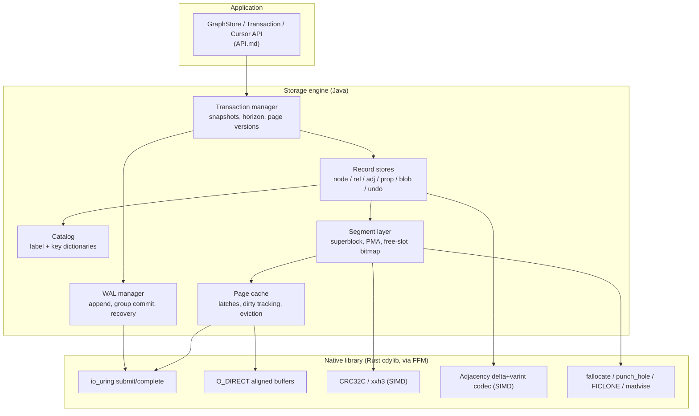

# MetaLoom // Graph — Project Context for AI Coding Agents

This document is the **entry point** for work on `metaloom-graph`. It is an **index and
router**, not a second copy of the specs: it catalogues every file under `spec/`, tells you which
one to open, and carries the project-wide cheat sheet, glossary and gotchas.

> **Project root**: `/home/defaultuser/workspaces/metaloom/metaloom-graph` —
> **spec root**: [spec/](.)

---

## 0. Read This First

### 0.1 What this project is

A **native-code backed graph storage layer** written in Java, using the Foreign Function and Memory
API (FFM, JEP 454, final since Java 22) to address memory-mapped binary files directly and to call
into a native library for the things the JVM cannot do well (io_uring, `O_DIRECT`, SIMD checksums
and codecs).

It stores **nodes**, **relationships** and **attributes** in compact, purpose-built binary files.
The defining design constraint is:

> **An element id decodes arithmetically into the exact file and byte offset of its record.
> Reading an element by id costs zero index probes and zero extra seeks.**

**Status.** Phases 0 to 10 are implemented to varying depth; 795 tests pass here, plus 23 in the MetaLoom
integration. The engine is **durable**
(write-ahead log, fsync before any data page is touched, redo recovery), **transactional** (commit,
rollback, auto-commit), **indexed** (label and property B+trees, and an HNSW index for
nearest-neighbour search over vector properties — [VECTOR.md](VECTOR.md)), and it reclaims space both without
moving anything (native hole punching) and by **compacting** — relocating records, rewriting every
reference to them and pulling the high water marks down.

Reads take no lock and scale to **10x at 32 threads**. Writers run **concurrently** on private page
copies and serialise only at the commit point and in slot allocation ([TRANSACTIONS.md §6](TRANSACTIONS.md));
the commit still fsyncs under its lock, so durable commits do not share an fsync. Readers get **MVCC
snapshot isolation**: `store.beginRead()` fixes a view across many reads while writers commit underneath.
There is now an **online logical backup** — a portable dump taken under an MVCC snapshot without stopping
writers, with a CLI to take and restore it ([BACKUP.md](BACKUP.md)). There is still no *physical* snapshot,
no incremental backup and no point-in-time recovery.

**Adjacency sizing, if you touch that layer**: a block is a run of 512 byte cells that doubles as the
node fills, not a page. It was a page until [reports/SCALE.md](reports/SCALE.md) measured what that
cost — 59 of 61 GiB on a mean-degree-4 graph — and the change took the same graph to 6.2 GiB. Store
format version 2; version 1 stores are rejected rather than converted.

What is done and what is left: [PROGRESS.md](PROGRESS.md). Per-phase status with the reason for every
gap: [reports/PHASE_STATUS.md](reports/PHASE_STATUS.md). Measured numbers:
[reports/BASELINE.md](reports/BASELINE.md) and [reports/SCALE.md](reports/SCALE.md). Running it in
anger: [OPERATIONS.md](OPERATIONS.md).

[CURRENT_STATE.md](CURRENT_STATE.md) is the record of the proof of concept this replaced, including
its defect register — worth reading before reintroducing any of its patterns.

### 0.2 The two rules

1. **The code is the source of truth.** Where a spec and the code disagree, the code wins — and you
   fix the spec in the same change. Every spec carries a git revision in its footer; treat anything
   older than the last relevant commit as a claim to re-check, not a fact.
2. **The addressing invariant is not negotiable.** Any design that introduces a mandatory
   indirection between "I have an id" and "I know the byte offset" is out of scope. If you think you
   need one, read [ID_ENCODING.md §6](ID_ENCODING.md#6-why-not-an-indirection-table) first — the
   tension with Copy-on-Write is real and is resolved there, not by adding a page table.

### 0.3 Reading order for a new task

```
CONTEXT.md (this file)
   ├─ CURRENT_STATE.md ......... what actually exists today, and its defects
   ├─ ARCHITECTURE.md .......... target layering, components, threading model
   ├─ PLAN.md .................. phased implementation plan — pick your work item here
   ├─ PROGRESS.md .............. what is done and what is left, as one checklist
   └─ the spec for your area:
        ├─ ID_ENCODING.md ............ ids, offsets, generations
        ├─ FILE_FORMAT.md ............ segments, pages, records, on-disk layout
        ├─ RELATIONSHIP_STORAGE.md ... adjacency, traversal, edge compression
        ├─ PROPERTY_STORAGE.md ....... attributes, dictionaries, blobs
        ├─ INDEX.md .................. the label, property and composite B+trees, unique constraints
        ├─ INDEX_TASKS.md ............ the work items behind INDEX.md's "not built" list
        ├─ VECTOR.md ................. vector records and the HNSW index over them
        ├─ TRANSACTIONS.md ........... ACID, snapshot isolation, page versions, CoW
        ├─ CYPHER.md ................. the openCypher subset, the server and the UI
        ├─ WIRE.md ................... the binary streaming port, its codec, its TLS listener and the Java client
        ├─ DATABASES.md .............. several stores under one root: layout, naming, selection
        ├─ WAL.md .................... write-ahead log, recovery, checkpoints
        ├─ SSD_IO.md ................. I/O strategy, seek avoidance, alignment
        ├─ NATIVE_FFM.md ............. the Java <-> native boundary
        ├─ IO_URING.md ............... the ring: what it buys, and why nothing calls it yet
        ├─ TASKS.md .................. deferred work items, area-prefixed — currently URING-1..7
        ├─ GRAALVM.md ................ the two native binaries: FFM under native-image
        ├─ API.md .................... the public Java API
        ├─ TESTING.md ................ test setup, benchmarks, crash testing
        ├─ OPERATIONS.md ............. configuration, sizing, tuning, monitoring, backup, recovery
        ├─ METRICS.md ................ the Prometheus meter catalogue, and the alert rules it implies
        ├─ BACKUP.md ................. the logical dump, the paced scan it needs, and the CLI
        ├─ MCP.md .................... the Model Context Protocol port and its tools
        ├─ AUTH.md ................... users, roles, grants, and where each port checks them
        └─ DEPLOYMENT.md ............. the container images, the Helm chart and the k3d harness
```

---

## 1. Spec File Catalogue

| File | Covers | Do not put here |
|------|--------|-----------------|
| [CURRENT_STATE.md](CURRENT_STATE.md) | As-is inventory of the PoC: every class, every on-disk layout, every known defect with evidence | Target design |
| [ARCHITECTURE.md](ARCHITECTURE.md) | Target layering, module split, component responsibilities, threading and lifecycle | Byte-level formats |
| [ID_ENCODING.md](ID_ENCODING.md) | The 64-bit `ElementId`, the id-to-offset function, generations, NULL, id stability under CoW | Record contents |
| [FILE_FORMAT.md](FILE_FORMAT.md) | Store directory layout, manifest, segment anatomy, page metadata array, free-slot bitmap, node and relationship record layouts, versioning and compaction | Adjacency internals, property internals |
| [RELATIONSHIP_STORAGE.md](RELATIONSHIP_STORAGE.md) | Inline edges, adjacency blocks, edge compression, lightweight edges, traversal cost model | Node record layout |
| [PROPERTY_STORAGE.md](PROPERTY_STORAGE.md) | Property blocks, key and label dictionaries, value typing, inline vs blob, string dedup | Relationship storage; the property *index* (INDEX.md) |
| [INDEX.md](INDEX.md) | The three secondary B+trees — label to node, hashed property value to node, and the declared `(label, key)` composite — their page layout, the candidate verification a hashed key requires, the four maintenance hooks, store-wide and label-scoped unique constraints, and why relationships are not indexed | How a property is stored (PROPERTY_STORAGE.md); which access path a query picks (CYPHER.md) |
| [INDEX_TASKS.md](INDEX_TASKS.md) | The work items behind [INDEX.md §11](INDEX.md): for each unbuilt index, whether it is worth building, what it costs and what "done" means. Also the answer to "are unindexed relationships a supernode problem" — they are not, and §1 says what is | The design of anything on the list; the cross-project backlog order (PROGRESS.md §5) |
| [VECTOR.md](VECTOR.md) | Vector data in the graph: the `VEC` record that holds a vector with its ANN links, the declared index over `(label, property key)`, the HNSW structure and its build, why no B+tree can answer a nearest-neighbour query, and the four shapes considered before HNSW was chosen | How a property value is encoded (PROPERTY_STORAGE.md) |
| [CYPHER.md](CYPHER.md) | The openCypher subset, reads and writes: grammar, null semantics, where it differs from the engine, which transaction a query gets, why writes are off by default, the planner's costs, and the Vert.x HTTP server with its React and D3 graph browser | The public API; the binary streaming port (WIRE.md) |
| [DATABASES.md](DATABASES.md) | Several databases under one root: the directory layout, why a name is validated by allow-list, lazy opening, create and drop, and how a database is selected from each front end | The storage format; the frame layout (WIRE.md) |
| [WIRE.md](WIRE.md) | The binary streaming port: the frame, the value codec, the server's four bounds on a slow reader, the memory multiplication, **the optional TLS listener (§7.1)** and the Java client | The query language (CYPHER.md), the HTTP route and the browser UI |
| [TRANSPORT_DECISION.md](TRANSPORT_DECISION.md) | History, not specification: the measured trial that chose framed TCP over gRPC, with its criteria committed before its numbers, and what building the winner for real then changed | What the protocol *is* (WIRE.md) |
| [TRANSACTIONS.md](TRANSACTIONS.md) | ACID guarantees, snapshot isolation, the anomaly matrix, per-page version chains, the reclamation horizon and budget, where Copy-on-Write genuinely applies. Also why `SERIALIZABLE`, `LockTable` and `xmin` are *not* built rather than unfinished | WAL record format |
| [WAL.md](WAL.md) | WAL record format, LSN semantics, group commit, ARIES recovery, checkpointing, log retention | Isolation semantics |
| [SSD_IO.md](SSD_IO.md) | Seek-avoidance rules, alignment, page cache, prefetch, write amplification, TRIM, queue depth | Format details |
| [NATIVE_FFM.md](NATIVE_FFM.md) | Which functions live in native code and why, the FFM binding rules, arena lifetimes, the pure-Java fallback contract | Storage semantics, and the two capabilities that have a file of their own |
| [IO_URING.md](IO_URING.md) | Capability N1 on its own: the Rust ring, `UringIoEngine`, the 15x measurement and what it is not, why no caller exists, and the group-commit design that would be the first | The other native capabilities; the work items behind its gaps (TASKS.md) |
| [TASKS.md](TASKS.md) | Deferred work items with an area prefix: for each gap a spec identified and did not close, whether it is worth building, what it costs, what would change the verdict, and what "done" means. Currently the io_uring items, URING-1..7, including why the WAL is further from being the ring's first caller than [IO_URING.md §6.1](IO_URING.md) reads | The design of anything on the list; the index backlog (INDEX_TASKS.md); the cross-project backlog order (PROGRESS.md §5) |
| [GRAALVM.md](GRAALVM.md) | Compiling the server **and the CLI** to native binaries: what native-image does and does not support of the FFM API, downcall registration, the netty substitution, and what each binary costs against its jar — one-sided for the CLI, a real trade for the server | How the FFM layer works (NATIVE_FFM.md) |
| [API.md](API.md) | The public Java API surface: `GraphStore`, transactions, cursors, traversal, element builders | Internals |
| [TESTING.md](TESTING.md) | Test layout, fixtures, benchmark harness, crash and fault injection, invariant checkers | Implementation steps |
| [OPERATIONS.md](OPERATIONS.md) | Running it: sizing, tuning, **how the server is configured from flags and the environment**, what to monitor, **the slow query log**, backup and restore, disaster recovery, what every exception means for an operator, the security posture of every port | Design rationale; how the binary protocol works (WIRE.md); the meter catalogue (METRICS.md) |
| [BACKUP.md](BACKUP.md) | The logical dump: why not a file copy, how one snapshot makes the walk online without stopping writers, the paced scan that keeps it that way, the format and its hostile-input rules, why ids are not preserved, the restore order, and `metaloom-graph-cli` | The storage format (FILE_FORMAT.md); the operational procedure (OPERATIONS.md §5) |
| [DEPLOYMENT.md](DEPLOYMENT.md) | The container images and the Helm chart: why the base image is not Alpine, why `/tmp` is load-bearing, why both images also carry `metaloom-graph-cli`, StatefulSet versus Deployment, probes on the monitoring port, and the k3d harness | How the server is configured (OPERATIONS.md §3.1); the native binary itself (GRAALVM.md) |
| [MCP.md](MCP.md) | The Model Context Protocol port: why it is the one port that is off by default, the two transports and the h2c trap that breaks SSE, the eight tools, the row cap, and the write gate's two enforcement points | The query language (CYPHER.md); the meter catalogue (METRICS.md) |
| [AUTH.md](AUTH.md) | Identity and what it may do: the fifteen privileges and the three surfaces they span, per-database grants, the `.auth/` file and why it is binary, PBKDF2, why a grant cannot override a capability flag, how each port establishes a principal, why the monitoring port is exempt, and what is still not covered | The frame layout (WIRE.md); the port table and operational posture (OPERATIONS.md §9); the root layout (DATABASES.md) |
| [METRICS.md](METRICS.md) | The Prometheus catalogue: every `graph_` meter with its type, labels and call site, the cached-versus-live tiers and why size gauges are refreshed on a timer, and the map from OPERATIONS.md §4's thresholds to alert rules. **Parsed by `MetricsCatalogScrapeTest`** — editing it can break the build | Which signals to watch and when to worry (OPERATIONS.md §4) |
| [PLAN.md](PLAN.md) | The phased implementation plan with per-phase deliverables, exit criteria and checkboxes | Design rationale |
| [PROGRESS.md](PROGRESS.md) | The consolidated done/pending checklist across every phase, and the backlog in priority order | Deliverable definitions, rationale for a gap |
| [reports/SCALE.md](reports/SCALE.md) | 10M nodes / 20M relationships measured, before and after the cell-based adjacency block: load time, disk cost, throughput curves | Small-scale benchmarks (BASELINE.md) |
| [GRAPH_BENCHMARK.md](GRAPH_BENCHMARK.md) | The run log: every `GraphScaleBenchmark` result in one progression table, what changed between runs, and what is measurement noise rather than progress | Why any one run came out as it did (SCALE.md) |
| [reports/BASELINE.md](reports/BASELINE.md) | The predecessor PoC measured on its own terms — record sizes, read counts, mapping behaviour — so every "before" column elsewhere has a source | Anything about the current engine |
| [reports/PHASE_STATUS.md](reports/PHASE_STATUS.md) | Per-phase status with the reason for every gap, including §7's MetaLoom integration and its **recommendation not to adopt** | The checklist itself (PROGRESS.md) |
| [reports/API_REVIEW.md](reports/API_REVIEW.md) | A review pass over the public API surface and what it found | The API definition (API.md) |

---

## 2. Cheat Sheet — The Numbers That Matter

These constants are defined normatively in [ID_ENCODING.md](ID_ENCODING.md) and
[FILE_FORMAT.md](FILE_FORMAT.md). Everything else references them.

| Constant | Value | Rationale |
|----------|-------|-----------|
| `ElementId` width | 64 bit | Fits a register and a `long`; half the width of the PoC's UUID |
| Id field layout | `kind:4 | segment:24 | slot:24 | gen:12` | See [ID_ENCODING.md §2](ID_ENCODING.md#2-bit-layout) |
| `PAGE_SIZE` | 8192 B (configurable 4/8/16 KiB, fixed at store creation) | Multiple of the 4 KiB SSD write unit; amortises per-page metadata |
| `SEGMENT_CAPACITY` | 4 GiB (max data bytes per segment file) | Keeps files manageable; sparse so unused space costs nothing |
| Node record stride | 64 B | Exactly one cache line, never straddles a page |
| Relationship record stride | 64 B | Same |
| Property cell stride | 32 B | 256 cells per page |
| `VEC` record stride | declared, a power of two (4 KiB at 768 dims) | Holds the vector and its ANN links in one record; 0 in a store without vector storage — [VECTOR.md](VECTOR.md) |
| Adjacency cell stride | 512 B | A block is a run of cells that doubles as the node fills, up to one page. A page-per-node cost 10x the disk — [reports/SCALE.md](reports/SCALE.md) |
| Undo record stride | 64 B | Same class as node/rel |
| Slots per segment | `min(2^24, SEGMENT_CAPACITY / stride)` | Slot field is 24 bit; large strides simply use fewer bits |
| `NULL_ID` | `0L` | Kind 0 is reserved as "none", so a zeroed page is unambiguously empty |
| Generation width | 12 bit | 4096 slot reuse cycles before wrap; see [ID_ENCODING.md §4](ID_ENCODING.md#4-generations-and-dangling-ids) |
| WAL segment size | 64 MiB | Preallocated, 4 KiB aligned; buffered by default, `O_DIRECT` when the direct engine is chosen ([WAL.md](WAL.md)) |
| WAL record header | 40 B | See [WAL.md §2](WAL.md#2-record-format) |

**The address function** — the single most important line of code in the project:

```java
long byteOffset = dataStart(kind) + (long) slot(id) * stride(kind);
```

No lookup. No probe. No seek beyond the one the read itself performs.

---

## 3. Architecture at a Glance



Full description in [ARCHITECTURE.md](ARCHITECTURE.md).

---

## 4. Glossary

| Term | Meaning |
|------|---------|
| **PoC** | The **predecessor** project this engine replaced, inventoried in [CURRENT_STATE.md](CURRENT_STATE.md). Never this project — every "PoC" in the spec tree refers backwards. This project is **MetaLoom // Graph** (`metaloom-graph`). |
| **Element** | A node or a relationship. Both carry a label, properties and an `ElementId`. |
| **Kind** | The store family an id belongs to: node, relationship, adjacency, property, blob, index, undo, vector. Encoded in the top 4 bits of every id. |
| **Segment** | One file of a store family, at most `SEGMENT_CAPACITY` bytes of data. `node-000017.seg`. |
| **Slot** | The index of a fixed-size record inside a segment. `offset = dataStart + slot * stride`. |
| **Stride** | The fixed byte size of one record of a given kind. |
| **Generation (`gen`)** | A per-slot reuse counter stored both in the id and in the record; a mismatch means the id is dangling. |
| **PMA** | Page Metadata Array — an out-of-line array of per-page metadata (LSN, checksum, live count) at the head of every segment. Keeps data pages pure record arrays. |
| **FSB** | Free Slot Bitmap — one bit per slot, at the head of every segment. |
| **Superblock** | A segment's own header, stored twice (A/B) and flipped atomically. The one place Copy-on-Write is used verbatim. |
| **Property block** | A single compact, variable-length record holding *all* properties of one element. |
| **Lightweight edge** | An edge with no properties, which therefore needs no relationship record at all — it exists only in adjacency. |
| **LSN** | Log Sequence Number, equal to the byte offset of a record in the logical WAL stream. Also serves as the commit timestamp. |
| **CSN** | Commit Sequence Number. In this design, the LSN of a transaction's commit record. |
| **Snapshot** | A commit timestamp; a reader sees every version committed at or before it. |
| **Before-image** | The bytes one commit overwrote, kept per page so an older reader can reconstruct what it is entitled to see. In memory, not on disk — undo does not need to be durable under no-steal. |
| **Read view** | `ReadTransaction`. Fixes what every read on the calling thread sees, at `SNAPSHOT` or `READ_COMMITTED`. Thread-confined. |
| **Horizon** | The oldest LSN any open view still needs. Everything superseded at or below it is reclaimed after the next commit. |
| **Vacuum** | Reclamation of before-images no view can need. A call at the end of commit, not a worker thread. |

---

## 5. Conventions and Gotchas

### 5.1 Binding rules for on-disk structures

- **An application-chosen stride is still a stride.** `Kind.VEC` is the one kind whose record size is
  not a property of the format — it comes from `GraphStoreOptions.vectorDimensions` and is recorded in
  the manifest — and it goes through every rule below unchanged. In particular it must still divide the
  page, which since pages are powers of two means it must be one: a 768-float vector is 3,072 bytes and
  its record is 4,096. Fixed at store creation, because `Geometry` derives every per-kind table from it
  and because crash recovery has to build that segment set before it can replay anything into it.
- **Every record stride divides `PAGE_SIZE`.** A record must never straddle a page boundary — a
  straddling record doubles the I/O and breaks per-page checksums. This is why strides are 32, 64 or
  `PAGE_SIZE` and never something like the PoC's 1080 bytes.
- **Data pages contain records only.** All per-page metadata lives out of line in the PMA. Putting a
  header inside the page would make `dataStart + slot * stride` wrong.
- **Little-endian, explicitly.** Use `ValueLayout.JAVA_LONG.withOrder(ByteOrder.LITTLE_ENDIAN)` (or
  the `_UNALIGNED` variants where required) rather than relying on the platform default. A store
  written on one machine must be readable on another.
- **Zero is a valid, meaningful state.** `NULL_ID == 0` and a freshly zeroed page is a page of dead
  slots (gen 0, flags 0). Never use 0 to mean "unset but live".
- **`-1` is not a sentinel.** The PoC uses `-1` for "no next segment" and for property-array padding.
  In the target design the sentinel is `NULL_ID` (0). Do not reintroduce `-1`.
- **Never widen a record in place.** Record strides are frozen per format version. New fields go in
  reserved bytes; if reserved space runs out, bump the format version and write a converter.

### 5.2 FFM rules

- **Do not `Arena.ofAuto()` a mapping per operation.** This is the PoC's central mistake: it maps a
  fresh segment on every read and never unmaps, which is why the test class documents
  `sysctl -w vm.max_map_count=13107290`. Map **whole segments once** through the page cache and slice.
- **`MemorySegment.asSlice` is free.** Slicing an already-mapped segment costs nothing and is the
  intended way to address a record.
- **Cache `VarHandle`s in `static final` fields.** `layout.varHandle(...)` inside a read path
  allocates path-element arrays on every call; the PoC does this in every accessor.
- **Confined arenas for scratch, shared arenas for mappings.** A mapped segment used by multiple
  threads must come from `Arena.ofShared()` (or `ofAuto()` at store scope), never `ofConfined()`.
- **`MemorySegment.force()` is the flush.** `FileChannel.force` does not cover a `MAP_SHARED`
  mapping's dirty pages in the way you need. Durability sequencing is specified in
  [WAL.md §5](WAL.md#5-durability-sequencing).

### 5.3 Traps specific to this repository

- **Location 0 is a real location.** `segment 0, slot 0` is the first node any store creates, so it
  can never be used as a sentinel in a packed adjacency entry. The tombstone is `-1L`; see
  [RELATIONSHIP_STORAGE.md §6.2](RELATIONSHIP_STORAGE.md#62-delete-an-edge). This bug cost a whole
  debugging round.
- **Zig-zag output is unsigned.** `Long.MAX_VALUE` encodes to `0xFFFFFFFFFFFFFFFE`; a signed
  comparison classifies it as one byte and truncates it to 127. Use `Long.compareUnsigned`.
- **Read the generation before zeroing a reused slot.** `free()` leaves the advanced generation in
  the record; clearing the record first wipes it and makes every reused slot look like generation 1,
  which silently defeats stale-id detection.
- **Checksums are computed at write-back, not per write.** A 64-byte record write marks its page
  dirty; `force()` and `verify()` flush the pending CRCs. Recomputing an 8 KiB CRC per record write
  costs more than the write.
- **`unix:blocks` is not available from the JDK here**, so true sparse-file accounting needs the
  native `statx` binding (Phase 6). `StoreStats.storageBytes()` is engine-side accounting instead.
- **The Rust library *is* built by Maven**, by the `build-native` and `package-native` executions in
  `graph-core/pom.xml`, and `cargo` is present here. A `mvn package` with no skip flags puts
  `native/linux-x86_64/libmetaloom_graph_native.so` inside the jar, and `/api/stats` then reports
  `nativeLayer: "ABI 2"` rather than `"not built"`. The graceful skip is there too: every native
  capability has a pure-Java fallback, so `-Dnative.skip=true` — or a machine without cargo — produces
  a working server that is quietly slower. `container/build-containers.sh` warns when it is about to
  package such a jar into an image, because that is where "quietly slower" stops being noticed.

---

## 6. Where Do I Find ...?

| I want to ... | Look at |
|---------------|---------|
| Understand what exists today | [CURRENT_STATE.md](CURRENT_STATE.md) |
| Know why a node record is 64 bytes | [FILE_FORMAT.md §5](FILE_FORMAT.md#5-node-record) |
| Compute a byte offset from an id | [ID_ENCODING.md §3](ID_ENCODING.md#3-the-address-function) |
| Understand id stability vs Copy-on-Write | [ID_ENCODING.md §6](ID_ENCODING.md#6-why-not-an-indirection-table), [TRANSACTIONS.md §7](TRANSACTIONS.md#7-where-copy-on-write-actually-applies) |
| Add a new record kind | [ID_ENCODING.md §2](ID_ENCODING.md#2-bit-layout) then [FILE_FORMAT.md §3](FILE_FORMAT.md#3-segment-anatomy) |
| Change how edges are stored | [RELATIONSHIP_STORAGE.md](RELATIONSHIP_STORAGE.md) |
| Store a new property value type | [PROPERTY_STORAGE.md §4](PROPERTY_STORAGE.md#4-value-encoding) |
| Add a WAL record type | [WAL.md §3](WAL.md#3-record-types) |
| Understand recovery | [WAL.md §6](WAL.md#6-recovery) |
| Know what runs in native code | [NATIVE_FFM.md §2](NATIVE_FFM.md#2-the-native-surface) |
| Write a crash test | [TESTING.md §6](TESTING.md#6-crash-and-fault-injection) |
| Work out what to monitor, or why it will not open | [OPERATIONS.md](OPERATIONS.md) |
| Back a database up, or restore one | [BACKUP.md](BACKUP.md), and [OPERATIONS.md §5](OPERATIONS.md#5-backup-and-restore) for the procedure |
| Add something to the read path | [TESTING.md §7](TESTING.md#7-benchmarks) first — the budgets are build failures |
| Pick up the next work item | [PROGRESS.md §5](PROGRESS.md#5-the-backlog-in-the-order-that-buys-the-most), then [PLAN.md](PLAN.md) for its definition |
| Know whether something is already built | [PROGRESS.md](PROGRESS.md) |
| Know how it behaves on a large graph | [reports/SCALE.md](reports/SCALE.md) |
| Decide whether to put something in native code | [NATIVE_FFM.md §1](NATIVE_FFM.md#1-why-native-at-all) — and read the N4 measurement first |
| Find the current source | `src/main/java/io/metaloom/graph/core/` |

---

## 7. Key Classes Reference

| Class | Package | Purpose |
|-------|---------|---------|
| `GraphStore` | `io.metaloom.graph.core.api` | The public interface: nodes, edges, relationships, traversal, maintenance |
| `GraphStoreImpl` | `io.metaloom.graph.core.store` | Wires the stores together; owns the lifecycle and the LOCK file |
| `GraphStoreOptions` | `io.metaloom.graph.core.api` | Page size and segment capacity, recorded in the manifest |
| `Properties` | `io.metaloom.graph.core.api` | Typed property values; absent and null are distinguishable |
| `Edge` / `Direction` | `io.metaloom.graph.core.api` | One traversal result and its direction |
| `ElementId` | `io.metaloom.graph.core.id` | The 64-bit id arithmetic; ids are plain `long` values |
| `Kind` | `io.metaloom.graph.core.id` | Record families, stride specs and generation offsets |
| `Geometry` | `io.metaloom.graph.core.segment` | Per-kind strides, capacities, region offsets, the address function |
| `SegmentFile` | `io.metaloom.graph.core.segment` | One `.seg` file, mapped once, sliced many times |
| `Superblock` | `io.metaloom.graph.core.segment` | The A/B double buffered segment header |
| `FreeSlotBitmap` / `PageMetadataArray` | `io.metaloom.graph.core.segment` | Durable free list; out-of-line per-page metadata |
| `SegmentSet` | `io.metaloom.graph.core.segment` | All segments of one kind, plus the slot allocator |
| `Manifest` | `io.metaloom.graph.core.store` | Store metadata and its atomic flip |
| `Catalog` / `Dictionary` | `io.metaloom.graph.core.catalog` | Label and property-key interning |
| `NodeStore` / `RelStore` | `io.metaloom.graph.core.store.node`, `...rel` | The 64-byte records |
| `PropertyStore` / `ValueCodec` | `io.metaloom.graph.core.store.prop` | Property blocks and typed value encoding |
| `BlobStore` | `io.metaloom.graph.core.store.blob` | Page-sized extents for large values |
| `AdjacencyStore` / `AdjacencyBlock` / `EdgeCodec` / `PackedEdge` | `io.metaloom.graph.core.store.adj` | The three adjacency tiers and the compressing codec |
| `BTree` / `IndexCatalog` | `io.metaloom.graph.core.index` | The label, property and declared-composite B+trees, rooted in an index page; also the declared vector-index list |
| `HnswIndex` | `io.metaloom.graph.core.index` | The approximate-nearest-neighbour graph over the vector records |
| `VectorStore` / `VectorRecord` | `io.metaloom.graph.core.store.vec` | One fixed-size record per vector, holding the vector **and** its ANN links so a search visits a node in one read |
| `Compactor` / `ForwardingMap` | `io.metaloom.graph.core.maintenance` | Record relocation and the reference rewrite; **the only thing that breaks an id** |
| `IoCounters` / `IoStats` / `StoreMetrics` | `io.metaloom.graph.core.metrics`, `...api` | Reads and writes per kind, log volume and lag, checkpoint and recovery timings |
| `InvariantChecker` | `io.metaloom.graph.core.store` | Every structural invariant, throttled or not |
| `WalManager` / `WalWriter` / `WalReader` | `io.metaloom.graph.core.wal` | Commit, redo recovery, checkpoint |
| `Crc` / `VarInt` / `Layouts` | `io.metaloom.graph.core.util` | CRC32C, LEB128, explicit little-endian layouts |
| `AuthStore` | `io.metaloom.graph.core.api` | `<root>/.auth/`: users, roles, grants; authenticates, and edits under a short-lived lock |
| `Privilege` / `Grant` / `Principal` | `io.metaloom.graph.core.api` | The fifteen names, a privilege on a database or `*`, and the one call every gate makes |
| `User` / `Role` | `io.metaloom.graph.core.api` | The stored records. `User` carries **no hash** — that is the point of it |
| `AuthCodec` / `PasswordHash` | `io.metaloom.graph.core.auth` | The byte format and its whole hostile-input surface; PBKDF2-HMAC-SHA512 |
| `WireTlsOptions` | `io.metaloom.graph.server.wire` | The certificate and the second binary port, and why it is a second port rather than a mode |
| `ClientTls` | `io.metaloom.graph.client` | What a client trusts and whether it checks the name. Verifies by default, because the library underneath does not |

---

## 8. Progress Assessment

Overall project status. The full done/pending checklist is [PROGRESS.md](PROGRESS.md); per-phase
deliverables and exit criteria are in [PLAN.md](PLAN.md).

- [x] PoC: FFM memory-mapped record storage for nodes and relationships
- [x] PoC: id-carries-offset concept (`GraphUUID`)
- [x] PoC: linked-list adjacency
- [x] PoC: append-only property storage
- [x] Specification tree (this folder)
- [x] Phase 0 — Baseline, harness, build hygiene
- [x] Phase 1 — Addressing and segment substrate
- [x] Phase 2 — Record stores and catalog
- [x] Phase 3 — Adjacency and traversal
- [x] Phase 4 — WAL, recovery, checkpoints (redo-only, no-steal)
- [x] Phase 5 — Transactions: ACID, **concurrent writers**, snapshot isolation for readers and writers with a
      horizon, a retention budget and vacuum; **no concurrent writers**
- [~] Phase 6 — Native layer: libc via FFM works; the Rust crate is written but never compiled
- [x] Phase 7 — Indexes
- [x] Phase 8 — Compaction and space reclamation
- [~] Phase 9 — Budgets, differential harness, hostile input, scaling, soak, kill -9, gates, CI, operations doc
- [x] Phase 10 — Built as a MetaLoom index, measured against real SQL, recommended against adopting
- [x] Authentication and RBAC authorization — users, roles and per-database grants; the HTTP, binary and MCP ports;
      a login page; the binary client; a CLI recovery command ([AUTH.md](AUTH.md))
- [x] TLS on the binary port — an optional second listener over the same server, off by default, with the client
      verifying unless told not to ([WIRE.md §7.1](WIRE.md)). The HTTP and MCP ports still expect a proxy in front

---

_Git HEAD revision: `58cd33e`_
_Last updated: 2026-08-18 (TLS on the binary port)_
