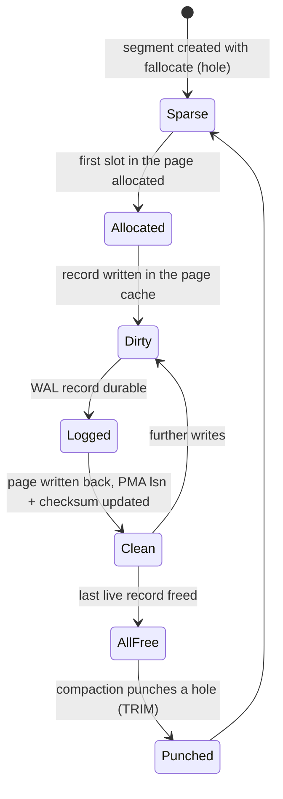

# On-Disk File Format

Normative specification of the store directory, the manifest, segment anatomy and the fixed-stride
record layouts. Adjacency internals are in [RELATIONSHIP_STORAGE.md](RELATIONSHIP_STORAGE.md);
property internals are in [PROPERTY_STORAGE.md](PROPERTY_STORAGE.md); the WAL is in
[WAL.md](WAL.md).

Store format version described here: **4** (`StoreFormat.CURRENT_VERSION`). What that number covers, the other
version fields in the store, and how a store moves from one version to the next are in [MIGRATION.md](MIGRATION.md).

---

## 1. Store Directory Layout

```
<store>/
  MANIFEST                 4 KiB x 2, A/B double buffered
  LOCK                     advisory exclusive lock, holds pid + boot id
  wal/
    wal-0000000000000000.log      64 MiB, preallocated
    wal-0000000004000000.log
  seg/
    node/  node-000000.seg  node-000001.seg  ...
    rel/   rel-000000.seg   ...
    adj/   adj-000000.seg   ...
    prop/  prop-000000.seg  ...
    blob/  blob-000000.seg  ...
    undo/  undo-000000.seg  ...
    index/ index-000000.seg ...
  dict/
    labels.dict            label/type dictionary (see PROPERTY_STORAGE.md §3)
    keys.dict              property key dictionary
```

Segment file names are `<kind>-%06d.seg`, the number being the id's `segment` field. A missing
segment number is an error, not a hole: segments are created densely.

---

## 2. Invariants

These hold for every kind and every format version. Breaking one breaks the addressing contract.

| # | Invariant |
|---|-----------|
| I1 | `STRIDE[kind]` divides `PAGE_SIZE`. No record ever straddles a page. |
| I2 | `DATA_START[kind]` is a multiple of `PAGE_SIZE`, and therefore of 4 KiB. |
| I3 | Data pages contain records only. All per-page metadata is out of line in the PMA. |
| I4 | The byte offset of a record depends only on `kind` and `slot` — never on the record's content, its neighbours, or any mapping structure. |
| I5 | All multi-byte fields are little-endian, declared explicitly. |
| I6 | A zeroed region is a valid, empty region: `gen == 0`, `flags == 0`, all ids `NULL_ID`. |
| I7 | Every page has a checksum in the PMA covering exactly `PAGE_SIZE` bytes of the data page. It is recomputed at **write-back** time, not per record write: a 64-byte write must not cost a CRC over 8 KiB. Writers mark the page dirty; `force()` and `verify()` flush the pending checksums. |
| I8 | Every durable page write is preceded by its WAL record reaching stable storage (WAL rule). |

---

## 3. Segment Anatomy

Every segment file, regardless of kind, has the same five-region shape:

```
byte 0                Superblock A            4 KiB
byte 4096             Superblock B            4 KiB
REGION_START          Free Slot Bitmap (FSB)  align_up(slots/8, PAGE_SIZE)
                      Page Metadata Array     align_up(pages*32, PAGE_SIZE)
DATA_START[kind]      Data pages              slots * stride
```

`REGION_START = align_up(8192, PAGE_SIZE)`, which is 8192 for 4 and 8 KiB pages and 16384 for 16 KiB
pages. Aligning it is what keeps `DATA_START` a multiple of `PAGE_SIZE` (invariant I2) when the page
is larger than the two superblocks.


Worked example for `NODE` with `PAGE_SIZE = 8192`:

| Region | Size | Offset |
|--------|------|--------|
| Superblock A | 4 KiB | 0 |
| Superblock B | 4 KiB | 4096 |
| FSB | 2^24 bits = 2 MiB | 8192 |
| PMA | 131,072 pages x 32 B = 4 MiB | 2 MiB + 8 KiB |
| Data | 2^24 slots x 64 B = 1 GiB | **6 MiB + 8 KiB** = `DATA_START[NODE]` |

Metadata overhead is 0.59 percent of a full segment. Segments are created **sparse** — currently by
extending the file with `truncate`, and with `fallocate` once the native layer lands — so an empty
segment consumes almost nothing on disk despite the nominal size.

`DATA_START` per kind (`PAGE_SIZE = 8192`):

| Kind | Slots | FSB | PMA | `DATA_START` | Data size |
|------|-------|-----|-----|--------------|-----------|
| NODE | 2^24 | 2 MiB | 4 MiB | 6 MiB + 8 KiB | 1 GiB |
| REL | 2^24 | 2 MiB | 4 MiB | 6 MiB + 8 KiB | 1 GiB |
| PROP | 2^24 | 2 MiB | 2 MiB | 4 MiB + 8 KiB | 512 MiB |
| ADJ | 2^19 | 64 KiB | 16 MiB | 16 MiB + 72 KiB | 4 GiB |
| BLOB | 2^19 | 64 KiB | 16 MiB | 16 MiB + 72 KiB | 4 GiB |
| UNDO | 2^24 | 2 MiB | 4 MiB | 6 MiB + 8 KiB | 1 GiB |
| INDEX | 2^19 | 64 KiB | 16 MiB | 16 MiB + 72 KiB | 4 GiB |

These values are computed at store creation from `PAGE_SIZE` and written into every superblock. A
reader **validates** them rather than assuming them, so a page-size change is detected instead of
silently misreading.

### 3.1 Superblock (4 KiB, written twice)

```
offset size field
0      8    magic            "MLGSSEG\0"
8      4    format_version   2 — the superblock's own version, see §10
12     4    kind
16     4    segment_number
20     4    page_size
24     8    stride
32     8    slots_capacity
40     8    data_start
48     8    fsb_start
56     8    pma_start
64     8    high_water_slot     highest slot ever allocated
72     8    live_count
80     8    free_count
88     8    last_lsn            highest LSN applied to this segment
96     8    created_ts
104    8    store_uuid_hi
112    8    store_uuid_lo
120    8    sb_sequence         monotonic; the higher of A/B wins
128    8    flags               SEALED, SLOT_RETIREMENT, COMPACTING, ...
136    3952 reserved (zero)
4088   4    reserved
4092   4    crc32c              over bytes 0..4087
```

**Superblock CoW.** Writes alternate A, B, A, B. A writer builds the new superblock in memory,
computes the CRC, writes it to the *inactive* slot, and issues a durability barrier. The active
superblock is the one with the higher `sb_sequence` **and** a valid CRC. A torn write can therefore
only damage the inactive copy, and the flip is atomic without needing a WAL entry. This is genuine
Copy-on-Write and it costs nothing on the read path.

### 3.2 Free Slot Bitmap

One bit per slot; `1` means allocated, `0` means free. Sized `align_up(slots_capacity / 8,
PAGE_SIZE)`.

The FSB is the durable free list, replacing the PoC's in-memory `ArrayDeque` (D11). Modifications
are WAL-logged as `ALLOC_SLOT` / `FREE_SLOT` records, so recovery reconstructs it exactly.

An in-memory **allocation cursor plus a FIFO ring of recently freed slots** sits in front of it so
that the common path is not a bitmap scan. See §8.

### 3.3 Page Metadata Array

One 32-byte entry per data page, indexed by page number.

```
offset size field
0      8    page_lsn         LSN of the last WAL record applied to this page
8      8    epoch            bumped on page rewrite/compaction; used for optimistic reads
16     4    checksum         CRC32C of the PAGE_SIZE data bytes
20     2    live_count       live records in the page
22     2    flags            DIRTY_ON_DISK, COMPRESSED, ALL_FREE, ...
24     4    free_hint        first free slot-in-page, or 0xFFFFFFFF
28     2    gen_floor        no slot on this page is handed out below this generation
30     2    reserved
```

**`gen_floor` is what survives a hole punch.** A slot's generation counter lives *inside* its record,
on the data page, and hole punching (§9) returns an all-free page's blocks to the filesystem —
after which the page, and every counter on it, reads as zeros. Without a floor the slots restart at
generation 1 and the allocator hands out an id byte-for-byte identical to one deleted earlier; nothing
throws, and the stale id resolves to the new record. That is strictly worse than an id being broken,
because it is silent. The PMA is a separate region and is never punched, so it is the one place the
history can live: `reclaimEmptyPages` raises the floor to the highest generation on the page before it
punches, and `SegmentSet.claim` falls back to it when the record's own counter reads zero.

**Not a maximum against a live counter.** Once a floor reached `MAX_GEN`, `max(recordGen, gen_floor)`
would put every wrapped counter on the page straight back to 4095 and pin it there, so
delete-then-recreate would return the identical id every time. The floor is a recovery for a counter
that has been destroyed, not a lower bound on a working one.

The floor is monotonic. A page can be punched more than once, and a page punched twice may hold slots
that were reused in between — carrying real counters — beside slots that were not, carrying the zeros
the first punch left. Only the maximum of the old floor and the current records covers both.

**No format bump.** These two bytes were reserved and are zero in every store written before them, so
an old store read by new code takes `max(gen, 0)` and behaves exactly as it did. A new store read by
old code is also fine; it simply loses the protection. (The earlier `crc32c of PMA entry bytes 0..27`
at offset 28 was specified and never implemented, so nothing had to be moved to make room.)

**Why out of line.** Putting an LSN and a checksum inside each page is the textbook approach, and it
is what forces engines to say "a page holds *up to* N records" and to keep a slot directory. Moving
the metadata into a contiguous array at the head of the segment keeps data pages **pure record
arrays**, which is what makes `DATA_START + slot * stride` exact (I3, I4).

Secondary benefits:

- The PMA is contiguous and small (0.4 percent of the data), so a scan can verify or prefetch a
  whole segment's checksums in a few sequential reads.
- A background scrubber reads the PMA linearly rather than touching every data page.
- The optimistic read protocol (see [ARCHITECTURE.md §6](ARCHITECTURE.md#6-concurrency-model)) reads
  `epoch` before and after copying a record; both reads hit the same cache-resident PMA line.

Cost: writing a page dirties two locations. Both are WAL-covered, and the PMA line for a hot page is
already in cache.

---

## 4. Manifest

`MANIFEST` is a 8 KiB file holding two 4 KiB copies, flipped exactly like a superblock. The layout as `Manifest`
writes it:

```
offset size field
0      8    magic            "MLGSMAN\0"                 frozen in every version (MIGRATION.md §2.3)
8      4    format_version   the store format version     frozen; 3 means 4 without vectors (MIGRATION.md §2.2)
12     4    page_size
16     8    segment_capacity
24     16   store_uuid       hi, then lo
40     8    manifest_sequence                             frozen; the higher valid copy is active
48     8    checkpoint_lsn        where recovery starts; the end of the last checkpoint's records
56     8    wal_min_lsn           oldest LSN still required for recovery
64     8    next_txn_id
72     4    vec_stride            VEC record size, 0 = no vector storage
76     4    vec_dimensions
80     8    feature_flags         bit 0: vector storage. An unknown bit is refused
88     ...  reserved (zero)
4092   4    crc32c                over bytes 0..4091         frozen
```

There is no per-kind segment count, label or key dictionary root, or index catalog root here, though earlier
revisions of this section listed them: segment sets are found by listing `seg/<kind>/`, the dictionaries are the two
files in `dict/`, and the index catalog is slot 0 of the first `INDEX` segment, where a transaction can change it
([INDEX.md](INDEX.md)). The log segment size is not recorded either; it is the length of the preallocated `wal-*.log`
files.

The manifest flip is the store's **commit point for metadata**: adding a segment, completing a
checkpoint, and advancing the WAL retention horizon all become visible atomically when the new copy
lands.

---

## 5. Node Record

**64 bytes, one cache line, 128 per 8 KiB page.**

```
offset size field                 notes
0      4    label_id              interned; 0 = no label
4      2    gen                   low 12 bits must match the id
6      1    flags                 bit0 LIVE, bit1 HAS_ADJ_BLOCKS, bit2 HAS_UNDO, bit3 DENSE
7      1    inline_edge_count     0..2
8      8    prop_block_id         PROP id, or NULL_ID
16     8    adj_head_id           ADJ id of the first adjacency block, or NULL_ID
24     4    label_id_2            second label, 0 = absent
28     4    label_id_3            third label, 0 = absent
32     8    label_overflow_id     PROP block holding labels four and beyond, or NULL_ID
                                 Written at create and whenever addNodeLabel/removeNodeLabel crosses
                                 the three-slot boundary, which frees the old block before allocating
                                 the new one so a node never holds two
40     8    inline_edge[0]        packed edge, see RELATIONSHIP_STORAGE.md §3
48     8    inline_edge[1]
56     4    degree_out
60     4    degree_in
       ----
       64
```

Compare with the PoC's 1080 bytes for the same information (D-list item on space in
[CURRENT_STATE.md §2.5](CURRENT_STATE.md#25-space-cost)): a **17x** reduction, driven by three
changes — the property-id array becomes a single `prop_block_id`, the label becomes an interned
`label_id`, and the two inline edges remove the need to touch the adjacency store at all for
low-degree nodes.

Design notes:

- **Offsets 24 to 39 were `version_ptr` and `xmin`.** Phase 5 resolved visibility per *page* rather
  than per record ([TRANSACTIONS.md §5.1](TRANSACTIONS.md#51-what-was-built)), so both were written as
  zero and read by nothing; format version 3 spends them on the label set. The record is still 64
  bytes and **no data migration is needed**: `NULL_ID` is zero, so a version 2 node decodes as exactly
  one label, which is what it has. The version bump exists for the other direction — a version 2 build
  would read a multi-label node's extra labels as an undo pointer.
- Three labels fit the record. Beyond that the set spills into a `PROP` block, which is owned by the
  node exactly as its properties are, and is therefore freed by the same cascade, relocated by the
  same compaction sweep and checked by the same orphan detector.
- `degree_out` / `degree_in` are maintained eagerly. They are what lets the traversal planner choose
  a direction without reading any adjacency block, and they make "is this a supernode" a free check.
- `DENSE` flag marks a node whose adjacency uses the sorted/indexed block layout rather than the
  append layout — see [RELATIONSHIP_STORAGE.md §5.3](RELATIONSHIP_STORAGE.md#53-dense-nodes).
- No `next`/`prev` pointers of any kind. Chasing pointers is the thing this format exists to avoid.

---

## 6. Relationship Record

**64 bytes.** Materialised only for edges that carry properties or that need a stable id; see
[RELATIONSHIP_STORAGE.md §4](RELATIONSHIP_STORAGE.md#4-lightweight-edges).

```
offset size field
0      8    from_id            NODE id
8      8    to_id              NODE id
16     4    type_id            interned relationship type
20     2    gen
22     1    flags              bit0 LIVE, bit1 HAS_UNDO
23     1    reserved
24     8    prop_block_id
32     8    version_ptr
40     8    xmin
48     8    reserved
56     8    reserved
       ----
       64
```

The two reserved longs are deliberate: they are where edge weights, temporal validity intervals or a
second property block will go without a format bump.

---

## 7. Page Lifecycle



The `Dirty -> Logged -> Clean` ordering is the WAL rule (I8) and is enforced in one place, the page
cache write-back path. See [WAL.md §5](WAL.md#5-durability-sequencing).

---

## 8. Free Space Management

Three layers, cheapest first:

1. **Bump cursor.** `high_water_slot` in the superblock. Allocating a brand-new slot is one atomic
   increment. This is the common case for a growing store and involves no bitmap access.
2. **FIFO free ring.** An in-memory bounded ring of recently freed slots per segment, drained
   oldest-first. FIFO rather than LIFO is a deliberate choice for generation safety
   ([ID_ENCODING.md §4](ID_ENCODING.md#4-generations-and-dangling-ids)) and it also spreads writes
   across pages, which is friendlier to the SSD's FTL than repeatedly rewriting one hot page.
3. **FSB scan.** On ring exhaustion, scan the bitmap with `Long.numberOfTrailingZeros` over 64 slots
   at a time, starting from a per-segment rotating hint. 2 MiB of bitmap scans at memory bandwidth;
   this is a rare path.

Segment selection for a new allocation prefers the **most recently created non-sealed segment**,
which keeps new writes physically clustered and sequential. A segment is `SEALED` when its
high-water mark reaches capacity and its free count is below a threshold.

Freeing a slot: clear the FSB bit, increment the record's `gen`, clear `LIVE`, decrement
`live_count` in the PMA, push the slot onto the free ring, WAL-log a `FREE_SLOT`. Cascading frees
(property blocks, adjacency blocks, undo chains) are the caller's responsibility and are specified
per store — this is the hole D12 leaves open in the PoC.

---

## 9. Compaction

Compaction is the only id-breaking operation and is therefore explicit, reported and, by default,
policy-gated.

**When**: a kind's `live_count / high_water_slot` falls below a configurable threshold (default 0.5).
`CompactionOptions` also carries a separate, lower threshold for the secondary indexes, for the
reason given in §9.3.

**How** (per kind, one batch of records at a time):

1. Enumerate the kind's live objects and sort them by position, highest first.
2. For each, claim the **lowest free run below its own position** and copy the record there. A record
   only ever moves downwards, which is what makes the pass terminate and what lets the high water
   mark come down at the end.
3. Rewrite every reference to the records this batch moved, using an in-memory forwarding map
   (§9.2).
4. Free the source slots, which advances their generations and so makes every outstanding old id
   detectably stale rather than silently reusable.
5. Punch the blocks of every page the pass emptied, then pull each segment's high water mark down to
   its topmost live slot and recompute its free counter from the bitmap.
6. Checkpoint, then unlink any trailing segment that ended up completely empty.

**Interruption safety**: steps 2 to 4 are **one transaction per batch**. The engine's no-steal log
(see [WAL.md](WAL.md)) guarantees that an uncommitted batch cannot reach a data file, so the only
states a crash can leave are "the first k batches happened", and the store is complete and
consistent at every one of them. A partially compacted store needs no resume logic: running
compaction again simply continues from wherever it stopped.

**Cheaper alternative that avoids compaction entirely**: hole punching. If a page becomes all-free,
`fallocate(FALLOC_FL_PUNCH_HOLE)` returns its blocks to the filesystem and issues TRIM to the SSD,
without moving anything and without breaking a single id. Compaction is only needed when free space
is *scattered within* pages. Prefer hole punching; run compaction rarely.

It does, however, destroy the generation counters of the slots on the page, because they live inside
the records it zeroes. That is why the PMA carries `gen_floor` (§3.3): without it, "without breaking a
single id" would have been true and useless, since the ids that survive intact would start naming
different records. The floor is raised before the punch, from the records that are about to be zeroed.

**Two known gaps, both pre-existing and both about the same missing lock.** A punch takes effect
immediately and the PMA writes describing it — the checksum fix-up and the floor — go to the mapping
and do not, so a crash in between leaves a page of zeros whose recorded checksum describes its old
contents. `verify()` then reports a healthy store as corrupt. The obvious remedy, forcing after the
punch, is worse: `force()` calls `flushChecksums()`, which walks the segment's dirty-page set **and
then clears it**, and `Compactor` calls `reclaim()` outside `runWrite()` — so it discards a concurrent
foreground writer's dirty marks and those pages never get a correct checksum at all. That is a
measurable flake in `CompactionTest`, not a theoretical one. For the same reason, compaction can punch
a page a foreground writer is allocating into. `GraphStore.reclaim()` takes the writer lock;
`Compactor` does not, and should.

### 9.1 Where this departs from the original design

Earlier revisions of this section specified copying into a freshly allocated destination segment and
keeping an **on-disk** forwarding map that a `StaleIdException` handler consulted as a slow path
until the rewrite completed. The implementation does neither, and the reasons are worth recording.

| | Specified | Built |
|---|---|---|
| Destination | a fresh segment | the lowest free slot below the record, in any existing segment |
| Forwarding map | on disk, in a temporary index segment | in memory, for the life of one batch |
| Reader fallback | `StaleIdException` resolves through the map while a compaction is in flight | none; a stale id stays stale |
| Unit of atomicity | per step, each WAL-logged and idempotent | one transaction per batch |
| Resume after a crash | replay from the last logged step | nothing to resume; rerun the compaction |

Relocating downwards rather than into a fresh segment is what actually reclaims space here. The high
water mark, not the live count, is what bounds `storageBytes` and every full scan, so packing records
into the holes below the mark and then lowering it is the operation with the payoff. Allocating a
fresh destination segment would have moved the same records into a *new* file and left the old one to
be unlinked, which only helps when a whole segment empties.

Dropping the reader fallback follows from making a batch atomic. A forwarding map that no reader
consults never has to be durable, and one that lives for the duration of a single transaction never
has to be written down at all. That also preserves the property the whole design is built on: there
is now **no** indirection table anywhere in the engine, not even a bounded one.

### 9.2 The reference classes

A missed reference class is a silent corruption, so the inventory is exhaustive. Every place an
element id is stored:

| Moved kind | Must be rewritten |
|------------|-------------------|
| `NODE` | relationship endpoints, adjacency block owners, adjacency entries, node inline edges, property block owners, `ElementRef` property values, both secondary indexes |
| `REL` | materialised adjacency entries, node inline edges, property block owners, `ElementRef` property values |
| `PROP` | `node.prop_block_id`, `rel.prop_block_id` |
| `ADJ` | `node.adj_head_id`, `block.next_block_id` |
| `BLOB` | blob ids inside property payloads, `extent.next_extent_id` |
| `INDEX` | nothing; index ids are internal, so the index is rebuilt rather than relocated |

Two of these are easy to overlook.

- **Ids inside property payloads.** A blob escape and an `ElementRef` are the only references that
  live in an opaque payload rather than in a typed record field. `ValueCodec.remapIds` walks an
  encoded block and rewrites them in place; both are fixed 8 byte fields, so the payload length never
  changes and the block keeps its cells.
- **Index keys.** An index entry cannot be patched, because the node id is the low half of the
  composite key and a moved node belongs at a different position in the tree. Remove and re-insert is
  the only correct edit.

Two structures are enumerated through their owners rather than through the free slot bitmap, because
the bitmap cannot describe them. A **property block** is a run of cells of which only the first is a
header, so a bitmap scan cannot tell a block from a continuation cell; live blocks are reached from
the node and relationship back-pointers instead. An **adjacency block** could be scanned, but its
chain position matters, so it is reached from `node.adj_head_id`. A block that no owner reaches is an
orphan, which `InvariantChecker` reports and which compaction deliberately leaves alone rather than
guessing at.

### 9.3 Adjacency and index compaction

Two structures are compacted by rebuilding rather than by relocation, and neither breaks an id.

**Adjacency chains.** Removing an edge only tombstones its entry, so a churned chain ends up with
many nearly empty blocks that a traversal still has to read. `AdjacencyStore.defragment` rebuilds a
node's chain from its live entries. Block ids are internal, so this is pure gain.

**Secondary indexes.** `BTree` does not merge underfull nodes, so deleting keys never frees an index
page: an index whose entries have all been deleted still reports every one of its pages as live.
Slot liveness is therefore the wrong trigger, and `indexFillThreshold` gates on entries per page as a
fraction of the fan-out instead. The default is 0.25 rather than 0.5 because a B+tree built by
ordinary inserts splits nodes down the middle and settles at about half full by construction — a 0.5
trigger would rebuild a perfectly healthy index on every run. The rebuild itself must be a single
transaction: batching it would commit an index missing entries, and an index that disagrees with the
records returns wrong answers rather than slow ones.

### 9.4 What compaction costs

- **A batch is bounded by memory**, since it holds a private copy of every page it touches. That is
  the no-steal trade the whole engine already makes; `maxRelocationsPerTransaction` is the knob.
- **The reference sweep runs once per batch**, not once per segment, so the total work is
  `O(live records x batches)`. Smaller batches mean lower latency for foreground writers and more
  total sweeping.
- **Scheduling is entirely the caller's.** There is no background thread. Compaction takes the writer
  lock one batch at a time rather than holding it for the whole run, so a foreground writer waits for
  at most one batch; `pauseBetweenBatchesMillis` widens the gap between them.

---

## 10. Format Versioning

The whole procedure is [MIGRATION.md](MIGRATION.md). In short:

- **The store format version** lives in the manifest at offset 8 and names the whole layout of the store directory —
  every region, record and codec in this file, the dictionaries and the log. It is **4**; a store without vectors
  still writes it as 3 ([MIGRATION.md §2.2](MIGRATION.md#22-the-legacy-encoding-and-its-end)).
- **A reader accepts exactly one version.** `GraphStore.open` refuses an older store with a
  `MigrationRequiredException` naming `metaloom-graph-cli database migrate`, and a newer one outright. Nothing is
  upgraded on open.
- **The segment superblock carries a version of its own**, `format_version` = 2 at offset 8, checked with `!=` along
  with the geometry fields. It is a local guard: it moves when the superblock's layout does, and always together with
  the store version, never instead of it. It did not move for multi-label nodes or vectors, whose changes were outside
  the superblock.
- **Strides and `DATA_START` are frozen per store version.** New fields use reserved bytes, and when the zeros an
  older store holds there mean exactly the old behaviour, no bump is needed (`gen_floor` in §3.3 is the precedent).
- **A bump ships with a migration step** that rewrites a copy of the store from version N to N + 1, and with a new
  golden fixture; `GoldenFixtureTest` fails a layout change that comes without one
  ([MIGRATION.md §6](MIGRATION.md#6-changing-the-format-the-procedure)). There is still no in-place upgrade of a
  stride: the step rewrites the copy, and the original is kept.
- `page_size`, `segment_capacity` and the vector dimension are geometry, not format: fixed at store creation,
  recorded in the manifest and validated against every superblock at open. Changing them is a dump and a restore.

---

## 11. Conventions and Gotchas

- **Do not add a field to a data page.** If you need per-page state, it goes in the PMA. If it does
  not fit in the PMA's reserved space, bump the format version.
- **`live_count` in the PMA and `live_count` in the superblock are independent counters** and both
  are WAL-maintained. A recovery that reconstructs one must reconstruct the other; the consistency
  checker asserts their sum relationship.
- **Sparse files lie about size.** `Files.size()` on a segment returns the nominal size, not the
  allocated size. Use `stat` block counts (via the native layer) when reporting real usage. The PoC's
  `ensureFileCapacity` writing zero bytes to grow the file is exactly the wrong approach — it
  materialises every block. Use `fallocate` with `FALLOC_FL_KEEP_SIZE` or nothing at all.
- **Never `map` a region per record.** Map the whole segment once, at open, from a store-scoped
  arena, and slice. This is D1.
- **CRC32C, not CRC32.** The native layer provides the hardware-accelerated variant; the Java
  fallback is `java.util.zip.CRC32C`.
- **The `SEALED` flag is advisory, not a lock.** Compaction can still write to a sealed segment.

---

## 12. Test Setup

- **Layout tests** (`SegmentLayoutTest`): for every kind and every supported page size, assert I1–I3
  and that the computed `DATA_START` matches the table in §3.
- **Superblock flip test**: write N superblocks, truncate/corrupt the inactive copy at every byte
  offset, assert the segment still opens and reads the active copy.
- **PMA test**: write a page, assert checksum and `page_lsn`; corrupt one byte of the data page,
  assert the checksum check fails on read with a `PageCorruptException` naming the segment and page.
- **Free space test**: allocate 10^6 slots, free every other one, assert the FSB is exact, restart,
  assert the free set is unchanged (the D11 regression).
- **Sparse test**: create a segment, assert the on-disk allocated size is under 1 MiB before any
  write.
- **Compaction test** (`CompactionTest`): churn a store to a tenth of its slots, compact, and assert
  that it comes back above 90 percent liveness; that every survivor is still reachable *without* any
  of the ids the test was holding, by re-finding it through the label index; and that a held id
  either still names the same record or names nothing, never a different record. `verify(FULL)` after
  every case is the `NoDanglingRefs` net.
- **Crash-during-compaction test** (`CompactionCrashTest`): fail at each batch in turn, both between
  batches and inside one, roll the data files back to a pre-compaction snapshot while keeping the
  log, and assert the store is complete and consistent at every stopping point and that rerunning the
  compaction still finishes the job.
- **Golden fixture test** (`GoldenFixtureTest`, `GoldenFixtureMigrationTest`): a small store written by the build
  that defined each format version is committed under `graph-core/src/test/resources/format/v<N>/`, and the current
  build must read it back exactly — through the data and through every index — and must migrate every older one to the
  current version. Not byte-exact segments: a store's bytes include a random UUID and timestamps, and what matters is
  that the bytes still *mean* the same thing. This is the tripwire for accidental layout drift
  ([MIGRATION.md §6](MIGRATION.md#6-changing-the-format-the-procedure)).

---

## 13. Progress Assessment

- [x] `SegmentFile` — open, validate superblock, map the whole file once, expose `asSlice`
- [x] Superblock A/B write and flip, with CRC validation
- [x] Free Slot Bitmap read/write plus the allocation cursor, FIFO ring and segregated run lists
- [x] Page Metadata Array accessors, epoch, live count and write-back checksums
- [x] `Manifest` read/write/flip with geometry validation
- [x] Node record layout and accessors
- [x] Relationship record layout and accessors
- [x] Sparse segment creation (via `truncate`; `fallocate` arrives with the native layer)
- [x] Format version and geometry gate on open
- [x] Segment rollover when a segment reaches capacity
- [x] Tests: layout, geometry, slot reuse, rollover, corruption detection, reopen
- [ ] PMA `page_lsn` maintenance (Phase 4, needs the log)
- [x] Hole punching for all-free pages
- [x] Compaction: downward relocation, per-batch forwarding map, full reference rewrite
- [x] High water mark shrink, empty segment retirement, adjacency and index rebuild
- [x] Golden fixture test, and a migration process for the next format change ([MIGRATION.md](MIGRATION.md))

---

## 14. Key Classes Reference (target)

| Class | Package | Purpose |
|-------|---------|---------|
| `SegmentFile` | `io.metaloom.graph.core.segment` | One `.seg` file: mapping, superblock, FSB, PMA, slicing |
| `Superblock` | `io.metaloom.graph.core.segment` | Read/write/flip of the A/B header pair |
| `FreeSlotBitmap` | `io.metaloom.graph.core.segment` | Durable free list |
| `PageMetadataArray` | `io.metaloom.graph.core.segment` | Per-page LSN, epoch, checksum, live count |
| `Manifest` | `io.metaloom.graph.core.store` | Store-level metadata and its atomic flip |
| `NodeRecord` | `io.metaloom.graph.core.store.node` | Static `VarHandle` accessors over a 64-byte slice |
| `RelationshipRecord` | `io.metaloom.graph.core.store.rel` | Same, for relationships |
| `Compactor` | `io.metaloom.graph.core.maintenance` | Segment compaction: relocation, reference rewrite, retirement |
| `ForwardingMap` | `io.metaloom.graph.core.maintenance` | Old to new ids for one batch, by full id and by 48-bit location |
| `MaintenanceRunner` | `io.metaloom.graph.core.maintenance` | How a maintenance task gets a batch into a transaction |
| `StoreFormat` | `io.metaloom.graph.core.api` | The store format version, and `inspect` for a store of any version |
| `MigrationRunner` | `io.metaloom.graph.core.migration` | A store from an older version to the current one — [MIGRATION.md](MIGRATION.md) |

---

_Git HEAD revision: `8f8caad`_
_Last updated: 2026-10-25 (store format version 4 defined, manifest layout corrected to the code, versioning moved to MIGRATION.md)_
