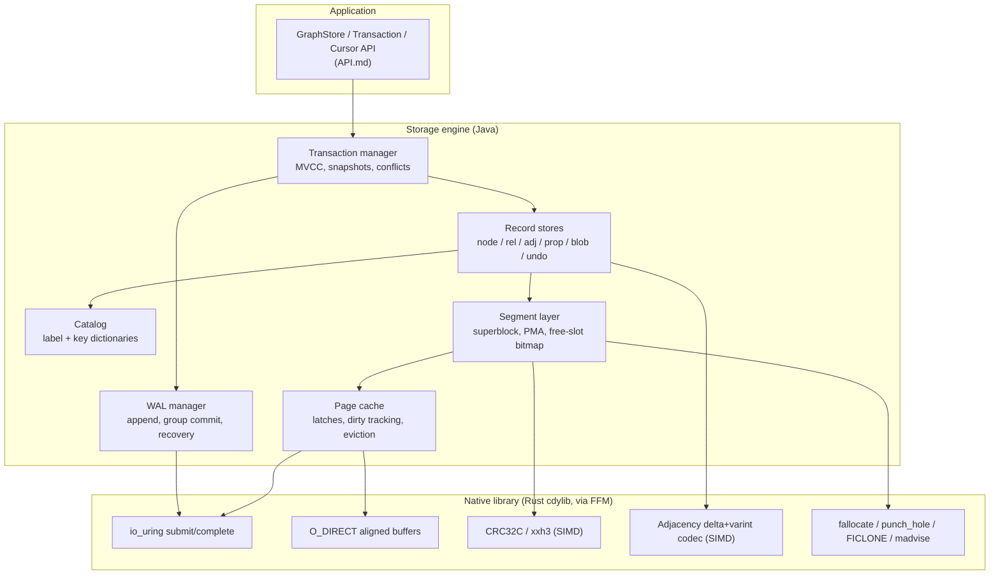

# Graph Storage — Project Context for AI Coding Agents

This document is the **entry point** for work on `graph-storage-ffm-poc`. It is an **index and
router**, not a second copy of the specs: it catalogues every file under `spec/`, tells you which
one to open, and carries the project-wide cheat sheet, glossary and gotchas.

> **Project root**: `/home/defaultuser/workspaces/metaloom/graph-storage-ffm-poc` —
> **spec root**: [spec/](.)

---

## 0. Read This First

### 0.1 What this project is

A **native-code backed graph storage layer** written in Java, using the Foreign Function and Memory
API (FFM, JEP 454, final since Java 22) to address memory-mapped binary files directly and to call
into a native library for the things the JVM cannot do well (io_uring, `O_DIRECT`, SIMD checksums
and codecs).

It stores **nodes**, **relationships** and **attributes** in compact, purpose-built binary files.
The defining design constraint is:

> **An element id decodes arithmetically into the exact file and byte offset of its record.
> Reading an element by id costs zero index probes and zero extra seeks.**

**Status.** Phases 0 to 10 are implemented to varying depth; 127 tests pass here, plus 23 in the MetaLoom
integration. The engine is **durable**
(write-ahead log, fsync before any data page is touched, redo recovery), **transactional** (commit,
rollback, auto-commit), **indexed** (label and property B+trees), and it reclaims space both without
moving anything (native hole punching) and by **compacting** — relocating records, rewriting every
reference to them and pulling the high water marks down.

Reads take no lock and scale to **10x at 32 threads**; writes do not scale at all and are not meant to.

It is **not concurrent for writers**: isolation is single-writer serialisable and there is **no MVCC**.
There is **no backup mechanism**. The Rust crate is written but has never been compiled here.

Per-phase status with the reason for every gap:
[reports/PHASE_STATUS.md](reports/PHASE_STATUS.md). Measured numbers:
[reports/BASELINE.md](reports/BASELINE.md). Running it in anger:
[OPERATIONS.md](OPERATIONS.md).

[CURRENT_STATE.md](CURRENT_STATE.md) is the record of the proof of concept this replaced, including
its defect register — worth reading before reintroducing any of its patterns.

### 0.2 The two rules

1. **The code is the source of truth.** Where a spec and the code disagree, the code wins — and you
   fix the spec in the same change. Every spec carries a git revision in its footer; treat anything
   older than the last relevant commit as a claim to re-check, not a fact.
2. **The addressing invariant is not negotiable.** Any design that introduces a mandatory
   indirection between "I have an id" and "I know the byte offset" is out of scope. If you think you
   need one, read [ID_ENCODING.md §6](ID_ENCODING.md#6-why-not-an-indirection-table) first — the
   tension with Copy-on-Write is real and is resolved there, not by adding a page table.

### 0.3 Reading order for a new task

```
GRAPH_STORAGE_CONTEXT.md (this file)
   ├─ CURRENT_STATE.md ......... what actually exists today, and its defects
   ├─ ARCHITECTURE.md .......... target layering, components, threading model
   ├─ PLAN.md .................. phased implementation plan — pick your work item here
   └─ the spec for your area:
        ├─ ID_ENCODING.md ............ ids, offsets, generations
        ├─ FILE_FORMAT.md ............ segments, pages, records, on-disk layout
        ├─ RELATIONSHIP_STORAGE.md ... adjacency, traversal, edge compression
        ├─ PROPERTY_STORAGE.md ....... attributes, dictionaries, blobs
        ├─ TRANSACTIONS.md ........... ACID, MVCC, snapshot isolation, CoW
        ├─ WAL.md .................... write-ahead log, recovery, checkpoints
        ├─ SSD_IO.md ................. I/O strategy, seek avoidance, alignment
        ├─ NATIVE_FFM.md ............. the Java <-> native boundary
        ├─ API.md .................... the public Java API
        ├─ TESTING.md ................ test setup, benchmarks, crash testing
        └─ OPERATIONS.md ............. sizing, tuning, monitoring, backup, recovery
```

---

## 1. Spec File Catalogue

| File | Covers | Do not put here |
|------|--------|-----------------|
| [CURRENT_STATE.md](CURRENT_STATE.md) | As-is inventory of the PoC: every class, every on-disk layout, every known defect with evidence | Target design |
| [ARCHITECTURE.md](ARCHITECTURE.md) | Target layering, module split, component responsibilities, threading and lifecycle | Byte-level formats |
| [ID_ENCODING.md](ID_ENCODING.md) | The 64-bit `ElementId`, the id-to-offset function, generations, NULL, id stability under CoW | Record contents |
| [FILE_FORMAT.md](FILE_FORMAT.md) | Store directory layout, manifest, segment anatomy, page metadata array, free-slot bitmap, node and relationship record layouts, versioning and compaction | Adjacency internals, property internals |
| [RELATIONSHIP_STORAGE.md](RELATIONSHIP_STORAGE.md) | Inline edges, adjacency blocks, edge compression, lightweight edges, traversal cost model | Node record layout |
| [PROPERTY_STORAGE.md](PROPERTY_STORAGE.md) | Property blocks, key and label dictionaries, value typing, inline vs blob, string dedup | Relationship storage |
| [TRANSACTIONS.md](TRANSACTIONS.md) | ACID guarantees, MVCC, snapshot isolation, version chains, undo segments, conflict detection, where Copy-on-Write genuinely applies, vacuum | WAL record format |
| [WAL.md](WAL.md) | WAL record format, LSN semantics, group commit, ARIES recovery, checkpointing, log retention | Isolation semantics |
| [SSD_IO.md](SSD_IO.md) | Seek-avoidance rules, alignment, page cache, prefetch, write amplification, TRIM, queue depth | Format details |
| [NATIVE_FFM.md](NATIVE_FFM.md) | Which functions live in native code and why, the FFM binding rules, arena lifetimes, the pure-Java fallback contract | Storage semantics |
| [API.md](API.md) | The public Java API surface: `GraphStore`, transactions, cursors, traversal, element builders | Internals |
| [TESTING.md](TESTING.md) | Test layout, fixtures, benchmark harness, crash and fault injection, invariant checkers | Implementation steps |
| [OPERATIONS.md](OPERATIONS.md) | Running it: sizing, tuning, what to monitor, backup and restore, disaster recovery, what every exception means for an operator, security posture | Design rationale |
| [PLAN.md](PLAN.md) | The phased implementation plan with per-phase deliverables, exit criteria and checkboxes | Design rationale |

---

## 2. Cheat Sheet — The Numbers That Matter

These constants are defined normatively in [ID_ENCODING.md](ID_ENCODING.md) and
[FILE_FORMAT.md](FILE_FORMAT.md). Everything else references them.

| Constant | Value | Rationale |
|----------|-------|-----------|
| `ElementId` width | 64 bit | Fits a register and a `long`; half the width of the PoC's UUID |
| Id field layout | `kind:4 | segment:24 | slot:24 | gen:12` | See [ID_ENCODING.md §2](ID_ENCODING.md#2-bit-layout) |
| `PAGE_SIZE` | 8192 B (configurable 4/8/16 KiB, fixed at store creation) | Multiple of the 4 KiB SSD write unit; amortises per-page metadata |
| `SEGMENT_CAPACITY` | 4 GiB (max data bytes per segment file) | Keeps files manageable; sparse so unused space costs nothing |
| Node record stride | 64 B | Exactly one cache line, never straddles a page |
| Relationship record stride | 64 B | Same |
| Property cell stride | 32 B | 256 cells per page |
| Adjacency block stride | `PAGE_SIZE` | One block = one page = one I/O |
| Undo record stride | 64 B | Same class as node/rel |
| Slots per segment | `min(2^24, SEGMENT_CAPACITY / stride)` | Slot field is 24 bit; large strides simply use fewer bits |
| `NULL_ID` | `0L` | Kind 0 is reserved as "none", so a zeroed page is unambiguously empty |
| Generation width | 12 bit | 4096 slot reuse cycles before wrap; see [ID_ENCODING.md §4](ID_ENCODING.md#4-generations-and-dangling-ids) |
| WAL segment size | 64 MiB | Preallocated, `O_DIRECT`, 4 KiB aligned |
| WAL record header | 40 B | See [WAL.md §2](WAL.md#2-record-format) |

**The address function** — the single most important line of code in the project:

```java
long byteOffset = dataStart(kind) + (long) slot(id) * stride(kind);
```

No lookup. No probe. No seek beyond the one the read itself performs.

---

## 3. Architecture at a Glance



Full description in [ARCHITECTURE.md](ARCHITECTURE.md).

---

## 4. Glossary

| Term | Meaning |
|------|---------|
| **Element** | A node or a relationship. Both carry a label, properties and an `ElementId`. |
| **Kind** | The store family an id belongs to: node, relationship, adjacency, property, blob, index, undo. Encoded in the top 4 bits of every id. |
| **Segment** | One file of a store family, at most `SEGMENT_CAPACITY` bytes of data. `node-000017.seg`. |
| **Slot** | The index of a fixed-size record inside a segment. `offset = dataStart + slot * stride`. |
| **Stride** | The fixed byte size of one record of a given kind. |
| **Generation (`gen`)** | A per-slot reuse counter stored both in the id and in the record; a mismatch means the id is dangling. |
| **PMA** | Page Metadata Array — an out-of-line array of per-page metadata (LSN, checksum, live count) at the head of every segment. Keeps data pages pure record arrays. |
| **FSB** | Free Slot Bitmap — one bit per slot, at the head of every segment. |
| **Superblock** | A segment's own header, stored twice (A/B) and flipped atomically. The one place Copy-on-Write is used verbatim. |
| **Property block** | A single compact, variable-length record holding *all* properties of one element. |
| **Lightweight edge** | An edge with no properties, which therefore needs no relationship record at all — it exists only in adjacency. |
| **LSN** | Log Sequence Number, equal to the byte offset of a record in the logical WAL stream. Also serves as the commit timestamp. |
| **CSN** | Commit Sequence Number. In this design, the LSN of a transaction's commit record. |
| **Snapshot** | A commit timestamp; a reader sees every version committed at or before it. |
| **Undo record** | A before-image of a modified record, used both for rollback and for serving old snapshots. |
| **Vacuum** | Background reclamation of undo records and dead versions no longer visible to any snapshot. |

---

## 5. Conventions and Gotchas

### 5.1 Binding rules for on-disk structures

- **Every record stride divides `PAGE_SIZE`.** A record must never straddle a page boundary — a
  straddling record doubles the I/O and breaks per-page checksums. This is why strides are 32, 64 or
  `PAGE_SIZE` and never something like the PoC's 1080 bytes.
- **Data pages contain records only.** All per-page metadata lives out of line in the PMA. Putting a
  header inside the page would make `dataStart + slot * stride` wrong.
- **Little-endian, explicitly.** Use `ValueLayout.JAVA_LONG.withOrder(ByteOrder.LITTLE_ENDIAN)` (or
  the `_UNALIGNED` variants where required) rather than relying on the platform default. A store
  written on one machine must be readable on another.
- **Zero is a valid, meaningful state.** `NULL_ID == 0` and a freshly zeroed page is a page of dead
  slots (gen 0, flags 0). Never use 0 to mean "unset but live".
- **`-1` is not a sentinel.** The PoC uses `-1` for "no next segment" and for property-array padding.
  In the target design the sentinel is `NULL_ID` (0). Do not reintroduce `-1`.
- **Never widen a record in place.** Record strides are frozen per format version. New fields go in
  reserved bytes; if reserved space runs out, bump the format version and write a converter.

### 5.2 FFM rules

- **Do not `Arena.ofAuto()` a mapping per operation.** This is the PoC's central mistake: it maps a
  fresh segment on every read and never unmaps, which is why the test class documents
  `sysctl -w vm.max_map_count=13107290`. Map **whole segments once** through the page cache and slice.
- **`MemorySegment.asSlice` is free.** Slicing an already-mapped segment costs nothing and is the
  intended way to address a record.
- **Cache `VarHandle`s in `static final` fields.** `layout.varHandle(...)` inside a read path
  allocates path-element arrays on every call; the PoC does this in every accessor.
- **Confined arenas for scratch, shared arenas for mappings.** A mapped segment used by multiple
  threads must come from `Arena.ofShared()` (or `ofAuto()` at store scope), never `ofConfined()`.
- **`MemorySegment.force()` is the flush.** `FileChannel.force` does not cover a `MAP_SHARED`
  mapping's dirty pages in the way you need. Durability sequencing is specified in
  [WAL.md §5](WAL.md#5-durability-sequencing).

### 5.3 Traps specific to this repository

- **Location 0 is a real location.** `segment 0, slot 0` is the first node any store creates, so it
  can never be used as a sentinel in a packed adjacency entry. The tombstone is `-1L`; see
  [RELATIONSHIP_STORAGE.md §6.2](RELATIONSHIP_STORAGE.md#62-delete-an-edge). This bug cost a whole
  debugging round.
- **Zig-zag output is unsigned.** `Long.MAX_VALUE` encodes to `0xFFFFFFFFFFFFFFFE`; a signed
  comparison classifies it as one byte and truncates it to 127. Use `Long.compareUnsigned`.
- **Read the generation before zeroing a reused slot.** `free()` leaves the advanced generation in
  the record; clearing the record first wipes it and makes every reused slot look like generation 1,
  which silently defeats stale-id detection.
- **Checksums are computed at write-back, not per write.** A 64-byte record write marks its page
  dirty; `force()` and `verify()` flush the pending CRCs. Recomputing an 8 KiB CRC per record write
  costs more than the write.
- **`unix:blocks` is not available from the JDK here**, so true sparse-file accounting needs the
  native `statx` binding (Phase 6). `StoreStats.storageBytes()` is engine-side accounting instead.
- **The Rust library is not built by Maven yet** and `cargo` is not installed in this environment.
  Wiring it in, with a graceful skip, is a Phase 6 item.

---

## 6. Where Do I Find ...?

| I want to ... | Look at |
|---------------|---------|
| Understand what exists today | [CURRENT_STATE.md](CURRENT_STATE.md) |
| Know why a node record is 64 bytes | [FILE_FORMAT.md §5](FILE_FORMAT.md#5-node-record) |
| Compute a byte offset from an id | [ID_ENCODING.md §3](ID_ENCODING.md#3-the-address-function) |
| Understand id stability vs Copy-on-Write | [ID_ENCODING.md §6](ID_ENCODING.md#6-why-not-an-indirection-table), [TRANSACTIONS.md §7](TRANSACTIONS.md#7-where-copy-on-write-actually-applies) |
| Add a new record kind | [ID_ENCODING.md §2](ID_ENCODING.md#2-bit-layout) then [FILE_FORMAT.md §3](FILE_FORMAT.md#3-segment-anatomy) |
| Change how edges are stored | [RELATIONSHIP_STORAGE.md](RELATIONSHIP_STORAGE.md) |
| Store a new property value type | [PROPERTY_STORAGE.md §4](PROPERTY_STORAGE.md#4-value-encoding) |
| Add a WAL record type | [WAL.md §3](WAL.md#3-record-types) |
| Understand recovery | [WAL.md §6](WAL.md#6-recovery) |
| Know what runs in native code | [NATIVE_FFM.md §2](NATIVE_FFM.md#2-the-native-surface) |
| Write a crash test | [TESTING.md §6](TESTING.md#6-crash-and-fault-injection) |
| Work out what to monitor, or why it will not open | [OPERATIONS.md](OPERATIONS.md) |
| Add something to the read path | [TESTING.md §7](TESTING.md#7-benchmarks) first — the budgets are build failures |
| Pick up the next work item | [PLAN.md](PLAN.md) |
| Find the current source | `src/main/java/io/metaloom/graph/core/` |

---

## 7. Key Classes Reference

| Class | Package | Purpose |
|-------|---------|---------|
| `GraphStore` | `io.metaloom.graph.core.api` | The public interface: nodes, edges, relationships, traversal, maintenance |
| `GraphStoreImpl` | `io.metaloom.graph.core.store` | Wires the stores together; owns the lifecycle and the LOCK file |
| `GraphStoreOptions` | `io.metaloom.graph.core.api` | Page size and segment capacity, recorded in the manifest |
| `Properties` | `io.metaloom.graph.core.api` | Typed property values; absent and null are distinguishable |
| `Edge` / `Direction` | `io.metaloom.graph.core.api` | One traversal result and its direction |
| `ElementId` | `io.metaloom.graph.core.id` | The 64-bit id arithmetic; ids are plain `long` values |
| `Kind` | `io.metaloom.graph.core.id` | Record families, stride specs and generation offsets |
| `Geometry` | `io.metaloom.graph.core.segment` | Per-kind strides, capacities, region offsets, the address function |
| `SegmentFile` | `io.metaloom.graph.core.segment` | One `.seg` file, mapped once, sliced many times |
| `Superblock` | `io.metaloom.graph.core.segment` | The A/B double buffered segment header |
| `FreeSlotBitmap` / `PageMetadataArray` | `io.metaloom.graph.core.segment` | Durable free list; out-of-line per-page metadata |
| `SegmentSet` | `io.metaloom.graph.core.segment` | All segments of one kind, plus the slot allocator |
| `Manifest` | `io.metaloom.graph.core.store` | Store metadata and its atomic flip |
| `Catalog` / `Dictionary` | `io.metaloom.graph.core.catalog` | Label and property-key interning |
| `NodeStore` / `RelStore` | `io.metaloom.graph.core.store.node`, `...rel` | The 64-byte records |
| `PropertyStore` / `ValueCodec` | `io.metaloom.graph.core.store.prop` | Property blocks and typed value encoding |
| `BlobStore` | `io.metaloom.graph.core.store.blob` | Page-sized extents for large values |
| `AdjacencyStore` / `AdjacencyBlock` / `EdgeCodec` / `PackedEdge` | `io.metaloom.graph.core.store.adj` | The three adjacency tiers and the compressing codec |
| `BTree` / `IndexCatalog` | `io.metaloom.graph.core.index` | The label and property B+trees, rooted in an index page |
| `Compactor` / `ForwardingMap` | `io.metaloom.graph.core.maintenance` | Record relocation and the reference rewrite; **the only thing that breaks an id** |
| `IoCounters` / `IoStats` / `StoreMetrics` | `io.metaloom.graph.core.metrics`, `...api` | Reads and writes per kind, log volume and lag, checkpoint and recovery timings |
| `InvariantChecker` | `io.metaloom.graph.core.store` | Every structural invariant, throttled or not |
| `WalManager` / `WalWriter` / `WalReader` | `io.metaloom.graph.core.wal` | Commit, redo recovery, checkpoint |
| `Crc` / `VarInt` / `Layouts` | `io.metaloom.graph.core.util` | CRC32C, LEB128, explicit little-endian layouts |

---

## 8. Progress Assessment

Overall project status. Per-phase detail lives in [PLAN.md](PLAN.md).

- [x] PoC: FFM memory-mapped record storage for nodes and relationships
- [x] PoC: id-carries-offset concept (`GraphUUID`)
- [x] PoC: linked-list adjacency
- [x] PoC: append-only property storage
- [x] Specification tree (this folder)
- [x] Phase 0 — Baseline, harness, build hygiene
- [x] Phase 1 — Addressing and segment substrate
- [x] Phase 2 — Record stores and catalog
- [x] Phase 3 — Adjacency and traversal
- [x] Phase 4 — WAL, recovery, checkpoints (redo-only, no-steal)
- [~] Phase 5 — Transactions: ACID, single-writer serialisable; **no MVCC**
- [~] Phase 6 — Native layer: libc via FFM works; the Rust crate is written but never compiled
- [x] Phase 7 — Indexes
- [x] Phase 8 — Compaction and space reclamation
- [~] Phase 9 — Budgets, differential harness, hostile input, scaling, soak, kill -9, gates, CI, operations doc
- [x] Phase 10 — Built as a MetaLoom index, measured against real SQL, recommended against adopting

---

_Git HEAD revision: `c016a41`_
_Last updated: 2026-08-13 (synced with the Phase 0 to 9 implementation)_
