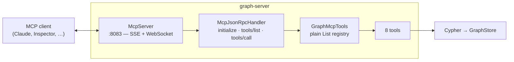

# MCP

The Model Context Protocol port: what an AI client can do to this graph, and what it deliberately cannot.

Design rationale for the query language is in [CYPHER.md](CYPHER.md); the security posture of every port is
[OPERATIONS.md §9.1](OPERATIONS.md#91-the-network-which-has-the-same-posture-and-a-wider-blast-radius).

---

## 1. TL;DR

```bash
java -jar graph-server.jar --mcp --demo /tmp/demo      # loopback:8083, read-only
npx @modelcontextprotocol/inspector                     # → http://127.0.0.1:8083/mcp/sse
```

| | |
|---|---|
| Port | **8083**, `--mcp-port=` / `GRAPH_MCP_PORT` |
| Host | **127.0.0.1**, `--mcp-host=` / `GRAPH_MCP_HOST` |
| On? | **No.** `--mcp` / `GRAPH_MCP_ENABLED=true` |
| Transports | HTTP+SSE (`GET /mcp/sse`, `POST /mcp/message`) and WebSocket (`GET /mcp/ws`) |
| Protocol revision | `2025-03-26` |
| Writes | Only with the server's own `--allow-write` |

---

## 2. Why it is off by default when nothing else is

Every other port here defaults to on, and this one does not. That is the single place this implementation
deliberately diverges from MetaLoom's `loom-service-mcp`, which sits behind a token.

Every port here now requires a credential ([AUTH.md](AUTH.md)), and this one is still off by default. When it had none, the argument was that for the HTTP and binary ports the exposure meant "anyone who can reach
it can read everything", which is stated plainly and bounded by where you put it. MCP is different in kind: it is a
remote code path an **LLM** drives, against a database, over a protocol whose whole purpose is to let a model decide
what to run. The blast radius of leaving it open is not the same as for a port a person has to point a client at on
purpose.

So it is opt-in, and when it is on it binds loopback, and widening it is a second deliberate act. **That has not changed now that it requires a credential.** A password says who the peer is; it says nothing about who could read it off a cleartext network, and it says nothing about whether an LLM deciding what to run is a thing this deployment wants reachable. Authentication is a reason to be less worried about the first, not about the second.

---

## 3. Architecture



**No MCP SDK.** JSON-RPC 2.0 is about two hundred lines and a dependency on a fast-moving SDK for that is a poor
trade; MetaLoom's MCP service made the same call and this mirrors its shapes deliberately, so somebody who knows one
knows the other.

**No Dagger.** MetaLoom uses multibinding because tools are contributed from several Maven modules. Here they are all
in one, so the registry is a `List`.

**The transports share one handler.** A rule enforced in `McpJsonRpcHandler` cannot be missing from one transport,
which is exactly the class of bug two parallel implementations produce.

### 3.1 The h2c trap

`McpServer` disables HTTP/2 clear text, and that line is load-bearing rather than tidy-minded.

Vert.x enables h2c by default. **Server-Sent Events do not survive it**: measured against this server, `curl -sN`
over HTTP/1.1 returns the endpoint event immediately, and the identical request with `--http2` returns **zero
bytes** and hangs. `java.net.http` — what a JVM-based MCP client uses — attempts an h2c upgrade by default, so the
symptom is a client that connects successfully, is told nothing, and waits forever, with no error anywhere to
explain it. It cost most of an afternoon to find, because every layer reports success.

`McpServerTest.testAnHttp2ClientStillGetsTheStream` is the guard: it drives an HTTP/2 client and asserts both that
the event arrives and that the negotiated version came back as 1.1.

---

## 4. The tools

| Tool | Writes | What it is for |
|------|--------|----------------|
| `graph_cypher_guide` | | The grammar this build implements, and what it does not |
| `graph_schema` | | Labels, relationship types, property keys, with counts |
| `graph_stats` | | Size and health: is a full scan affordable? |
| `graph_list_databases` | | The databases under the root |
| `graph_list_indexes` | | Which `(label, key)` pairs are a lookup rather than a scan |
| `graph_query` | per query | Run Cypher, return rows |
| `graph_create_index` | **yes** | Declare an index, optionally unique |
| `graph_drop_index` | **yes** | Drop one. The data is untouched |

### 4.1 `graph_cypher_guide` is the one that earns its place

It looks like documentation and it is the highest-value tool here. A model that has seen Neo4j writes
`FOREACH` or a map projection within two turns (it used to be `OPTIONAL MATCH`, which is built now). This engine refuses those at parse time — correctly — and the model is left with an
error it cannot reason its way out of, so it tries a synonym, and then another. One call replaces that whole loop.

The text is a packaged resource, `mcp/cypher-guide.md`, and `CypherGuideToolTest` checks it against
[CYPHER.md](CYPHER.md) so that the guide and the parser cannot drift into disagreeing about what is supported. That
failure would be worse than having no guide: the server would have told the model that something works.

### 4.2 The row cap

**An LLM context is not a result set.** `graph_query` stops at 200 rows by default, 1000 at most, enforced by
returning `false` from the engine's own `RowSink` — so the scan actually stops rather than being truncated after it
has already been paid for.

The response carries `truncated` and, when true, a note saying what to do about it. A model told it saw everything
when it did not will draw a conclusion from half an answer, which is a worse outcome than a refusal.

`limit` is clamped as a long. Read with `getInteger`, `Long.MAX_VALUE` became `-1` and was clamped to **one** row.

**Elements come back as the HTTP table renders them** — a node as `{_type, id, labels, properties}`, a relationship
with `relType`, `start` and `end`, a path as its length and text, ids and integers past 2^53 as strings —
through `ResultJson.value`, the same function the HTTP route uses. The tool used to put the engine's own node objects
into the `JsonObject`, which Vert.x's encoder has no mapping for, so `MATCH (n) RETURN n` — the first query anybody
writes — came back as `graph_query failed`.

### 4.2.1 Arguments of the wrong shape

The caller is a model, and a model sends a string for an integer and an array for an object. Every such message gets an
answer it can read, never silence:

| Wrong | Answer |
|---|---|
| `method` not a string | JSON-RPC `-32600` invalid request |
| `params` not an object; `name` not a string; `arguments` not an object | JSON-RPC `-32602` invalid params |
| a tool argument of the wrong type (`limit: "10"`, `parameters: [1]`, `database: [..]`) | a tool result with `isError`, naming the argument problem — the model's to fix, like a syntax error |
| anything else thrown while handling a request | JSON-RPC `-32603`, logged |

The last row is the backstop that matters most on the WebSocket transport: an exception escaping a message handler
there is logged by Vert.x and answered by nothing, and the client waits on that request id for ever. `getString` also
used to turn a numeric `name` into its text and look it up; the types are now checked rather than coerced
(`JsonRpcRequest.from`, `McpBadArgumentsTest`).

### 4.3 What is not exposed, and why

- **Creating or dropping a database.** Dropping already has its own flag, `--allow-drop`, separate from
  `--allow-write` because it destroys a whole directory in one request and "enabling writes is not asking for that".
  Handing that to a model is further still.
- **`EXPLAIN`.** The grammar has none. Inventing one for MCP would be a query-language change made in the wrong
  place; `graph_list_indexes` plus `graph_stats` answers the question it would be used for. Filed in
  [TASKS.md](TASKS.md) if it is ever wanted properly.

---

## 5. The write gate, and why it is checked twice

Two rules now — the server's own `--allow-write` **and** what the caller was granted — and the same two enforcement
points, which is why the shape survived the change:

1. **`tools/list` omits what this caller cannot use**, whether the reason is the flag or the grant. An agent should not
   be shown a capability it cannot use, because it will spend turns trying.
2. **`tools/call` re-checks before dispatch.** A call naming a tool remembered from an earlier session — or from a
   session as somebody else — must not work.

Either alone is a hole: listing without dispatch checking trusts the client's memory; dispatch checking without
listing wastes the model's time. `McpProtocolTest` and `McpAuthTest` assert both.

`McpToolDescriptor` carries a `requiredPrivileges` set for the coarse cases, and `graph_query` is checked **per call**
against the query, because what a query needs depends on the query — exactly as whether it *writes* does. That class
used to explain why there was deliberately no such field: "this server has no authentication and therefore no
identities; inventing a permission field that is always empty would suggest a check that does not happen". The
reasoning was right, and the field arrived when the check did; the comment is kept rather than deleted.

**`tools/call` checks `requiredPrivileges` against the database the call names** — the `database`
argument every store tool takes, through `GraphMcpTool.database(arguments)` — and only falls back to
the server's default when there is none. It used to check the default whatever the call named, so a
role holding `DROP_INDEX ON default` could drop an index on any database. `tools/list` still filters
against the default, because a listing names no database. `graph_list_databases` is filtered exactly
as `GET /api/databases` is, to the databases the caller holds any privilege on
(`GraphServer.visibleTo`, shared rather than copied).

A refusal comes back as a **tool result with `isError`**, not as a JSON-RPC error, and its text names the flag and
says *do not retry*. The distinction matters: a JSON-RPC error is a transport failure the model may reasonably retry,
where this is a decision it should report to the user.

`McpToolDescriptor.write` is **not serialised**. It is a server-side dispatch detail, and sending it would invite the
model to argue about it.

---

## 6. Metrics

`graph_mcp_tool_calls{tool,outcome}` — `ok`, `refused` or `error` — and `graph_mcp_sessions` as a gauge.
A call naming a tool that does not exist is recorded as `tool="unknown"`: the name is the client's, and
used as a label it would be one new series per string anybody cared to send. Queries run
through `graph_query` are recorded as `graph_queries{frontend="mcp"}`, so one dashboard covers all three front ends.
See [METRICS.md](METRICS.md).

---

## 7. Client configuration

```json
{
  "mcpServers": {
    "metaloom-graph": {
      "url": "http://127.0.0.1:8083/mcp/sse"
    }
  }
}
```

**There is a token now.** All three transports require `Authorization: Bearer <session>`, obtained from
`POST /api/login` on the HTTP port — this port has no login route of its own, deliberately: one identity store, one
place to log in. The websocket cannot decline an upgrade, because Vert.x 5 removed `accept()`/`reject()` from
`ServerWebSocket`, so an unauthenticated `/mcp/ws` is closed with **1008** (policy violation), exactly as the
wrong-path branch already does.

What the token does not buy is privacy: it crosses in cleartext like everything else here.

---

## 8. What is not here

- **No transport security on this port.** The bearer token crosses in cleartext. This port is HTTP, so an ingress or a
  reverse proxy is where TLS for it belongs; the *binary* port terminates its own ([WIRE.md §7.1](WIRE.md)) because
  nothing in front of it can terminate a raw TCP protocol. Authentication exists ([AUTH.md](AUTH.md)); privacy here does
  not.
- **No token of its own.** A session comes from the HTTP port's `POST /api/login`; there is one identity store and one place to log in.
- **No resources and no prompts.** Only `tools`. A `resources/list` over a graph would have to invent a URI scheme
  for nodes, and nothing has asked for it.
- **No streaming of a long result.** A tool result is one message. The row cap is what makes that acceptable; the
  binary port ([WIRE.md](WIRE.md)) is the answer for a real result set.
- **No `notifications/tools/list_changed`.** The tool set is fixed at start-up, since it depends only on
  `--allow-write`.

---

_Git HEAD revision: `f2b6d5f`_
_Last updated: 2026-10-24 (MCP argument shapes, elements rendered as on HTTP, the limit clamp)_
