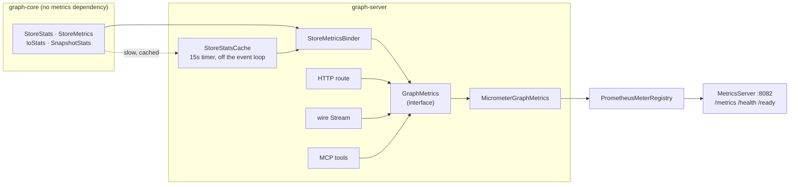

# Metrics

What `graph-server` exposes to Prometheus, what each meter means, and which of them
[OPERATIONS.md §4](OPERATIONS.md#4-monitoring) tells you to alert on.

> **The code is the source of truth.** The tables in §3 and §5 are **parsed at test time** by
> `MetricsCatalogScrapeTest`, which scrapes a real registry bound to a real store and fails if a meter documented as
> live is missing, or if a meter documented as absent turns up. Editing this file can therefore break the build — which
> is the point. A metrics catalogue that drifts is worse than none, because it is trusted.

---

## 1. TL;DR

```bash
curl localhost:8082/metrics        # the scrape
curl localhost:8082/health         # liveness  — 200 while the process is up
curl localhost:8082/ready          # readiness — 503 once shutdown has begun
```

Port 8082 by default, `--metrics-port=` or `GRAPH_METRICS_PORT`, `--no-metrics` to turn the whole thing off.
**Do not publish this port.** It carries database names, node counts and store sizes, and like every other port in this
server it has no authentication.

Everything this project emits is prefixed `graph_`. Alongside it a scrape carries `jvm_*`, `process_*`,
`system_*` and `vertx_*`, which come from the Micrometer JVM binders and from `vertx-micrometer-metrics` and are not
catalogued here.

---

## 2. Architecture



**graph-core has no metrics dependency and is not going to get one.** Its job is to expose the four snapshot records;
turning them into meters is `graph-server`'s. An engine a caller can embed without also taking a metrics framework is
worth more than one that reports its own numbers — and `graph-core`'s only runtime dependency being slf4j is a property
worth keeping.

**No call site touches Micrometer.** Everything records through the `GraphMetrics` interface, so the whole catalogue is
readable in one file, and `GraphMetrics.NOOP` works with no registry at all.

**Meter names omit the `_total` and `_seconds` suffixes** — the Prometheus registry appends them at scrape time. The
names in §3 are the names in the code; the names in a scrape carry the suffix. The test knows about this and compares
accordingly.

---

## 3. The catalogue

### 3.1 Queries

Recorded by all three front ends, tagged `frontend` = `http` | `wire` | `mcp`, so one dashboard covers them all.

| Metric | Type | Labels | Call site |
|--------|------|--------|-----------|
| `graph_queries` | counter | frontend, kind, outcome | `GraphServer:369`, `WireServer.Stream.complete` |
| `graph_query_duration` | timer | frontend, kind | `MicrometerGraphMetrics:34` |
| `graph_query_rows` | summary | frontend | `MicrometerGraphMetrics:41` |
| `graph_queries_rejected` | counter | frontend, reason | `GraphServer:299`, `WireServer.Connection.query` |
| `graph_queries_slow` | counter | frontend | `SlowQueryLog:69` |

`kind` is `read` or `write`, taken from the parsed tree rather than from what the query turned out to do, and
`unknown` for a query that failed to parse. `outcome` is `ok`, `syntax`, `type`, `timeout`, `database`, `constraint`,
`store`, `argument` or `internal` — a closed, small set, which is what keeps it a usable Prometheus label where an
exception class name would not be.

**Only successful queries enter `graph_query_duration`.** A syntax error is fast and a timeout is exactly as long as
the budget; including either would make the histogram describe the mix of failures rather than how long the engine
takes to answer.

**A refusal is not an outcome.** `readonly`, `overloaded` and `shutdown` cost nothing and are counted separately —
folded into `graph_queries` they would drag the duration histogram towards zero, and a server refusing every write
would look like one answering instantly.

### 3.2 Writes

| Metric | Type | Labels | Call site |
|--------|------|--------|-----------|
| `graph_write_operations` | counter | operation | `MicrometerGraphMetrics:78` |

`operation` is `nodes_created`, `nodes_deleted`, `relationships_created`, `relationships_deleted`, `properties_set`,
`labels_added` or `labels_removed`. Counted only when non-zero, so a read-only server's scrape does not carry seven
series pinned at zero.

**One tagged counter rather than seven named ones, and that is not a style choice.** The Prometheus client strips the
reserved suffixes `_created`, `_total`, `_count`, `_sum`, `_bucket` and `_info` before re-adding the type suffix, so a
counter named `graph_nodes_created` is published as **`graph_nodes_total`** — silently, and reading exactly like a
count of all nodes rather than of the ones this server created. `graph_relationships_created` collapses the same way.
`MetricsCatalogScrapeTest` is what found it, on the first run, which is roughly the argument for having it.

### 3.3 Store size — the **cached** tier

All tagged `database`. **These are up to `graph_store_stats_age_seconds` old**, and that is deliberate:
`store.stats()` ends in a directory listing and a `Files.size()` per dictionary file, while a Prometheus scrape
collects gauges on the event loop. A gauge that called it would do filesystem I/O on an event loop, once per series,
on every scrape. So a timer refreshes them off the event loop every 15 seconds and the scrape reads the last snapshot.
The staleness is exported rather than hidden.

| Metric | Type | Labels | Call site |
|--------|------|--------|-----------|
| `graph_store_nodes` | gauge | database | `StoreMetricsBinder:72` |
| `graph_store_relationships` | gauge | database | `StoreMetricsBinder:73` |
| `graph_store_adjacency_cells` | gauge | database | `StoreMetricsBinder:74` |
| `graph_store_property_cells` | gauge | database | `StoreMetricsBinder:75` |
| `graph_store_blob_extents` | gauge | database | `StoreMetricsBinder:76` |
| `graph_store_index_pages` | gauge | database | `StoreMetricsBinder:77` |
| `graph_store_labels` | gauge | database | `StoreMetricsBinder:78` |
| `graph_store_property_keys` | gauge | database | `StoreMetricsBinder:79` |
| `graph_store_segment_files` | gauge | database | `StoreMetricsBinder:80` |
| `graph_store_record_bytes` | gauge | database | `StoreMetricsBinder:81` |
| `graph_store_bytes` | gauge | database | `StoreMetricsBinder:82` |
| `graph_store_stats_age_seconds` | gauge | database | `StoreMetricsBinder:84` |

`graph_store_bytes` is the engine's own accounting, not what `du` reports — the files are sparse and holes have been
punched in them. [OPERATIONS.md §2.1](OPERATIONS.md#21-disk) explains the difference.

### 3.4 Durability, readers and I/O — the **live** tier

All tagged `database`, all read fresh on every scrape, all in-memory counters that touch no file.

| Metric | Type | Labels | Call site |
|--------|------|--------|-----------|
| `graph_store_wal_lag_bytes` | gauge | database | `StoreMetricsBinder:87` |
| `graph_store_wal_bytes_since_checkpoint` | gauge | database | `StoreMetricsBinder:88` |
| `graph_store_unflushed_pages` | gauge | database | `StoreMetricsBinder:89` |
| `graph_store_checkpoint_millis_avg` | gauge | database | `StoreMetricsBinder:90` |
| `graph_store_recovery_millis` | gauge | database | `StoreMetricsBinder:91` |
| `graph_store_open_views` | gauge | database | `StoreMetricsBinder:94` |
| `graph_store_oldest_view_age_millis` | gauge | database | `StoreMetricsBinder:95` |
| `graph_store_retained_bytes` | gauge | database | `StoreMetricsBinder:96` |
| `graph_store_retained_entries` | gauge | database | `StoreMetricsBinder:97` |
| `graph_store_versioned_pages` | gauge | database | `StoreMetricsBinder:98` |
| `graph_store_abandoned_views` | counter | database | `StoreMetricsBinder:99` |
| `graph_store_wal_syncs` | counter | database | `StoreMetricsBinder:103` |
| `graph_store_wal_records` | counter | database | `StoreMetricsBinder:104` |
| `graph_store_wal_bytes_appended` | counter | database | `StoreMetricsBinder:105` |
| `graph_store_page_applies` | counter | database | `StoreMetricsBinder:106` |
| `graph_store_bytes_applied` | counter | database | `StoreMetricsBinder:107` |
| `graph_store_data_forces` | counter | database | `StoreMetricsBinder:108` |
| `graph_store_checkpoints` | counter | database | `StoreMetricsBinder:109` |
| `graph_store_pages_punched` | counter | database | `StoreMetricsBinder:110` |
| `graph_store_compactions` | counter | database | `StoreMetricsBinder:111` |
| `graph_store_records_relocated` | counter | database | `StoreMetricsBinder:112` |
| `graph_store_adjacency_block_decodes` | counter | database | `StoreMetricsBinder:113` |
| `graph_store_adjacency_block_skips` | counter | database | `StoreMetricsBinder:114` |
| `graph_store_record_reads` | counter | database, kind | `StoreMetricsBinder:124` |
| `graph_store_record_writes` | counter | database, kind | `StoreMetricsBinder:126` |

The I/O totals are **`FunctionCounter`s and not gauges**. They only ever go up, and Prometheus computes `rate()` over a
counter with reset detection — publish a total as a gauge and its rate goes sharply negative on every restart.

`graph_store_record_reads` keeps its `kind` tag (`node`, `rel`, `adj`, `prop`, `blob`, `index`, `undo`, `vec`) because
the budget §4 states is *reads per operation for one kind*. Summing them would hide exactly the regression
`ReadBudgetTest` exists to catch.

### 3.5 The front ends themselves

| Metric | Type | Labels | Call site |
|--------|------|--------|-----------|
| `graph_http_inflight` | gauge | — | `StoreMetricsBinder:133` |
| `graph_wire_running_streams` | gauge | — | `StoreMetricsBinder:134` |
| `graph_wire_buffered_bytes` | gauge | — | `StoreMetricsBinder:135` |
| `graph_mcp_tool_calls` | counter | tool, outcome | `MicrometerGraphMetrics:77` |

`graph_wire_buffered_bytes` against `WireServerOptions.maxBufferedBytes()` is the one number
[WIRE.md](WIRE.md) asks an operator to multiply — this is it, measured rather than configured.

---

## 4. Two rules the bindings follow

Both are failure modes that were designed out rather than found:

1. **A supplier resolves its store inside the lambda**, never over a captured handle. A database can be dropped and
   recreated while the server runs, and a gauge holding the old `GraphStore` would report, forever, on a closed store —
   plausible numbers from a store nobody is using, which is worse than no numbers.
2. **A supplier cannot throw.** Micrometer collects the whole registry into one response, so a single gauge throwing
   does not lose one series, it loses the entire scrape — and the store legitimately throws when a database has just
   been dropped. Every supplier is wrapped to return `NaN`, which Prometheus already reads as "no sample".

Meters are bound **lazily**, from `GraphServer.lookup`, the first time a database is resolved. A root holding fifty
databases of which two are in use should not open the other forty-eight in order to report that nothing is happening
in them.

---

## 5. Declared but not recorded

Nothing. Every meter named in §3 is bound or incremented by code that runs.

This section exists because the test reads it: any name listed here must **not** appear in a scrape. It is where a
meter goes when it is documented ahead of being built, so that "planned" can never be mistaken for "available".

---

## 6. From a signal to an alert

[OPERATIONS.md §4](OPERATIONS.md#4-monitoring) is a table of what to watch and when to worry. This is the same table
with meter names, at which point those thresholds are alert rules.

| §4 signal | Meter | Investigate when |
|-----------|-------|------------------|
| `walLagBytes` | `graph_store_wal_lag_bytes` | non-zero under `FSYNC_ON_COMMIT` — a commit returned without an fsync |
| `walBytesSinceCheckpoint` | `graph_store_wal_bytes_since_checkpoint` | growing without bound: nothing is checkpointing, and recovery time grows with it |
| `unflushedPages` | `graph_store_unflushed_pages` | monotonically rising: writes are outrunning the flush |
| `averageCheckpointMillis` | `graph_store_checkpoint_millis_avg` | seconds rather than tens of milliseconds |
| `io.walSyncs` per commit | `rate(graph_store_wal_syncs_total)` | much more than one per commit |
| `io.recordReads(NODE)` per op | `rate(graph_store_record_reads_total{kind="node"})` | more than one for a read by id — `ReadBudgetTest` gates this in the build |
| `writeAmplification` | `rate(graph_store_wal_bytes_appended_total) / rate(graph_store_bytes_applied_total)` | above 3 |
| retention | `graph_store_retained_bytes`, `graph_store_oldest_view_age_millis` | a reader holding a view open holds back reclamation for exactly as long |

Two that §4 could not express and this can:

- `graph_store_stats_age_seconds` climbing well past 15 means the refresh is failing — usually a database that was
  dropped while its meters stayed bound.
- `rate(graph_queries_rejected_total{reason="overloaded"})` above zero means
  `WireServerOptions.maxConcurrentStreams` is being reached rather than merely configured.

---

## 7. What is not here

- **No push, no OTLP, no exemplars.** Scrape only.
- **No per-query series.** A query string cannot be a Prometheus label without producing one time series per distinct
  query, which is how a monitoring system is taken down by a monitored one. Naming the offending query is the
  [slow query log](OPERATIONS.md#42-the-slow-query-log)'s job, and the two are deliberately complementary: the
  histogram says how often and how bad, the log says which one.
- **No authentication on the monitoring port**, in common with every other port here. See
  [OPERATIONS.md §9](OPERATIONS.md#9-security-posture).

---

_Last updated: 2026-08-16_
