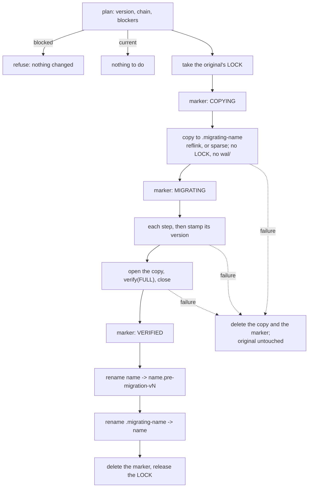

# MIGRATION.md — Format Versions and the Migration Process

How the on-disk format is versioned, what a build does with a store of another version, and the process a format
change has to go through: a migration step, a copy-on-write runner that swaps the result in, a CLI command, and the
golden fixtures that make an undeclared format change fail the build.

> **Do not put here**: the byte layouts themselves ([FILE_FORMAT.md](FILE_FORMAT.md), with the adjacency and
> property internals in [RELATIONSHIP_STORAGE.md](RELATIONSHIP_STORAGE.md) and
> [PROPERTY_STORAGE.md](PROPERTY_STORAGE.md)), the log ([WAL.md](WAL.md)), the logical dump that moves data across
> builds without reading their format ([BACKUP.md](BACKUP.md)), or the operator's upgrade checklist
> ([OPERATIONS.md §5.1](OPERATIONS.md#51-upgrading-across-a-store-format-version), which links back here).

---

## 0. Status

| | |
|---|---|
| **Store format version** | **4** (`StoreFormat.CURRENT_VERSION`). The 0.1.0-alpha.1 baseline: the first version with a migration process |
| **Where** | `MANIFEST`, offset 8 of each 4 KiB copy. Still written as **3** in a store without vector storage (§2.2) |
| **Older store** | Refused by `GraphStore.open` with `MigrationRequiredException`, which names the command to run. **No automatic upgrade** (§2.5) |
| **Newer store** | Refused with `FormatVersionException`. There is no downgrade |
| **Migration steps shipped** | **None.** 4 is the first version; the registry is empty and the chain starts at the step from 4 to 5 |
| **Runner** | `MigrationRunner` behind the public `StoreMigration`: copy, steps, `verify(FULL)`, swap, original kept (§4) |
| **CLI** | `metaloom-graph-cli database migrate <db> --path=<root> [--dry-run]`, `database info <db> --path=<root>` (§5) |
| **Golden fixture** | `graph-core/src/test/resources/format/v4/`, 71 KB zipped. `GoldenFixtureTest`, `GoldenFixtureMigrationTest` (§6) |
| **Alpha policy** | From 0.1.0-alpha.1 on, **every** format change goes through §6. No "breaking, dump and restore" releases (§7) |

---

## 1. Version Inventory

Every structure the engine persists, whether it carries a version of its own, and what guards it. The **store
format version** is the one number that covers all of them that live inside a store directory: a change to any row
marked *covered* is a change to the store format.

### 1.1 Inside a store directory

| Structure | Where | Own version | How a reader checks it | Covered by the store version |
|-----------|-------|-------------|------------------------|------------------------------|
| **Manifest** | `MANIFEST`, 2 x 4 KiB, A/B | **the store format version**, offset 8 | `Manifest.open`: exactly `CURRENT_VERSION`, else refused (§2.5) | is it |
| Manifest feature flags | `MANIFEST` offset 80 | bit set; bit 0 = vector storage | an unknown bit is refused by name (builds from 0.1.0-alpha.1 on) | yes |
| Manifest geometry | page size 12, segment capacity 16, `vec_stride` 72, `vec_dimensions` 76 | — | compared with the open options; a mismatch is refused | yes |
| Segment superblock | first 8 KiB of every `.seg`, A/B | `format_version` = **2**, offset 8 | `Superblock.validateGeometry`: `!=` 2 is refused, and kind, segment number, page size, stride, slot capacity and the three region offsets are each compared with `Geometry` | yes |
| Free slot bitmap, page metadata array | segment regions after the superblocks | — | region offsets are in the superblock check; PMA checksums by `verify` | yes |
| Record layouts | `NODE` 64, `REL` 64, `PROP` 32-byte cells, `ADJ` 512-byte cells, `BLOB` and `INDEX` page-sized, `VEC` declared | — | strides are in the superblock check; contents are not versioned | yes |
| Property value codec | inside `PROP` blocks and blobs | — | tag numbers 0..11 are frozen (`ValueCodec.T_*`) | yes |
| Adjacency block and edge codec | `ADJ` cells | — | none beyond the stride | yes |
| B+tree page | `INDEX` pages | **none**: the `version` field at offset 16 is a **conflict counter** bumped by every change, not a format version | — | yes |
| Index catalog page | `INDEX` slot 0 | magic `MLIDX\0`, no version | magic only; each list's region reads as "none declared" when zero | yes |
| HNSW links | inside `VEC` records | — | — | yes |
| Dictionaries | `dict/labels.dict`, `dict/keys.dict` | **none, and no magic**: `[u32 big-endian length][utf8]` per entry | lengths bounded at load, torn tail truncated | yes |
| Write-ahead log | `wal/wal-%016x.log` | **none**: the 40-byte header, the CRC and the self-identifying LSN; record type numbers frozen | CRC and self-LSN; an unknown type fails recovery | yes, and **never migrated**: a migration requires an empty log and does not copy `wal/` (§4.2) |
| WAL segment size | file length of each `wal-*.log` | — | not recorded anywhere; `StoreFormat.Info.walSegmentBytes` reads it off the files | n/a |
| `LOCK` | store root | — | an advisory `flock`; empty | n/a |
| `UNDO` kind | declared in `Kind` | — | no segment set is ever created for it | n/a |

### 1.2 Beside a store, or outside it

| Structure | Where | Own version | Relation to the store format |
|-----------|-------|-------------|------------------------------|
| **Identity file** | `<root>/.auth/AUTH`, beside the databases | `AuthCodec.VERSION` = **1**, magic `MLGAUTH\0` | **Independent.** Not in any store, not migrated by a store migration, refused by number when unknown. Policy in §7.3 |
| **Dump** | a file anywhere | `DumpFormat.VERSION` = **1**, magic `MLGDUMP\0` | **Independent**, deliberately: it carries no byte of the store format, which is what makes it the path between builds that cannot read each other's stores ([BACKUP.md §1](BACKUP.md)) |
| Migration marker | `<root>/.migration-<name>` | `marker=1` | Exists only while a migration is in progress (§4.6) |
| Golden fixture canonical form | `expected.txt` first line | `canonical form 1` | Test resource; see the rule in §6.4 |
| Wire protocol | the network | `Protocol.VERSION` = 4 | **Not on disk.** [WIRE.md](WIRE.md) |
| Native ABI | the Rust library | `SUPPORTED_ABI_VERSION` = 2 | **Not on disk.** A mismatch means the library is not loaded and the pure-Java path is used ([NATIVE_FFM.md](NATIVE_FFM.md)) |

### 1.3 History of the store format version

| Version | Layout change | A store of it today |
|---------|---------------|---------------------|
| 1 | The first engine format: one 8 KiB adjacency page per node | Refused, no migration path |
| 2 | Cell-based adjacency blocks, 512-byte cells doubling to a page ([reports/SCALE.md](reports/SCALE.md)) | Refused, no migration path |
| 3 | Multi-label nodes: `label_id_2`, `label_id_3`, `label_overflow_id` in the node record's dead `version_ptr`/`xmin` bytes | **Reads as 4.** Its layout is version 4's without vectors: everything added since went into bytes such stores hold as zero |
| **4** | Vector storage, the `VEC` kind — written as 4 only by a store that has it. Plus every zero-compatible addition before the alpha: the PMA `gen_floor`, the composite-index region of the catalog page, the relationship type cached in adjacency entries | **Current.** The 0.1.0-alpha.1 baseline |

Versions 1 and 2 predate any migration process and there is no step from them. Such a store has to be dumped by a
build that reads it and restored with this one, which is exactly what the refusal message says.

---

## 2. The Store Format Version

### 2.1 What it names

One number for the whole on-disk layout of a store directory: the manifest, every segment and every record in it,
the dictionaries and the log. It is what a migration step is keyed on — a step takes a store from version N to
N + 1 — and it is distinct from the per-structure versions in §1, which are local guards a reader of one structure
checks for itself.

**Why the baseline is 4 and not 1.** The manifest field already said 3 or 4 on every store written before the number
had this definition, and both mean exactly the layout described as version 4. Renumbering to 1 would have needed
either a rewrite of every existing manifest or a second version field beside the first; in both cases a store on
disk would say something other than what its bytes are, and every store written by the code before this change
would have needed a migration to be opened. With 4, every one of them opens unchanged.

### 2.2 The legacy encoding, and its end

| `format_version` field | `vec_stride` | Store format version |
|------------------------|--------------|----------------------|
| 1, 2 | any | 1, 2 — refused as older, no path |
| 3 | 0 | **4**, without vector storage |
| 3 | non-zero | corrupt: refused |
| 4 | non-zero | **4**, with vector storage |
| 4 | 0 | corrupt: refused |
| 5 and up | any | the field, and nothing else |

Before the definition, the field was bumped per feature and 4 was written **only** by a store with vector storage:
the field answered two questions at once, the layout and whether vectors were present. The vector question is now
answered by `vec_stride` and feature bit 0, and the field is the layout.

**Why the code still writes 3.** For as long as the current version is 4, a store without vectors keeps the field at
3, so that a build from before this change — which accepts exactly 3 and 4 — still opens what this build writes.
That costs one line (`Manifest.encodeVersion`) and keeps a downgrade inside the alpha baseline possible. At version 5
it ends: `encodeVersion` returns the version for every store, `decodeVersion` keeps reading 3 and 4 as 4 for as long
as a step from 4 exists, and an older build refuses 5 on its own.

### 2.3 Frozen bytes

The runner must read the version of a store it cannot otherwise read, and must stamp a new version after each step
without knowing the step's layout. So these never move, in any version:

| Bytes of each 4 KiB manifest copy | Field |
|-----------------------------------|-------|
| 0..7 | magic `MLGSMAN\0` |
| 8..11 | `format_version` |
| 40..47 | `manifest_sequence`, which picks the active copy |
| 4092..4095 | CRC32C over bytes 0..4091 |

Everything else in the manifest, and everything outside it, is a step's to change.

### 2.4 When to bump what

| Change | What it needs | Precedent |
|--------|---------------|-----------|
| A new field in bytes every existing store holds as **zero**, where zero means exactly the old behaviour, and an older build reading the new value is harmless | **Nothing.** Say why in the layout's spec | PMA `gen_floor`; the composite-index region; type id 0 = "not cached" in adjacency entries |
| An optional feature that an older build must not open a store with, but whose absence this build reads as before | A **feature flag** in the manifest. Builds from 0.1.0-alpha.1 on refuse an unknown bit; builds before it ignore the field, so for them pair the flag with a version bump if they must be kept out | (none yet; `FEATURE_VECTORS` predates the check) |
| Anything else: a stride, a region offset, a record field moved or reinterpreted, a codec tag's meaning, the dictionary encoding, the WAL record framing, a manifest field outside §2.3 | A **store format version bump**, a registered migration step and a new golden fixture — §6 | 2 (adjacency), 3 (multi-label) |
| A change to one structure that has its own version (the segment superblock) | The store bump **and** that structure's own version, so a reader of that structure alone refuses a mixed store. A store bump never requires the per-structure versions to move | — |
| Page size, segment capacity, vector dimensions | Not a format change at all: geometry, fixed at creation, recorded and validated. Changing it means a dump and a restore into a store created with the new options | |

Never renumber or reuse a version, and never relax a check from `!=` to `<`: a build reads exactly one version.

### 2.5 What `GraphStore.open` does

| Store | Result | Changed on disk |
|-------|--------|-----------------|
| Current version | opens | — |
| Older, with a chain of steps to current | `MigrationRequiredException(migratable = true)`: the exact `database migrate … --dry-run` and `database migrate …` commands, and where the original will be kept | nothing |
| Older, no chain (1, 2 today) | `MigrationRequiredException(migratable = false)`: dump with the build that wrote it, restore with this one | nothing |
| Newer | `FormatVersionException`: use that build or a newer one; no downgrade | nothing |
| Unknown feature bit | `FormatVersionException` naming the bits | nothing |
| A migration marker beside it | `MigrationException`: finish the migration first (§4.6). Checked **before** the directory is created | nothing |

**No automatic upgrade, and no opt-in for one.** A migration copies the store, needs room for that copy, takes time
proportional to the store and leaves the original beside it. None of that should be the side effect of a server
starting — a server that opens five databases would quietly double the disk usage of all five, or fill the disk half
way through the third. An explicit command makes the cost visible and the dry run makes it reviewable, and an
operator who wants it automated can run the command in a deployment step. The refusal is the safe default because
nothing is touched by it.

---

## 3. The Migration Step Contract

```java
public interface FormatMigration {
    int from();                                   // the version it reads
    default int to() { return from() + 1; }       // always from + 1; the registry refuses anything else
    String description();                         // one line for the plan
    void migrate(MigrationContext context) throws IOException;
    default List<String> logBlockers(Path store, StoreFormat.Info info) throws IOException { ... }
}
```

`MigrationContext` carries the working copy's path (`store()`), the original's manifest as the plan read it
(`source()` — its geometry is what the old offsets are computed from), the two versions, and `progress(String)`.

| Rule | Why |
|------|-----|
| **It runs on a copy.** It may rewrite files in place, create and delete them, and fail half way | The runner throws the copy away on any failure |
| **It runs on a cleanly closed store**, with no log | The runner refuses a store with unreplayed work and does not copy `wal/` (§4.2) |
| **It does not stamp the version.** The runner writes `to()` into both manifest copies after it returns | The version bytes are frozen (§2.3) precisely so a step need not know the manifest's layout to finish |
| **It reads the old layout with its own offsets**, copied into the step | The engine's classes describe the current layout. After the bump, reading version N through `NodeStore` is reading it through N + 1's eyes |
| **It need not be idempotent** | A crash before verification restarts from a fresh copy of the untouched original (§4.6) |
| **Its result must open with this build and pass `verify(FULL)`** | The runner checks exactly that before anything is renamed |
| **`logBlockers` of the first step decides whether the store is clean** | The default reads the log with this build's `WalReader`, correct while the record framing is unchanged since `from()`. A step from a version with different framing overrides it; reading an old log with new framing would see nothing valid and call a dirty store clean |

**A chain, not a table of pairs.** Every step goes from N to N + 1, so the path from any version is unique, a gap is
visible when the registry is built, and adding a version adds one step rather than one per older version. A long
chain is slower than a direct conversion would be, and that is accepted.

`MigrationRegistry` validates at construction — a step that skips a version, two steps from one version, or a step
past the target fail when the build starts, not when somebody's data needs them. `path(from)` returns the chain or
throws a `MigrationException` naming the missing step; `hasPath(from)` is what `MigrationRequiredException` reports.

A step, when the time comes, looks like this:

```java
/** Version 4 to 5: <what changes on disk>. */
final class V4ToV5 implements FormatMigration {
    // The version 4 offsets this step reads, copied here: after the bump the engine's own constants are version 5's.
    private static final int V4_OFF_SOMETHING = 24;

    public int from() { return 4; }
    public String description() { return "moves <field> to <place> in every NODE record; reads and rewrites seg/node"; }
    public void migrate(MigrationContext context) throws IOException {
        Path segments = context.store().resolve("seg/node");
        Geometry v4 = new Geometry(context.source().pageSize(), context.source().segmentCapacity(),
            context.source().vectorStride());
        // ... rewrite each segment file in place, page by page, recomputing each touched page's PMA checksum ...
        context.progress("rewrote " + count + " node segments");
    }
}
```

and is registered in `MigrationRegistry.STANDARD`, oldest first, in the same change that sets
`StoreFormat.CURRENT_VERSION` to 5.

---

## 4. The Runner



Everything lives in the store's parent directory — for a database, the root:

| Path | What | Listed as a database |
|------|------|----------------------|
| `<name>` | the store; after the swap, the migrated one | yes |
| `.migrating-<name>` | the working copy | no — a dot-name fails validation |
| `.migration-<name>` | the marker | no |
| `<name>.pre-migration-v<N>` | the original after the swap, kept until somebody deletes it | no — `.` is not allowed in a name |

### 4.1 Preconditions — the plan

`StoreMigration.plan(store)` reads and changes nothing, and lists **every** reason the migration cannot run now, each
with what to do about it:

| Blocker | What to do |
|---------|------------|
| The store is newer than this build | use that build |
| No chain of steps from its version | dump with the build that wrote it, restore with this one |
| The `LOCK` is held — a server has it open | stop the server cleanly |
| Committed transactions past the last checkpoint | open and close it once with the build that wrote it (§4.2) |
| `<name>.pre-migration-v<N>` already exists | move or delete the earlier backup; it is never overwritten |
| A `.migrating-<name>` with no marker | delete it if no migration is running; it is not deleted on a guess |

It also reports the store's allocated size (`statx`, when the native layer is available) and the free space beside
it, and an interrupted earlier migration (§4.6).

### 4.2 Why the log must be empty, and is not copied

The log is redo-only and holds byte-run **differences** against the data files as the old build laid them out. After
a step has rewritten those files, no old record can be applied to them — and the new build's recovery would try. So:

- **The store must have been closed cleanly**: `LogInspector` reads the log from the manifest's checkpoint LSN and
  refuses if there is a committed transaction past it. Uncommitted page images there are fine: recovery discards
  them, and under no-steal they never reached a data file. A clean `close()` leaves only the checkpoint records and,
  under the direct writer, a padding record.
- **The cure is the old build, not this one.** This build cannot replay the old log, because it cannot open the old
  store. Start the old server once and stop it with `SIGTERM` (not `kill -9`), or run any old-build CLI command
  that opens the database — recovery replays the log and checkpoints.
- **`wal/` is not copied.** The copy is opened with a fresh log that starts at the checkpoint LSN, which the existing
  open path already handles (`WalManager.recover` returns the checkpoint when there is no log; the writer creates the
  segment). So a migration never carries a log across a format change, and the log's framing is free to change in a
  step like anything else. `testTheMigratedStoreTakesWritesAndRecoversFromACrash` proves the result is an ordinary
  store: it commits, is killed, and recovers.

### 4.3 The copy

`StoreCopier` copies every file except the top-level `LOCK` and `wal/`, in two ways:

1. **A reflink** (`FICLONE`, `NativeLib.reflink`) where the filesystem has one — btrfs, xfs with reflink,
   bcachefs. It shares every block with the original until a step writes to it: instant, and no space until then.
   This is the first caller that primitive has had.
2. **A sparse copy** everywhere else: `lseek(SEEK_DATA/SEEK_HOLE)` (`NativeLib.dataExtents`, bound for this) finds
   the ranges that hold data, only those are read, only the 4 KiB blocks in them that are not all zero are written,
   and the file is extended to its length with a truncate, which leaves a hole. Without the native layer the whole
   nominal length is read instead — correct, and slow on a store with default geometry, whose empty segments span
   about 15 GiB.

`Files.copy` was not usable: on most filesystems it writes holes as zeros, so a store holding 50 MiB in 20 GiB of
sparse segments would have needed 20 GiB free to migrate.

### 4.4 Verification

The copy is opened with **its own** geometry, read from its manifest after the steps (a step may change it), and the
original's log segment size, which no manifest records; then `verify(FULL, consistentSnapshot())`; then closed. The
engine's own invariant checker decides, not anything a step wrote: a record the current code cannot read, an
accounting counter off by one, a page whose checksum no longer matches. The swapped-in store has therefore already
been opened and closed once by this build, and its first checkpoint written.

### 4.5 The swap

Two renames in one directory, each followed by an `fsync` of the directory, with the original's `LOCK` held from
before the copy until after the second rename — so no other process can open the original and write to it after it
has been copied, and none can open the half-swapped state.

### 4.6 The marker, and what a rerun does

`.migration-<name>` is plain `key=value` text — readable without this build — written to a temporary name and renamed
over, with the directory synced, so a crash leaves the previous phase or the new one and never half a file.

| Crash point (`MigrationHooks`) | Marker | Directories | A rerun |
|-------------------------------|--------|-------------|---------|
| `started`, `copied` | `COPYING` | original intact, partial copy | deletes the copy, starts over |
| `stepped-N` | `MIGRATING` | original intact, partly migrated copy | deletes the copy, starts over |
| `verified` | `VERIFIED` | original intact, verified copy | renames both |
| `backed-up` | `VERIFIED` | original renamed aside, verified copy | renames the copy in |
| `swapped` | `VERIFIED` | done | deletes the marker |
| any other combination under `VERIFIED` | | | **refused**, naming what exists, because something other than the runner moved these |

Before `VERIFIED` the original has not been touched, so starting over is always correct. From `VERIFIED` on, a rerun
only ever finishes the swap — it never starts over, because the original may already have been renamed.

**While a marker exists the store does not open**, in every phase, and `GraphStore.open` checks before it creates the
directory. That is the one property the whole scheme rests on: after the first rename the store's directory is
missing, and an open that created an empty store there — which `GraphDatabases.open` does for `default` when it finds
no database — would leave the next rerun with two stores and no way to tell them apart.
`GraphDatabases.create` checks too, and the runner tolerates an empty directory left in the original's place.

### 4.7 Rollback

The original is kept, so rolling back is two renames with the server stopped, and then the old build:

```bash
mv /data/graphs/sales /data/graphs/sales.migrated-v5
mv /data/graphs/sales.pre-migration-v4 /data/graphs/sales
```

To abandon an interrupted migration **before** `VERIFIED` instead of finishing it, delete `.migrating-<name>` and
`.migration-<name>`; the refusal message names both. After `VERIFIED`, finish it and then roll back as above.

### 4.8 The safety properties, in one place

| Property | How | Test |
|----------|-----|------|
| The original is never written | steps run on a copy; the only writes beside it are the marker and the renames | `testChainedStepsRunInOrderAndTheOriginalIsKept` (backup byte-identical) |
| A failure leaves the original as it was | copy and marker deleted on any `IOException`/`RuntimeException` before `VERIFIED` | `testAFailingStepLeavesTheOriginalUntouched`, `testACopyThatFailsVerificationIsNotSwappedIn` |
| A crash is finished by running again | the marker's phase decides between restart and finish | `testACrashAtAnyPointIsFinishedByRunningItAgain`, 7 points |
| Nothing opens a half-swapped store | the marker refuses `open` and `create` before a directory is made | the same test, and `testAServerStartDuringAnInterruptedSwapCreatesNothing` |
| No concurrent writer | the original's `LOCK` from before the copy to after the swap | `testAStoreOpenElsewhereIsRefused` |
| No lost commits | a committed transaction past the checkpoint is refused | `testAStoreThatWasNotClosedCleanlyIsRefusedUntilItIs` |
| No downgrade | a newer store is refused by `plan`, `migrate` and `open` | `testANewerStoreIsRefused` (both classes) |
| A plan changes nothing | digest of every file before and after | `testThePlanIsTheChainAndChangesNothing`, `testADryRunPrintsThePlanAndChangesNothing` |

### 4.9 What it costs

- **Disk**: a reflink copy costs nothing until written; a sparse copy costs the store's allocated size. The original
  stays until deleted, so plan for twice the store either way.
- **Time**: the copy, plus each step, plus one full `verify`. The copy reads only data ranges when the native layer
  is loaded.
- **Downtime**: the store is closed for the whole migration. There is no online migration.

---

## 5. The CLI

```bash
metaloom-graph-cli database info    sales --path=/data/graphs              # the version, without opening it
metaloom-graph-cli database migrate sales --path=/data/graphs --dry-run    # the plan; changes nothing
metaloom-graph-cli database migrate sales --path=/data/graphs              # do it
```

- **`--path` only.** `migrate` needs the server stopped — it rewrites files a running server has mapped — and `info`
  reads 8 KiB of manifest with no lock, which works with a server running. Both refuse `--server` by name.
- **The plan goes to stdout**, as the command's answer, the way `inspect` prints a dump header; progress goes to
  stderr, as everywhere in this CLI.
- **Exit codes**: 0 migrated, or nothing to do, or a dry run that could proceed; 1 refused or failed (a dry run that
  could not proceed is 1, so a deployment script can gate on it); 2 a usage mistake.
- A database that does not exist is an error and is not created; a missing database **with** a marker beside it is
  accepted, because that is a migration half way through its swap.

Output for the store this build writes (real output):

```
$ metaloom-graph-cli database info sales --path=/data/graphs
store            /data/graphs/sales
format version   4 (current; written as 3, the encoding of 4 without vector storage)
this build reads 4
page size        8192
segment capacity 4294967296
vector dims      none
feature flags    0x0
checkpoint lsn   1641
store uuid       389475a0-e949-4483-8234-69d6bcb6809c
log segment size 67108864 bytes

$ metaloom-graph-cli database migrate sales --path=/data/graphs --dry-run
store            /data/graphs/sales
format version   4, which is current: nothing to do
Dry run: nothing was changed.
```

A store from before any migration process (stamped as version 2), refused with the way out:

```
$ metaloom-graph-cli database migrate sales --path=/data/graphs --dry-run
store            /data/graphs/sales
format version   2 -> 4
blocked          There is no migration step from format version 2 to 3. This build can migrate stores from version 4 onwards; an older store has to be dumped with the build that wrote it and restored with this one.
Dry run: the migration cannot run now, for the reasons under 'blocked' above. Nothing was changed.
$ echo $?
1
```

A chain of two steps, run through the CLI with the synthetic registry `MigrateCliTest` uses, over an empty store with
**default geometry** — about 15 GiB of sparse segment files, copied in 199 ms because only the data ranges are read
(the shape every future migration will print; real output, paths shortened):

```
$ metaloom-graph-cli database migrate sales --path=/data/graphs
store            /data/graphs/sales
format version   1 -> 3
step             1 -> 2  first synthetic step
step             2 -> 3  second synthetic step
copy             104.0 KiB into /data/graphs/.migrating-sales (126.1 GiB free; a reflink copy needs none)
original kept as /data/graphs/sales.pre-migration-v1
Copying /data/graphs/sales to /data/graphs/.migrating-sales
Copied 7 files, 77839 bytes written
Step 1 -> 2: first synthetic step
  [1 -> 2] did first synthetic step
Step 2 -> 3: second synthetic step
  [2 -> 3] did second synthetic step
Verifying the migrated copy: open, then verify(FULL)
Swapping: /data/graphs/sales -> /data/graphs/sales.pre-migration-v1, then /data/graphs/.migrating-sales -> /data/graphs/sales
Migrated /data/graphs/sales from format version 1 to 3. The original is kept at /data/graphs/sales.pre-migration-v1; delete it once the migrated store has been checked.
Migrated 'sales' from format version 1 to 3 in 199 ms.
The original is kept at /data/graphs/sales.pre-migration-v1. Delete it once the migrated store has been checked; to roll back, stop the server, move the migrated store aside and rename the original back.
```

The version is also visible in `GET /api/stats` as `storeFormatVersion` — necessarily the current one, since a
server only has current stores open — and in Java as `StoreFormat.inspect(path)`.

| Variable | Default | Used by `migrate` / `info` |
|----------|---------|----------------------------|
| `GRAPH_ROOT` | — | as `--path` |
| `GRAPH_DATABASE` | `default` | the database, when none is named |

In a container, stop the server and run the CLI against the volume:
`docker run --rm -v graphdata:/data metaloom/graph-server:<new> metaloom-graph-cli database migrate default`
(`GRAPH_ROOT=/data` is set in the image).

---

## 6. Changing the Format: the Procedure

### 6.1 Step by step

1. **Decide whether it is a format change** with §2.4. If zeros in an old store mean exactly the old behaviour,
   it is not; say why in the layout's spec and stop here. The golden fixture will tell you if you were wrong.
2. **Bump** `StoreFormat.CURRENT_VERSION` to N + 1. If the change belongs to a structure with its own version (the
   superblock), bump that too.
3. **Write the step** `V<N>ToV<N+1>` in `io.metaloom.graph.core.migration`, against the version N layout with its own
   copied constants (§3), and register it in `MigrationRegistry.STANDARD`. If the log's record framing changed,
   override `logBlockers`. At N + 1 = 5, also end the legacy encoding in `Manifest.encodeVersion` (§2.2).
4. **Generate the new fixture**: `tools/golden-fixture.sh`. It writes
   `graph-core/src/test/resources/format/v<N+1>/` with the current code and refuses to overwrite one that exists.
   Commit it.
5. **Keep the old fixture.** `format/v<N>/` is never regenerated, edited or deleted: it is the only evidence of what
   version N's bytes were, and from now on `GoldenFixtureMigrationTest` migrates it on every build.
6. **Run the suite.** `GoldenFixtureTest` proves the new fixture reads back; `GoldenFixtureMigrationTest` proves every
   older fixture migrates to N + 1 and still reads back as its own `expected.txt`; `MigrationRegistryTest`'s
   assertion on the standard registry needs its expected oldest version updated.
7. **Update the specs**: the layout in [FILE_FORMAT.md](FILE_FORMAT.md) (or the spec that owns it), §1.3 here, and
   the release notes, which must say that stores of version N need `database migrate` and roughly what it costs.

### 6.2 What fails when a step is skipped

| Mistake | What fails |
|---------|------------|
| Changed the layout, did not bump | `GoldenFixtureTest.testTheCurrentFixtureReadsBackExactly` — the committed bytes no longer read as they did. Checked: moving one field of the index catalog page fails it with the unique-constraint list missing |
| Bumped, no new fixture | `testThereIsAFixtureForTheCurrentVersion` |
| Bumped, no step | `GoldenFixtureMigrationTest` — the v<N> fixture has no path; and every v<N> store refuses to open with `migratable = false` |
| A step that loses content | `GoldenFixtureMigrationTest` — the old fixture reads back differently |
| A step that leaves a store the new code rejects | the runner's own `verify(FULL)`, then `GoldenFixtureMigrationTest` |
| Regenerated an old fixture | `testEveryFixtureIsTheVersionItIsFiledUnder` — its store reads as the newer version |

### 6.3 The fixture

```
graph-core/src/test/resources/format/v4/
  root.zip            a root of databases: golden/ (the store, closed cleanly) and .auth/ (an identity file)
  expected.txt        GoldenContent.canonical(golden), read back through a fresh open at generation time
  expected-auth.txt   GoldenContent.canonicalAuth(root)
  fixture.properties  version, commit, date, and the options it was written with
```

`GoldenContent.write` covers every path with its own encoding: all property value types including the internal
element reference, strings either side of the 255-byte inline limit and one of ten page-sized blob extents (seeded
noise, because blobs are compressed and a repetitive string would fit in far fewer), vectors that go to `VEC` records
and one of another length that goes to a blob, five labels on one node (two past the inline three), a node with
none, lightweight and materialised edges, parallel edges, a self-loop, a hub of forty edges, deleted nodes and
relationships whose slots are then reused at a higher generation, a composite index, a store-wide and a
label-scoped unique constraint, and a built HNSW index. The geometry is 4 KiB pages and 32 KiB segments, so the blob
kind rolls over into a second segment, and the whole root is 1.6 MB unzipped and **71 KB** zipped. `expected.txt`
has no ids in it: nodes by `uid`, references as the `uid` they point at, edges as `(from, type, to)`, plus the answer
of every access path — label index, property index, composite index, exact and HNSW nearest neighbours — so an index
whose bytes moved is caught even where the data reads fine.

### 6.4 Rules for the fixture code

- **`GoldenContent.canonical` must render every committed fixture exactly as it did when that fixture was generated.**
  A new section of output may only print something for content an older fixture cannot contain. `canonical form 1`
  in the first line is there to be bumped, with an explicit per-version branch, if that rule ever cannot be kept.
- `GoldenContent.write` may grow freely: a new fixture captures what it writes at the time.
- `--replace` regenerates the **current** version's fixture, and only for growing its coverage while the format has
  not moved. It cannot regenerate an older one: the generator only writes the current format.

---

## 7. Policy

### 7.1 The alpha

**From 0.1.0-alpha.1 on, every format change goes through §6** — a version bump, a registered step and a new
fixture — alpha or not. The alternative, declaring a change breaking and making dump and restore the upgrade path,
was considered and rejected:

- **A dump does not preserve ids** ([BACKUP.md §4](BACKUP.md)), so every application that stored an element id —
  MetaLoom's index does — would lose them on every format change. A migration keeps them unless a step deliberately
  relocates records.
- **The tripwire forces the decision anyway.** An undeclared change fails `GoldenFixtureTest`, so the only question
  is whether the declared path is a step or a release note telling people to dump. A step is a few hundred lines
  written once by the person who knows both layouts; dumping is work for every user.
- **The process is cheap when nothing changes on disk**: a step whose layout change is zero-compatible can be a
  stamp, `migrate` doing nothing but the copy and the verification.

Stores written before 0.1.0-alpha.1 that read as version 4 (field 3 or 4) need nothing. Versions 1 and 2 have no
step and never will.

### 7.2 Downgrades

There are none. A newer store is refused by an older build, and a dump taken with the newer build and restored with
the older one is the way back, at the cost of ids.

### 7.3 The identity file and the dump

Both are versioned on their own and neither is touched by a store migration.

- **The identity file** is small and rewritten whole on every change, so it does not need a copy-and-swap runner: a
  bump of `AuthCodec.VERSION` must keep **decoding** every older version, and the next write upgrades it. It is in the
  golden fixture (`expected-auth.txt`) for the same tripwire.
- **The dump** is the escape hatch between builds that cannot read each other's stores, so a newer build must read
  every older dump version, and a dump format change is independent of the store format.

---

## 8. Conventions and Gotchas

- **3 is 4.** A manifest that says 3 is the current version in a store without vectors. Do not "fix" the encoding
  while the current version is 4; it is what keeps pre-alpha builds able to open what this build writes.
- **Never read an old version through the engine's classes.** They describe the current layout; a step copies the old
  constants it needs.
- **Never stamp a real manifest to a fake version and expect it to open.** `GraphStore.open` accepts exactly the
  current version. Runner tests keep synthetic versions in a sidecar file (`SidecarVersions`) and leave the store a
  real current one, so their verification is the real `open` plus `verify(FULL)`.
- **Feature flags are only checked from 0.1.0-alpha.1 on.** An older build ignores the field; keep that in mind
  before relying on a flag alone to keep one out.
- **The dictionary files are big-endian**, the one exception to invariant I5 ([FILE_FORMAT.md §2](FILE_FORMAT.md)).
  Changing that is a format change like any other.
- **A store with a marker beside it does not open, even when it is current.** Finish or abandon the migration first.
- **Do not add `wal/` to the copy.** The copy's log is fresh on purpose (§4.2).
- **The backup is not deleted for you.** `<name>.pre-migration-v<N>` stays until an operator removes it, and a second
  migration from the same version refuses to run while it exists.
- **Without the native layer the copy reads every hole.** An empty store with default geometry spans about 15 GiB;
  `MigrateCliTest` creates its stores with small segments for that reason.

---

## 9. Test Setup

| Test | Module | What it pins |
|------|--------|--------------|
| `MigrationRunnerTest` | graph-core, `unit` | The runner over a synthetic 1 → 2 → 3 chain (a dictionary rewrite and a trace): plan changes nothing; chained steps in order; original kept byte for byte; failing step and failing verification leave the original untouched; a crash at each of 7 points then a rerun ends in the same state, each step run exactly once; a refused open creates nothing; a server start mid-swap creates nothing; newer, dirty, locked, existing backup, foreign working copy, missing step, inconsistent marker; non-default geometry; the migrated store commits, crashes and recovers |
| `MigrationRegistryTest` | graph-core, `unit` | The chain, a gap named, below the chain, newer refused, registration mistakes refused at construction, the shipped registry ends at the current version |
| `StoreFormatVersionTest` | graph-core, `unit` | The legacy encoding still written (3 without vectors, 4 with), encode/decode round trip and the two corrupt combinations, `inspect` changes nothing and its options open the store, an older store refused with the typed exception and nothing changed, the migratable message, a newer store refused, an unknown feature bit refused, the standard migration leaves a current store alone |
| `StoreCopierTest` | graph-core, `unit` | Every data file byte for byte without `LOCK` and `wal/`; a 64 MiB file with three runs of data copies as three runs and stays sparse |
| `GoldenFixtureTest` | graph-core, `unit` | §6.2: a fixture exists for the current version; every fixture is the version it is filed under; the current one reads back as `expected.txt`, passes `verify(FULL)`, matches hand-stated facts, and its identity file authenticates |
| `GoldenFixtureMigrationTest` | graph-core, `unit` | Every committed fixture migrated by the shipped migration reads back as its own `expected.txt`. Today the identity |
| `MigrateCliTest` | graph-cli, `unit` | `info` on a held store and on an older one; nothing to do; no path blocked with exit 1 and nothing changed; newer; missing database not created; `--server` and a stray `--dry-run` refused; dry run of a synthetic chain prints the plan and changes nothing; a full run through the CLI; a held store refused |
| `GraphServerTest#testStats` | graph-server, `unit` | `storeFormatVersion` in `/api/stats` |

```bash
mvn -o test -pl graph-core -Dtest='Migration*Test,StoreFormatVersionTest,StoreCopierTest,Golden*Test'
mvn -o test -pl graph-core,graph-cli -am -Dtest=MigrateCliTest -Dsurefire.failIfNoSpecifiedTests=false
tools/golden-fixture.sh                 # the next version's fixture, after a bump
```

---

## 10. Where Do I Find ...?

| I want to ... | Look at |
|---------------|---------|
| Know a store's version without opening it | `StoreFormat.inspect`, or `metaloom-graph-cli database info` |
| See where the version is checked on open | `Manifest.open` → `requireReadable` |
| Add a migration step | §6.1; `MigrationRegistry.STANDARD` |
| Change how the version is encoded | `Manifest.encodeVersion` / `decodeVersion`, §2.2 |
| Understand a stuck migration | the marker `.migration-<name>` (plain text), §4.6 |
| Regenerate or add a golden fixture | `tools/golden-fixture.sh`, `GoldenFixtureGenerator` |
| Change what the fixture contains | `GoldenContent`, and §6.4 first |
| Test the runner with fake versions | `SidecarVersions`, `MigrationRunnerTest` |
| Find the committed fixtures | `graph-core/src/test/resources/format/` |
| Find the operator's upgrade procedure | [OPERATIONS.md §5.1](OPERATIONS.md#51-upgrading-across-a-store-format-version) |

---

## 11. Key Classes Reference

| Class | Package | Purpose |
|-------|---------|---------|
| `StoreFormat` | `io.metaloom.graph.core.api` | `CURRENT_VERSION`, and `inspect(path)` → `Info`: version, geometry, checkpoint, log segment size, without opening |
| `StoreMigration` | `io.metaloom.graph.core.api` | The public face: `standard()`, `plan`, `migrate`, and the `Plan`, `Step`, `Result`, `Listener` types |
| `MigrationRequiredException` | `io.metaloom.graph.core.api` | An older store; carries both versions, whether a path exists, and the command |
| `MigrationException` | `io.metaloom.graph.core.api` | Refused, failed, or interrupted |
| `Manifest` | `io.metaloom.graph.core.store` | The version field: `encodeVersion`, `decodeVersion`, `read` (no create, no lock), `stampVersion` |
| `FormatMigration` | `io.metaloom.graph.core.migration` | One step, N to N + 1 |
| `MigrationContext` | `io.metaloom.graph.core.migration` | What a step is given |
| `MigrationRegistry` | `io.metaloom.graph.core.migration` | The shipped chain (`STANDARD`, empty today), path planning, registration checks |
| `MigrationRunner` | `io.metaloom.graph.core.migration` | Plan, copy, steps, verify, swap, resume |
| `MigrationMarker` | `io.metaloom.graph.core.migration` | The marker file, the sibling names, and the refusal `GraphStore.open` makes |
| `StoreCopier` | `io.metaloom.graph.core.migration` | Reflink or sparse copy without `LOCK` and `wal/` |
| `LogInspector` | `io.metaloom.graph.core.migration` | Committed work past the checkpoint |
| `StoreVersions`, `MigrationVerifier`, `MigrationHooks` | `io.metaloom.graph.core.migration` | The runner's three seams: where versions live, what "good enough" is, where a test crashes it |
| `NativeLib.dataExtents` | `io.metaloom.graph.core.nativelib` | `lseek(SEEK_DATA/SEEK_HOLE)` |
| `GoldenContent`, `GoldenFixtures`, `GoldenFixtureGenerator` | `io.metaloom.graph.core.format` (test) | The fixture's content and canonical form, the committed fixtures, the generator |
| `SidecarVersions`, `StoreFiles` | `io.metaloom.graph.core.fixture` (test) | Synthetic versions for runner tests; hole-aware digests of a directory |

---

## 12. Progress Assessment

- [x] Version inventory of every persisted structure (§1)
- [x] One store format version, defined, with the legacy encoding kept readable and still written (§2)
- [x] Unknown manifest feature bits refused
- [x] `GraphStore.open` refuses older stores with a typed exception naming the command, newer ones without a downgrade
- [x] `StoreFormat.inspect`: the version and geometry of a store of any version, without opening it
- [x] Step contract, chain registry with registration checks
- [x] Runner: lock, clean-log check, reflink or sparse copy, steps, stamp, `verify(FULL)`, swap, original kept
- [x] Marker-based resume at every point, refusal to open mid-migration, inconsistent states refused
- [x] `lseek(SEEK_DATA/SEEK_HOLE)` for the copy, registered for GraalVM
- [x] CLI: `database migrate [--dry-run]`, `database info`; `storeFormatVersion` in `/api/stats`
- [x] Golden fixture for version 4, generator and script, the read-back and migrate-every-fixture tests
- [ ] The first real step, 4 → 5, when the format next changes — and with it the end of the legacy encoding
- [ ] A migration of every database under a root in one command (`--all`); today it is one database per run
- [ ] A disk-space check that refuses up front; today a full disk fails the copy, which is safe but late
- [ ] Physical backup by reflink, which the copier's reflink path would make nearly free ([BACKUP.md §9](BACKUP.md))

---

_Git HEAD revision: `8f8caad`_
_Last updated: 2026-10-25 (format migration process for 0.1.0-alpha.1)_
