# Implementation Plan

The route from the current proof of concept to a transactional, crash-safe, space-efficient graph
storage engine.

Design rationale is in the other spec files; this file is the **work breakdown**. Each phase lists
its deliverables as checkboxes, its exit criteria, its dependencies and its risks. Phases are
sequential unless marked parallel.

---

## 0. Sequencing at a Glance

```mermaid
gantt
    dateFormat X
    axisFormat %s
    title Phase dependencies (relative effort, not calendar time)

    section Foundation
    P0 Baseline and hygiene        :p0, 0, 1
    P1 Addressing and segments     :p1, after p0, 3
    P2 Record stores and catalog   :p2, after p1, 3

    section Graph
    P3 Adjacency and traversal     :p3, after p2, 3

    section Durability
    P4 WAL, recovery, checkpoints  :p4, after p2, 4
    P5 MVCC transactions           :p5, after p4, 4

    section Performance
    P6 Native Rust IO layer        :p6, after p3, 3
    P7 Indexes                     :p7, after p5, 3
    P8 Compaction and reclamation  :p8, after p5, 2

    section Release
    P9 Hardening and performance   :p9, after p8, 3
    P10 MetaLoom integration       :p10, after p9, 2
```

P3 and P4 can proceed in parallel once P2 lands — they touch different layers. P6 can start earlier
if the io_uring engine is needed to make P3's traversal benchmarks meaningful.

**The store is usable in anger after P5.** P0–P4 produce something crash-safe but single-writer;
P6–P10 are performance and operations.

---

## 1. Guiding Rules for Every Phase

1. **Every phase ends green.** No phase leaves the build red or a test disabled.
2. **Every phase ships its tests.** The "Tests" line in each phase is a deliverable, not a follow-up.
3. **Every phase updates its spec file.** The code wins on conflict; fix the spec in the same change
   ([GRAPH_STORAGE_CONTEXT.md §0.2](GRAPH_STORAGE_CONTEXT.md#02-the-two-rules)).
4. **Every phase records benchmark numbers.** Even when they are bad. A phase with no measurement is
   a phase with no evidence.
5. **No format change after P2 without a version bump** and a converter.

---

## Phase 0 — Baseline, Harness and Build Hygiene

**Goal**: know exactly where you are starting from, and have somewhere to put the evidence.

- [x] Move to Java 25 in `pom.xml` (`<release>25</release>`); FFM APIs compile without preview flags
- [x] Split the test suite per [TESTING.md §2](TESTING.md#2-layout); add the JUnit tags and the
      Maven profiles (`slow`, `crash`, `bench`, `all-tests`)
- [x] Move the bulk loops out of the unit suite into `bench/BulkBenchmark`, tagged and excluded by
      default
- [x] Write `spec/reports/BASELINE.md` with measured numbers and the machine
- [x] `GraphStorageTest#testTraverse` (D8): superseded — the whole PoC engine is replaced in
      Phases 1 to 3 and the traversal it could not perform is now covered by
      `GraphStoreTest#testBreadthFirstTraversal`
- [ ] Set up CI: build, unit suite, and the two-way native on/off run
- [ ] `CountingIoEngine` instrumentation for reads-per-operation budgets (needs the `IoEngine`
      abstraction from Phase 6)

**Exit criteria**: `mvn test` is green; `spec/reports/BASELINE.md` exists with real numbers.
**Status: met**, except CI, which needs a runner this repository does not have yet.

**Risk**: none material. This phase exists to stop the project from arguing about improvements
without a baseline.

---

## Phase 1 — Addressing and Segment Substrate

**Goal**: replace `GraphUUID`, `FileHeader` and `OffsetProvider` with the real addressing and segment
machinery. Nothing graph-specific happens here.

Specs: [ID_ENCODING.md](ID_ENCODING.md), [FILE_FORMAT.md §3–§4, §8](FILE_FORMAT.md#3-segment-anatomy)

- [x] `ElementId` (static arithmetic over a `long`), `Kind` enum, `Geometry` with strides,
      capacities and `dataStart`
- [x] `StaleIdException`; the generation-check helper
- [x] `SegmentFile`: create (sparse), open, validate superblock, map once from a store-scoped shared
      arena, slice by offset
- [x] `Superblock` A/B write and flip with CRC32C and `sb_sequence`
- [x] `FreeSlotBitmap` with set, clear, the 64-slot-word scan, and page-aware run search
- [x] `PageMetadataArray` accessors: `epoch`, checksum, `live_count`, `free_hint`
- [x] `SegmentSet`: bump cursor, FIFO free ring, segregated run lists, segment rollover
- [x] `Manifest` with A/B flip and geometry validation
- [x] `GraphStore.open/close` lifecycle with the `LOCK` file
- [x] Delete `GraphUUID`, `FileHeader`, `OffsetProvider`, `AbstractMMapFileStorage`,
      `AbstractElementStorage`, `LongBinaryTree`
- [x] Tests: `ElementIdTest`, `GeometryTest`, `SegmentLifecycleTest` (reuse, rollover, corruption,
      reopen, geometry mismatch)
- [ ] `IoEngine` interface and `MmapIoEngine` — deferred to Phase 6, where the alternative engines
      make the abstraction worth having. Today `SegmentFile` maps directly.
- [ ] `PageCache` with latches and eviction — deferred to Phase 5, where concurrency makes it
      necessary. Today the OS page cache serves the mapping.

**Exit criteria**: a store directory can be created, segments allocated and slots handed out and
freed durably across a reopen; `vm.max_map_count` consumption is one mapping per segment, not one per
record; `SegmentLayoutTest` asserts invariants I1–I3 for every kind and page size.

**Fixes**: D1, D11, D15, D19, D21, partially D22.

**Risks**:
- *Mapping a 4 GiB segment on a 32-bit-address-space-constrained platform* — not a concern on
  supported targets, but the mapping strategy should allow windowed mapping later. Keep
  `SegmentFile.slice(offset,len)` as the only access path so a windowed implementation is a drop-in.
- *Getting `dataStart` arithmetic wrong* is silent and catastrophic. The golden-file test in
  [FILE_FORMAT.md §12](FILE_FORMAT.md#12-test-setup) is the tripwire; write it in this phase.

---

## Phase 2 — Record Stores and Catalog

**Goal**: nodes, relationships and properties in their target layouts, with dictionaries. This is
where the 17x space win lands.

Specs: [FILE_FORMAT.md §5–§6](FILE_FORMAT.md#5-node-record),
[PROPERTY_STORAGE.md](PROPERTY_STORAGE.md)

- [x] `NodeStore` and `RelStore`: 64-byte records with fixed-offset accessors over a slice
- [x] Create, read with generation check, update, free with cascade
- [x] `Catalog` with the label and key dictionaries, an append-only backing file plus an on-heap
      cache (the B+tree arrives in Phase 7)
- [x] `PropertyStore` block encoder/decoder: entries sorted by key id, all type tags from
      [PROPERTY_STORAGE.md §4](PROPERTY_STORAGE.md#4-value-encoding) except `MAP` and `DURATION`
- [x] Cell run allocation with segregated free lists and page-straddle avoidance
- [x] `BlobStore` with extent chaining and a whole-blob CRC; no compression yet
- [x] Cascade rules: freeing an element frees its property block and every blob it references
- [x] Typed `Properties` at the API boundary, with absent versus null distinguished
- [x] Tests: `ValueCodecTest`, `PropertyRoundTripTest`, `SpaceEfficiencyTest`
- [ ] `MAP` and `DURATION` value types
- [ ] `NoOrphanBlocks` and `DictionaryIntegrity` invariant checkers

**Exit criteria**: the fixed 100k-node / 500k-edge fixture occupies less than one twelfth of the
PoC's bytes; a node with two small properties costs at most 128 bytes across node and property
segments; every property type round trips.

**Fixes**: D3, D4, D5, D12 (partially), D13, D14, D17, D18.

**Risks**:
- *Cell-run fragmentation* under heavy property churn. Mitigated by size classes; measured by a soak
  test in P9. If it bites, the fix is a slab allocator per size class, which is a local change.
- *Dictionary as a bottleneck* for write-heavy bulk load with many distinct keys. The on-heap cache
  makes the steady state free; the cold path is a P7 concern.

---

## Phase 3 — Adjacency and Traversal

**Goal**: the reason the project exists. Make traversal cost one read per thousands of edges.

Spec: [RELATIONSHIP_STORAGE.md](RELATIONSHIP_STORAGE.md)

- [x] `PackedEdge` encode/decode, tombstone unreachable through the constructors
- [x] Inline edge tier in the node record (degree <= 2, zero extra I/O)
- [x] `AdjacencyBlock`: compressed sorted region plus raw tail, with in-place recompaction
- [x] Tier promotion: inline -> single block -> chain, preserving the edge set exactly
- [x] Bidirectional maintenance — both endpoints, always (D9)
- [x] `EdgeCodec` delta + varint, Java implementation
- [x] Tombstone deletion with block rewrite
- [x] `min_location` / `max_location` and the type bitmap, used to skip blocks on delete
- [x] Degree counter maintenance, asserted against actual adjacency
- [x] Breadth-first `traverse` with depth, direction, type filter and node uniqueness
- [x] Lightweight edges and materialised relationships in one chain
- [x] Tests: `PackedEdgeTest`, `EdgeCodecTest`, `AdjacencyTierTest`, `SpaceEfficiencyTest`,
      `GraphStoreTest`
- [ ] Streaming `EdgeCursor` / `TraversalCursor` with prefetch (Phase 6)
- [ ] Type-bitmap skipping on the read path
- [ ] `Bidirectionality` and `DegreeCounters` as standalone invariant checkers

**Exit criteria**: `TraversalCostTest` proves the S4 and S5 budgets — 0 adjacency reads for degree 2,
1 read for degree 4000; a 10M-edge scale-free graph's adjacency occupies under 4 bytes per directed
entry; BFS depth 3 on that graph beats the PoC by at least two orders of magnitude.

**Fixes**: D7, D9, D20.

**Risks**:
- *Delta encoding assumes neighbour-id locality.* If a real workload creates nodes in an order that
  destroys locality, deltas become large and the win shrinks to about 2x rather than 4x. Measure with
  the `ScaleFree` and a deliberately adversarial `ShuffledIds` fixture. Mitigation if needed: an
  optional locality-preserving id assignment during bulk load.
- *Supernode deletion cost.* Accepted and documented; the lazy mirror cleanup lands in P5 with
  vacuum. Until then, deleting a supernode is O(degree) synchronously.
- *Block sealing under concurrent readers* is the trickiest concurrency in the project. Sealing
  allocates a new block and flips a pointer under a latch; the old block is freed only after P5's
  snapshot machinery exists. Before P5, keep the old block until close.

---

## Phase 4 — WAL, Recovery and Checkpoints

**Goal**: interruption safety. After this phase the store never loses a committed write and never
opens corrupt.

Spec: [WAL.md](WAL.md)

- [ ] `WalRecord`: 40-byte header, CRC32C, self-identifying LSN
- [ ] `WalWriter`: aligned ring buffer, LSN allocation under a short append lock, 4 KiB block flush
      (buffered I/O initially; `O_DIRECT` arrives with P6)
- [ ] WAL segment preallocation, rotation, retention and deletion
- [ ] `durable_lsn` watermark and `awaitDurable`
- [ ] Group commit with parking
- [ ] `wal.sync.mode` implementations
- [ ] Redo handler for every record type in [WAL.md §3](WAL.md#3-record-types)
- [ ] Undo handlers and CLRs
- [ ] Three-pass `Recovery` driver
- [ ] `WriteBackScheduler`: WAL-gated, offset-ordered page write-back — the one place the WAL rule
      lives
- [ ] Page checksums maintained on write-back; verification on read
- [ ] `Checkpointer` (fuzzy) and manifest advance
- [ ] Corruption detection, `PageCorruptException`, read-only salvage mode
- [ ] `FaultInjectingIoEngine` and the crash matrix harness
- [ ] Tests: `WalRecordTest`, `WalWriterTest`, the `RecoveryTest` matrix, `RecoveryIdempotenceTest`,
      `TornWriteTest`, `LogRetentionTest`, `CheckpointTest`, plus `PageChecksums`, `SlotAccounting`
      and `WalContinuity` invariant checkers

**Exit criteria**: the crash matrix injects every fault type at every I/O index of a fixed workload,
and every resulting store opens, passes all invariant checkers, and contains exactly the acknowledged
commits; recovery is idempotent under 100 randomised interruptions.

**Fixes**: D2, D10.

**Risks**:
- *This is the phase where subtle bugs hide.* Budget generously. The mechanically generated crash
  matrix is not optional — hand-written crash tests reliably miss the interesting index.
- *`msync` semantics with the mmap engine* vary by kernel and filesystem. If the durability evidence
  is not convincing, move the data path to `pwrite` earlier (pull P6's direct engine forward). Do not
  ship a durability claim resting on mmap flush behaviour you have not tested on the target
  filesystem.
- *Recovery time* grows with WAL depth; the checkpoint cadence is the control. Measure it in the
  `RecoveryTime` benchmark from this phase onwards.

---

## Phase 5 — MVCC Transactions

**Goal**: ACID with snapshot isolation and concurrent readers and writers.

Spec: [TRANSACTIONS.md](TRANSACTIONS.md)

- [ ] `TransactionManager`: LSN-based timestamps, active set, in-flight capture at begin
- [ ] `Transaction`: begin, commit, rollback, read-your-writes, `AutoCloseable`
- [ ] `xmin` placeholder scheme, the recent-commit map, and the lazy `xmin` rewrite pass
- [ ] Visibility predicate and version-chain walk
- [ ] `UndoStore` and the 64-byte undo record
- [ ] Undo-before-overwrite ordering enforced in every store
- [ ] `LockTable`: striped write-intent map, eager conflict detection
- [ ] `READ_COMMITTED` and `SNAPSHOT` levels
- [ ] Optimistic lock-free reads via the PMA `epoch`
- [ ] `Vacuum` worker: undo reclamation, dead-version reclamation, lazy adjacency mirror cleanup
- [ ] `SnapshotTooOldException` and the retention horizon
- [ ] `store.inTransaction` with retry
- [ ] Tests: `VisibilityTest`, `SnapshotIsolationTest` (the anomaly matrix), `ConflictTest`,
      `RollbackTest`, `RollbackEqualsRecoveryTest`, `VacuumTest`, `SnapshotTooOldTest`,
      `LongRunningReaderTest`, plus jcstress harnesses for the visibility and latch protocols, and
      the `VersionChains` invariant checker
- [ ] The reference-model differential harness from [TESTING.md §4](TESTING.md#4-property-based-and-invariant-tests)

**Exit criteria**: the anomaly matrix shows exactly the expected preventions per level; the
reference-model harness survives 10^7 randomised operations including crashes; 16 concurrent writer
threads scale without a global lock on the read path.

**Fixes**: D6 (ids become stable and generation-checked end to end), D12 (fully), D16.

**Risks**:
- *Version-chain length under update-heavy workloads* is the classic MVCC failure mode. Vacuum lag is
  the metric to watch; expose it in `StoreStats` and alarm on it in the soak test.
- *Eager conflict detection aborts more than commit-time detection would* for workloads with
  short-lived contention. Accepted deliberately for debuggability; revisit only with evidence.
- *`SERIALIZABLE` via SSI is a stretch item.* If it slips, ship with `SNAPSHOT` and document the
  write-skew exposure honestly rather than claiming serializability.

---

## Phase 6 — Native Rust I/O Layer

**Goal**: the "native code backed" part, where it actually pays.

Spec: [NATIVE_FFM.md](NATIVE_FFM.md)

- [ ] Restructure the crate as `metaloom-graph-native` per
      [NATIVE_FFM.md §2.1](NATIVE_FFM.md#21-rust-crate-structure); `rust-toolchain.toml`; clippy clean
- [ ] `mlg_version` / `mlg_capabilities`; the Java loader with graceful fallback and the
      `metaloom.graph.native.path` override
- [ ] `NativeLib` with `static final MethodHandle`s and correct `critical(true)` usage
- [ ] `NativeBindings` layouts plus the ABI size/offset assertions
- [ ] N4: `mlg_crc32c`, `mlg_xxh3` with differential tests against the JDK
- [ ] N4: `mlg_edges_encode/decode`, scalar then SIMD, differential against the Java codec, plus a
      fuzz target
- [ ] N4: lz4 bindings, wired into `BlobStore`
- [ ] N3: `fallocate`, `punch_hole`, `madvise`, `statx`, `reflink`
- [ ] N2: `O_DIRECT` open and aligned allocation; move the WAL onto it
- [ ] N1: ring lifecycle, submit read/write/fsync, reap
- [ ] `DirectIoEngine` and `UringIoEngine`
- [ ] Cursor prefetch and batch `readNodes` wired onto the ring
- [ ] Maven `exec-maven-plugin` integration that **skips gracefully when `cargo` is absent** (it is
      absent in the current dev environment); multi-target build; in-jar packaging
- [ ] `cargo clippy -D warnings`, `cargo test`, `cargo miri test`, `cargo fuzz` in CI
- [ ] Delete `native-c-lib/`; rewrite `FFMLibraryTest` as a real binding test that skips when the
      library is missing
- [ ] `module-info.java`
- [ ] Tests: differential, leak, corrupt-input, capability matrix, ring, ABI, `EngineEquivalenceTest`,
      `QueueDepthTest`

**Exit criteria**: the full suite passes with `native.enabled` both true and false, with identical
results; the uring engine beats the mmap engine on a cold, larger-than-RAM traversal by the margin
predicted in [SSD_IO.md §4](SSD_IO.md#4-io-engines); zero native allocations leak after a full run.

**Fixes**: the rest of D22.

**Risks**:
- *io_uring behaviour varies across kernels* and is restricted in some container runtimes. The
  capability probe plus fallback is the answer; never make the ring load-bearing for correctness.
- *SIMD codec correctness.* This is the one place a subtle bug corrupts data silently. `miri`, fuzz
  and byte-for-byte differential testing against the Java implementation are mandatory, and the Java
  implementation stays the reference forever.
- *Cross-compilation and packaging* is unglamorous and takes longer than expected. Start with
  linux-x86_64 only.

---

## Phase 7 — Indexes

**Goal**: find elements by something other than their id.

- [ ] `BTree` over `INDEX`-kind pages, Copy-on-Write page updates
- [ ] `IndexCatalog` in the manifest: definition, state, build progress
- [ ] Label index: `label_id -> node ids`
- [ ] Property indexes: `(label_id, key_id, value) -> element ids`, unique and non-unique
- [ ] Move the dictionaries onto the B+tree
- [ ] Online index build with a WAL-logged progress marker, resumable after a crash
- [ ] Index maintenance inside the transaction (an index update is part of the atomic unit)
- [ ] Optional string intern table for property dedup
- [ ] B+tree adjacency for extreme supernodes
- [ ] Vector index hook (delegating to an external ANN index rather than implementing one)
- [ ] Tests: B+tree property tests, concurrent split/merge under jcstress, crash-during-build,
      index-vs-scan differential (an indexed query must return exactly what a full scan returns)

**Exit criteria**: an indexed lookup on a 10^8-element store costs at most 4 device reads; the
index-vs-scan differential passes on randomised data; a crash mid-build resumes.

**Risks**: B+tree concurrency is a well-known hard problem; use a proven protocol (Blink-tree or
latch coupling with optimistic descent) rather than inventing one.

---

## Phase 8 — Compaction and Space Reclamation

**Goal**: give space back, and keep segments dense.

Spec: [FILE_FORMAT.md §9](FILE_FORMAT.md#9-compaction),
[SSD_IO.md §7](SSD_IO.md#7-space-reclamation-and-trim)

- [x] All-free page detection and `punch_hole` reclamation (no ids break) — do this first, it is
      cheap and may make compaction rare
- [x] `Compactor`: liveness scan, destination allocation, record-by-record relocation
- [x] Forwarding map, held in memory for one batch rather than on disk (see below)
- [x] Reference rewrite sweep: adjacency entries and block owners, node inline edges, relationship
      endpoints, property back-pointers, ids embedded in property payloads, both indexes
- [x] High water mark shrink and free counter recomputation, which is where the space reappears
- [x] Segment retirement and unlink, preceded by a checkpoint
- [x] Adjacency block defragmentation (`AdjacencyStore.defragment`), and index rebuild gated on
      entries per page rather than on slot liveness
- [x] Scheduling policy and throttling: the writer lock is taken per batch, not per run, with a
      configurable pause between batches
- [x] Tests: `CompactionTest` (11 cases) and `CompactionCrashTest` (failure injected at every batch,
      both between batches and inside one), plus a `benchCompaction` measurement
- [ ] `StaleIdException` slow-path fallback through the forwarding map — **deliberately not built**,
      see below
- [ ] Foreground p99 latency budget during compaction (needs the JMH harness of Phase 9)

**Exit criteria**: a store churned to 10 percent liveness compacts to over 90 percent with no lost or
misresolved references; a crash at any compaction step resumes correctly; foreground p99 latency
degrades by less than a configured budget during compaction.

**Met**: `benchCompaction` churns 200,000 nodes to a tenth and reports liveness 0.105 -> 0.947.
`CompactionTest` proves survivors are all still reachable without any held id, and that a held id
never names a different record. `CompactionCrashTest` injects a failure at every batch and asserts
the store is complete at each one. **Not met**: the p99 latency budget, which needs Phase 9's JMH
harness; there is only the qualitative evidence that a concurrent writer makes progress throughout a
compaction.

**Two deliberate departures from the specified design**, both recorded in
[FILE_FORMAT.md §9.1](FILE_FORMAT.md#91-where-this-departs-from-the-original-design):

1. **Records move downwards into existing holes, not into a fresh destination segment.** The high
   water mark, not the live count, is what bounds `storageBytes` and every full scan, so packing
   records below the mark and then lowering it is the move with the payoff.
2. **The forwarding map is in memory and lives for one batch.** Making a batch a single transaction
   — which the no-steal log gives for free — removes the need for both an on-disk map and the
   `StaleIdException` reader fallback. That also preserves the property the whole design rests on:
   there is now no indirection table anywhere in the engine, not even a bounded one.

**Risks**: the reference rewrite sweep must be exhaustive. A missed reference class is a silent
corruption. The inventory is tabulated in [FILE_FORMAT.md §9.2](FILE_FORMAT.md#92-the-reference-classes);
`verify(FULL)` after every compaction test is the safety net, and it grew an `AdjacencyChains`
checker for the block headers and chain pointers that compaction rewrites and that nothing previously
verified.

---

## Phase 9 — Hardening and Performance

**Goal**: earn the right to call it a storage engine.

- [~] Full JMH suite per [TESTING.md §7](TESTING.md#7-benchmarks) with regression gates in CI —
      **JMH's annotation processor is not in the offline repository**, so the suite cannot be built.
      `PerformanceGateTest` is the substitute: warmup, measure, compare against checked-in gates,
      fail the build. Honest about what it is not
- [x] Reads-per-operation budgets enforced as build failures (`ReadBudgetTest`, plus exact gates in
      `-Pbench`)
- [x] Write amplification measured and under 3x on the mixed workload — **1.70x** measured, 1.97x on
      a bulk load, against a structural floor of 2
- [~] 12-hour soak: leak detection, fragmentation, unbounded growth — the harness exists and asserts
      all three; **the twelve hour run has not been performed**, only 25 seconds and 60 in CI
- [~] `kill -9` loop — the harness exists and checks acknowledged commits against a separately
      fsynced ack file; **8 iterations run clean, not a week of nightlies**
- [~] Documented manual power-loss test — the procedure is written
      ([OPERATIONS.md §8](OPERATIONS.md#8-the-manual-power-loss-test)); **it has not been executed**
- [x] Concurrency scaling curve to 32 threads, with the bottleneck identified at each knee
- [x] Observability: `StoreMetrics` and `IoStats` — log volume and lag, fsyncs, record reads and
      writes per kind, checkpoint and recovery timings, pages punched, records relocated
- [x] `store.verify(FULL)` usable online with throttling (`VerifyOptions`)
- [x] Operational documentation: [OPERATIONS.md](OPERATIONS.md) — sizing, tuning, monitoring, backup,
      disaster recovery, what every exception means, and an explicit list of what is missing
- [x] Security review of the format parsers ([reports/PHASE_STATUS.md](reports/PHASE_STATUS.md) §6)
- [~] API stability review ([reports/API_REVIEW.md](reports/API_REVIEW.md)) — done; the review
      **recommends against** a 1.0 freeze, with reasons
- [ ] `FaultInjectingIoEngine` and the crash matrix (lost, torn, reordered, failing writes)
- [ ] Cold-cache and recovery-time measurements; both need the direct-I/O engine of Phase 6

**Exit criteria**: all targets in [TESTING.md §7](TESTING.md#7-benchmarks) met or explicitly and
publicly revised with evidence; a week of nightly crash loops clean; the operational documentation
exists.

**Partially met.** Six of nine performance targets are met and gated. Three are not, and are recorded
as misses rather than revised away: cold-cache read latency and recovery time are unmeasured because
both need an I/O engine that does not exist, and **durable insert throughput under group commit is
17k against a 200k target** — an order of magnitude, and structural, because group commit amortises
one fsync across time rather than across writers and there is only one writer. The operational
documentation exists. The week of nightly crash loops does not.

**What this phase actually bought.** The tests were worth more than the features:

| Found by | Defects |
|----------|---------|
| Hostile input against the format parsers | 7: unbounded allocations from unvalidated length fields, chain walks that never terminated, corrupt pointers escaping as untyped exceptions |
| The reference-model differential harness | 2: an invariant checker that reported corruption on a healthy store, and materialised self-loops that read back as two outgoing edges |
| The concurrency scaling curve | 2: a synchronized dictionary and a shared counter on the read path, together costing **63x** aggregate read throughput at 32 threads |
| The reads-per-operation budgets | 3 redundant record reads on the hottest paths, worth 12 percent single threaded |

The scaling one is worth stating plainly because it inverts the usual intuition about measurement:
read throughput at 32 threads went from **4.4M ops/s to 280M**, and the entire gain came from
deleting two things that looked harmless — a `synchronized` on an append-only lookup table, and a
`counter++` added three hours earlier to make the budgets measurable.

**Risks**: the gates are timing loops on a shared machine, so they cannot catch small regressions;
the crash matrix that would catch torn and reordered writes is not built; and the power-loss
assumption underneath every durability claim is documented but untested.

---

## Phase 10 — MetaLoom Integration (optional)

**Goal**: use it for something real. This is what turns a well-specified engine into a validated one.

- [x] Identify the MetaLoom use case with the best fit — the **asset relationship graph**: assets, tags, collections,
      remixes and people, connected through four link tables and queried with a union self-join
- [x] Prototype behind an interface, running **alongside** Postgres rather than replacing it, with a differential
      check that both return the same answers — `AssetGraphIndex`, `GraphStoreAssetGraphIndex`, and
      `AssetGraphDifferentialTest`, which compares against real SQL on a real Postgres across insertions, deletions,
      a rebuild and a compaction
- [x] Decide on the basis of measured results, not architecture preference
- [x] Publish the artefact to the MetaLoom Maven repository if adopted — **not adopted, so not published**

**Explicitly not a goal**: replacing Postgres as MetaLoom's system of record. The precedent is the vector index —
Postgres remains the source of truth and the specialised store is an index or a cache with a defined rebuild path.
That is exactly the shape the prototype took.

**Result: do not adopt.** The measurement is in
[reports/PHASE_STATUS.md §7.2](reports/PHASE_STATUS.md#72-the-measurement-and-why-the-first-version-of-it-was-wrong),
and the honest version of it is the point of the phase:

| | naive SQL | tuned SQL | this engine |
|---|---|---|---|
| 50,000 assets, 400,000 edges | 126,755 us | 456 us | 193 us |

Measured against the obvious query — a materialised four-way union, self-joined — this engine is **657x faster** and
gets further ahead as the graph grows. Measured against the same query written properly, it is **2.4x faster and
stays 2.4x faster**. Only the second number is a reason to do anything, and 2.4x on a 0.3 ms query does not pay for a
second copy of the data.

**What the phase actually established**, which is worth more than the throughput figure:

- The engine's model fits a real one without friction. Answers are byte-identical to SQL through insertions,
  deletions, a full rebuild and a compaction.
- Every objection in the pre-Phase-10 assessment — one writer, the commit rate, the missing backup — is answered by
  using it as a derived index rather than by changing the engine. That framing works.
- What stopped adoption was **none of the engine's limitations**. It was that the query it would accelerate is
  already fast enough.

---

## 4. Progress Assessment

- [x] Specification tree written
- [x] Phase 0 — Baseline, harness and build hygiene
- [x] Phase 1 — Addressing and segment substrate
- [x] Phase 2 — Record stores and catalog
- [x] Phase 3 — Adjacency and traversal
- [x] Phase 4 — WAL, recovery and checkpoints (redo-only, no-steal)
- [~] Phase 5 — Transactions: ACID and single-writer serialisable; **MVCC not implemented**
- [~] Phase 6 — Native layer: libc via FFM works; the Rust crate is written but never compiled
- [x] Phase 7 — Indexes: label and property B+trees
- [x] Phase 8 — Compaction and space reclamation (p99 latency budget deferred to Phase 9)
- [~] Phase 9 — Budgets, differential harness, hostile input, scaling, soak, kill -9 loop, gates, CI, operations doc; **no JMH, no crash matrix, no executed power-loss test**
- [x] Phase 10 — Built, measured, and recommended against adopting, with the numbers to say why

Per-phase detail and the reasons for every gap are in
[reports/PHASE_STATUS.md](reports/PHASE_STATUS.md).

---

_Git HEAD revision: `c016a41`_
_Last updated: 2026-08-13 (synced with the Phase 0 to 10 implementation)_
