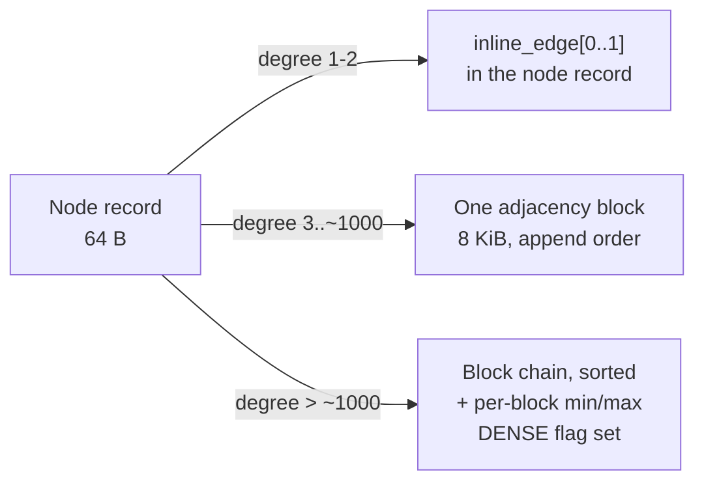

# Relationship and Adjacency Storage

How edges are stored so that traversal costs one sequential read per few hundred neighbours instead
of one random read per neighbour.

This is where the PoC is furthest from the goal: `NodeRelationshipStorageImpl` is a singly linked
list with a 32-byte link per edge, each hop opening a file channel and creating a mapping. Walking a
node with 1000 edges costs 1000 random reads and 1000 mappings.

---

## 1. The Cost Model

Traversal is the operation a graph store exists for, and its cost is dominated by how many distinct
device reads it takes to enumerate a node's neighbours.

| Design | Reads to enumerate d neighbours | Bytes read | Bytes stored per edge |
|--------|-------------------------------|------------|----------------------|
| PoC linked list | d | d x 8 KiB (one page each) | 32 |
| Materialised relationship record per edge, contiguous | d | d x 8 KiB | 64 |
| **Inline edges (d <= 2)** | **0** | **0** | **8** |
| **Adjacency blocks, compressed** | **ceil(d / ~8000)** | **ceil(d/8000) x 8 KiB** | **~1 to 1.3** |

The target is the last two rows. The mechanism is: put the first two edges in the node record where
they are already paid for, and put the rest in page-sized blocks holding hundreds of
delta-compressed entries.

---

## 2. Three Storage Tiers



| Tier | Trigger | Where |
|------|---------|-------|
| **Inline** | `degree_out + degree_in <= 2` | `inline_edge[0..1]` in the node record |
| **Blocked** | up to one block's capacity | a single `ADJ` block, `adj_head_id` |
| **Dense** | beyond one block | a chain of blocks with a sorted, skippable layout; node flagged `DENSE` |

Promotion is one-way and happens on insert; demotion happens only during compaction.

Real graphs are power-law: in most datasets over half the nodes have degree 1 or 2, which the inline
tier serves with **zero** additional I/O and **zero** additional bytes beyond the node record that
was going to be read anyway.

---

## 3. The Packed Edge (8 bytes)

Both inline edges and adjacency entries are logically the same tuple, packed into 8 bytes:

```
 63  62 61      48 47                                        0
+------+----------+-------------------------------------------+
| dir 2| type 14  |          neighbour slot+segment 48         |
+------+----------+-------------------------------------------+
```

| Field | Bits | Meaning |
|-------|------|---------|
| `dir` | 2 | 0 = outgoing, 1 = incoming, 2 = undirected, 3 = reserved |
| `type` | 14 | interned relationship type id (16,384 distinct types) |
| `neighbour` | 48 | the neighbour node's `segment:24 | slot:24` — the id without kind and generation |

The kind is implicitly `NODE`, and the generation is deliberately **omitted**: adjacency is
maintained transactionally alongside the node, so an adjacency entry is never stale in the way an
externally held id can be. To rebuild the full neighbour `ElementId` for the API boundary, read the
neighbour record's `gen` field, which you are about to read anyway.

A type id beyond 14 bits, or an edge that carries properties, escalates to a **materialised edge**
(§4).

**Why direction is per-entry rather than per-block**: it lets one block hold both directions for a
node, which halves the block count for the common case of a node with a few edges each way, and it
makes "all neighbours regardless of direction" a single scan.

---

## 4. Lightweight Edges

An edge that carries **no properties** needs no `REL` record at all. It exists only as two adjacency
entries (one on each endpoint). This is the largest single space win available:

| Edge kind | Bytes on disk |
|-----------|---------------|
| Lightweight (no properties) | 2 x 8 = **16** (one entry per endpoint) |
| Materialised (has properties) | 2 x 8 + 64 (`REL` record) + property block |

In many real graphs the majority of edges carry nothing but a type. The PoC pays 1088 bytes for
each of them.

**Escalation.** Setting a property on a lightweight edge materialises it: allocate a `REL` slot,
write the record, and rewrite the two adjacency entries to point at the relationship instead of the
neighbour. A materialised entry is distinguished by `dir == 3` in the packed edge... which conflicts
with "reserved". Concretely:

- Packed edge with `dir` in {0,1,2}: lightweight; the 48-bit field is the **neighbour**.
- Packed edge with `dir == 3`: materialised; the 48-bit field is the **`REL` id's `segment:slot`**,
  and the direction, type and neighbour all come from the relationship record.

This costs a materialised edge one extra 64-byte read during traversal, which is the right place to
pay it — you were going to read the relationship's properties anyway.

**API consequence**: an edge only has a stable, externally usable `ElementId` once materialised. The
API therefore exposes `createEdge(from, type, to)` returning a lightweight handle and
`createRelationship(...)` returning a `REL` id; see [API.md §5](API.md#5-edges-vs-relationships).

---

## 5. Adjacency Blocks

An adjacency block is a **run of consecutive 512 byte cells** (`Kind.ADJ_CELL_BYTES`), addressed by an
`ADJ` id naming its first cell. It starts at one cell and **doubles as it fills** — 512 B, 1 KiB,
2 KiB, 4 KiB, one page — and only a node that has filled a whole page starts a chain. A block never
straddles a page, which is what lets the whole of one be acquired in a single read: the run from its
first cell to the end of its page is always safe to take, and the header says how much of it to use.

**This was a page from the first edge that did not fit inline, and that was the largest space defect
the project has found in itself.** A node of degree three was given 8 KiB. On a random graph of mean
degree 4 that is three quarters of all nodes; measured on ten million nodes it was 59 of 61 GiB, and
making the block grow instead took the same graph to 6.2 GiB and its load from 43 minutes to 11.
See [reports/SCALE.md](reports/SCALE.md). Store format version **2**.

```
offset size field
0      8    node_id            owner node (self-check and reverse lookup)
8      8    next_block_id      ADJ id, or NULL_ID
16     8    xmin               commit timestamp of the last structural change
24     4    sorted_bytes       length of the compressed region
28     2    tail_count         raw entries at the end of the page
30     2    gen
32     4    sorted_count       entries in the compressed region
36     1    flags              FULL
37     1    cells              allocation units this block spans, 1..pageSize/512
38     2    reserved
40     8    min_location       for skipping a block without decoding it
48     8    max_location
56     8    type_bitmap        Bloom-style over 64 hashed type ids
64     N    payload
```

64-byte header. The block is laid out as

```
[ header 64 B ][ compressed sorted region ][ free ][ raw tail entries, 8 B each, growing downwards ]
```

`flags` is **one byte**, not four. It was written four bytes wide once, which silently claimed the
reserved bytes beside it and erased `cells` on every write.

**The hybrid is what makes the compression pay.** An append writes an 8-byte raw entry at the tail;
when the tail meets the sorted region the block recompresses everything into the sorted region, which
typically reclaims most of the space and lets appending continue. Only when compression can no longer
make room does the block grow to the next size — or, at page size, get marked `FULL` so a new block
is chained in front of it.

Growth is preferred over chaining wherever there is room in the page: a chain costs a read per block
on every traversal, a larger run costs none. It costs one copy per doubling, five to reach a page,
which is amortised O(1) per edge.

Measured cost per directed entry:

| Degree | Block | Bytes per entry |
|---|---|---|
| 3 | 1 cell | 170 |
| 20 | 1 cell | 25.6 |
| 60 | 1 cell | 8.53 |
| 150 | 1 cell | 3.41 |
| 400 | 1 cell | **1.28** |
| 20,000 | 48 cells | **1.23** |
| 500,000 | 62 pages | **1.02** (8065 entries per 8 KiB block) |

One 512 byte cell holds **400 directed entries**, so on ordinary graphs growth rarely triggers at all.
A raw 8-byte layout would need 489 pages for the last row and the proof of concept's linked list 1954.

**Enumerating blocks goes through the owners, never the free-slot bitmap.** The bitmap is per cell, so
a sweep over live `ADJ` slots sees continuation cells as well as block headers, and a continuation
cell holds compressed edge data — nothing in it identifies it as one. Compaction and `verify(FULL)`
both walk node chains instead, exactly as they do for property blocks.

### 5.1 Chain order

New blocks are pushed onto the **head** of the chain (`adj_head_id`), so appending is O(1) rather
than a walk to the tail.

### 5.2 The compressed region — delta + varint

The sorted region is encoded as:

- Entries grouped by `(dir, type)`. The group header is one varint pair; the per-entry `dir` and
  `type` bits disappear.
- Within a group, neighbours are sorted ascending and **delta-encoded**, then varint-coded.
- Deltas are typically small: neighbours created near each other in time land in nearby slots, and a
  graph loaded in any locality-preserving order produces deltas of 1 to a few hundred.

Observed encoding cost:

| Neighbour delta | Varint bytes |
|-----------------|--------------|
| < 128 | 1 |
| < 16,384 | 2 |
| < 2^21 | 3 |
| arbitrary | up to 7 |

So a block holds **roughly 4,000 to 8,000 edges** in 8 KiB for locality-friendly data, versus 1,016
raw and versus 254 for the PoC's 32-byte links. That is the "storage efficient file format for
relationships" requirement, met — and measured at 8065 entries per block in `SpaceEfficiencyTest`.

The encoded form is:

```
varint groupCount
per group:
  varint groupKey       (dir << 14 | type)
  varint count
  varint firstLocation
  varint delta ...      (count - 1 of them)
```

Encoding and decoding of a whole block is a SIMD-friendly loop and is one of the four native
functions ([NATIVE_FFM.md §2](NATIVE_FFM.md#2-the-native-surface)); the Java fallback is a scalar
loop that is roughly 3x slower and entirely correct.

### 5.3 Dense nodes

Above one block, blocks form a chain via `next_block_id`. Each block's `min_neighbour` /
`max_neighbour` and `type_bitmap` let a filtered traversal ("outgoing `FOLLOWS` edges only", "does an
edge to node X exist") skip blocks without decoding them.

The chain is kept sorted across blocks so that a merge-scan is possible and `hasEdge(a, b)` is
O(log blocks) block reads plus one in-block binary search rather than a full scan.

For very high-degree nodes (configurable, default 2^20 edges) the chain is replaced by a **B+tree
keyed on `(dir, type, neighbour)`** in the `INDEX` kind. That is a Phase 7 item; the `DENSE` flag and
`adj_head_id` are already shaped to allow it without a format change (the head id's kind
distinguishes `ADJ` from `INDEX`).

---

## 6. Operations

### 6.1 Insert an edge (a) -[T]-> (b)

```
if a.inline_edge_count < 2 and a has no adj blocks:
    a.inline_edge[n] = pack(OUT, T, b);  a.inline_edge_count++
else:
    block = tail block of a's chain (or allocate one, migrating the inline edges into it)
    if block is full: allocate a new block, link it
    append pack(OUT, T, b)
a.degree_out++
... symmetric for b with dir = IN
```

Both endpoints are updated. This is the bug the PoC does not fix: `GraphStorageImpl` links only
`nodeA` (D9), which makes incoming traversal structurally impossible.

Both endpoint updates plus the block write are covered by a single transaction and logged as one
`EDGE_INSERT` WAL record pair.

### 6.2 Delete an edge

The entry is replaced with a tombstone and the block is rewritten without it.

**The tombstone is the all-ones value `-1L`, not location 0.** Location 0 is the perfectly valid
location of slot 0 in segment 0, which is the first node any store creates — treating it as a
tombstone silently drops every edge touching that node. `-1L` decodes as `dir = 3, type = MAX_TYPE`,
and `PackedEdge.pack` rejects a materialised entry with a non-zero type, so the value is unreachable
through the constructors.

Deleting a node deletes all of its edges, which requires visiting each neighbour's adjacency to
remove the mirror entry. For a dense node this is expensive and is therefore performed **lazily**:
the node's slot is freed immediately, and mirror entries are removed by the vacuum worker, with
traversal skipping entries whose neighbour fails the generation/live check. This is a deliberate
trade — see §8.

### 6.3 Traverse

```java
Cursor c = tx.neighbours(nodeId, Direction.OUT, typeFilter);
```

1. Read the node record (64 B, one cache line, usually already read).
2. Yield matching inline edges. For degree <= 2, **done, with no further I/O**.
3. Walk the block chain. For each block: check `type_bitmap` and `min/max` against the filter, skip
   or decode. Issue a prefetch for `next_block_id` before decoding the current block, so the device
   and the CPU overlap.
4. For entries with `dir == 3`, read the relationship record.

Prefetch depth is configurable; with the io_uring engine the cursor keeps several block reads in
flight, which is the only way to saturate an NVMe device from a single traversal thread. See
[SSD_IO.md §5](SSD_IO.md#5-prefetch-and-queue-depth).

---

## 7. Worked Example

A 10-million-node social graph, average degree 50, 80 percent of edges property-free, 5 relationship
types.

| Component | PoC | Target |
|-----------|-----|--------|
| Node records | 10M x 1080 B = 10.8 GB | 10M x 64 B = 640 MB |
| Edge storage (500M edges, both directions = 1G entries) | 1G x 32 B = 32 GB | ~1G x 2.5 B = 2.5 GB |
| Relationship records | 500M x 1088 B = 544 GB | 100M x 64 B = 6.4 GB |
| Property records | ~30 GB unbounded growth | ~4 GB with dictionaries |
| **Total** | **~617 GB** | **~13.5 GB** |
| Reads to enumerate one node's 50 neighbours | 50 | 1 |

The numbers are estimates, but the orders of magnitude are structural, not tuning.

---

## 8. Conventions and Gotchas

- **Always update both endpoints.** Any code path that writes one side of an edge without the other
  is a bug. There is an invariant checker for this ([TESTING.md §5](TESTING.md#5-invariant-checkers)).
- **`dir == 3` means materialised, not "reserved".** Do not use it for a third direction.
- **A tombstoned entry is `neighbour == 0`, not `-1`.** The PoC's `-1` sentinel does not exist here.
- **Do not sort a block in place while a cursor may be reading it.** Sealing allocates a new block
  and flips `adj_head_id` / `next_block_id` under the page latch; the old block is freed once no
  snapshot can see it.
- **Degree counters are authoritative and must be maintained transactionally.** A drifted
  `degree_out` silently changes traversal plans. The invariant checker recounts them.
- **The type bitmap is a filter, not an index.** False positives are fine; false negatives are
  corruption.
- **Deleting a supernode is slow.** That is the accepted trade for making the common case free. If a
  workload deletes supernodes frequently, that is a signal to build the Phase 7 B+tree adjacency.

---

## 9. Test Setup

- `PackedEdgeTest`: round trip all four `dir` values, all 14 type bits, and 48-bit neighbours at 0,
  1, max.
- `AdjacencyBlockTest`: fill a block in layout 0, seal to layout 1, decode, assert set equality with
  the input, for random and for adversarial (all-max-delta) inputs.
- `EdgeCodecFuzzTest`: property-based — any multiset of edges encodes and decodes to itself; the
  native codec and the Java fallback produce byte-identical output.
- `AdjacencyTierTest`: assert the inline -> block -> dense promotion boundaries, and that promotion
  preserves the edge set exactly.
- `BidirectionalityTest`: for a random graph, assert every out-edge on `a` has a matching in-edge on
  `b` (the D9 regression).
- `TraversalCostTest`: instrumented `IoEngine` counting device reads; assert that enumerating a
  degree-2 node costs 0 adjacency reads and a degree-1000 node costs 1.
- `SupernodeTest`: 10^6 edges on one node; assert block-chain scan time is linear and that a filtered
  scan on a rare type skips at least 90 percent of blocks.

---

## 10. Progress Assessment

- [x] `PackedEdge` encode/decode, with the tombstone unreachable through the constructors
- [x] Inline edge tier in the node record (degree <= 2 costs no adjacency storage)
- [x] `AdjacencyBlock` with the compressed region plus raw tail hybrid
- [x] `EdgeCodec` (delta + varint), Java implementation
- [x] Recompaction on tail exhaustion, `FULL` marking and chain extension
- [x] Tier promotion (inline -> block -> chain), preserving the edge set
- [x] Bidirectional maintenance, with a test asserting every mirror entry
- [x] Degree counter maintenance, asserted against actual adjacency
- [x] Lightweight edges and materialised relationships in the same chain
- [x] `min/max` location and type-bitmap skipping on delete
- [x] Edge deletion with block rewrite
- [x] Tests: packed edge, codec round trip and corrupt input, tiers, supernode density,
      bidirectionality, mixed edge kinds
- [x] Chain defragmentation (`AdjacencyStore.defragment`): rebuilds a churned chain from its live
      entries, dropping tombstones and packing the survivors. Breaks no ids, since block ids are
      internal, so it runs before any record relocation
- [ ] Native SIMD codec + differential test against Java (Phase 6)
- [ ] Traversal cursor with prefetch (Phase 6, needs the io_uring engine)
- [ ] Type-bitmap skipping on the read path
- [ ] Lazy mirror-entry cleanup in vacuum (Phase 5)
- [ ] B+tree adjacency for extreme supernodes (Phase 7)

---

## 11. Key Classes Reference (target)

| Class | Package | Purpose |
|-------|---------|---------|
| `AdjacencyStore` | `io.metaloom.graph.core.store.adj` | Insert, delete, enumerate edges; tier promotion |
| `AdjacencyBlock` | `io.metaloom.graph.core.store.adj` | Block header accessors and entry iteration |
| `EdgeCodec` | `io.metaloom.graph.core.store.adj` | Delta + varint encode/decode, native and fallback |
| `PackedEdge` | `io.metaloom.graph.core.store.adj` | The 8-byte edge tuple |
| `NeighbourCursor` | `io.metaloom.graph.core.api` | Streaming traversal with prefetch |

---

_Git HEAD revision: `c016a41`_
_Last updated: 2026-08-13 (synced with the Phase 0 to 3 implementation)_
