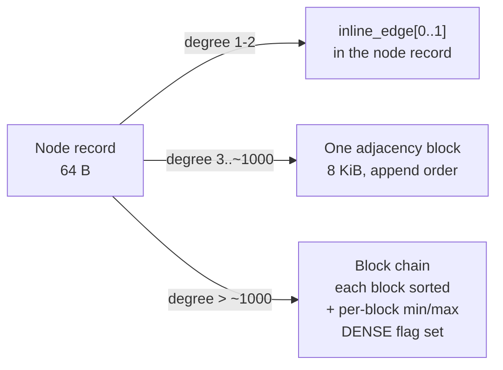

# Relationship and Adjacency Storage

How edges are stored so that traversal costs one sequential read per few hundred neighbours instead
of one random read per neighbour.

This is where the PoC is furthest from the goal: `NodeRelationshipStorageImpl` is a singly linked
list with a 32-byte link per edge, each hop opening a file channel and creating a mapping. Walking a
node with 1000 edges costs 1000 random reads and 1000 mappings.

---

## 1. The Cost Model

Traversal is the operation a graph store exists for, and its cost is dominated by how many distinct
device reads it takes to enumerate a node's neighbours.

| Design | Reads to enumerate d neighbours | Bytes read | Bytes stored per edge |
|--------|-------------------------------|------------|----------------------|
| PoC linked list | d | d x 8 KiB (one page each) | 32 |
| Materialised relationship record per edge, contiguous | d | d x 8 KiB | 64 |
| **Inline edges (d <= 2)** | **0** | **0** | **8** |
| **Adjacency blocks, compressed** | **ceil(d / ~8000)** | **ceil(d/8000) x 8 KiB** | **~1 to 1.3** |

The target is the last two rows. The mechanism is: put the first two edges in the node record where
they are already paid for, and put the rest in page-sized blocks holding hundreds of
delta-compressed entries.

---

## 2. Three Storage Tiers



| Tier | Trigger | Where |
|------|---------|-------|
| **Inline** | `degree_out + degree_in <= 2` | `inline_edge[0..1]` in the node record |
| **Blocked** | up to one block's capacity | a single `ADJ` block, `adj_head_id` |
| **Dense** | beyond one block | a chain of blocks, each sorted within itself and skippable by its header summary; node flagged `DENSE` |

Promotion is one-way and happens on insert; demotion happens only during compaction.

Real graphs are power-law: in most datasets over half the nodes have degree 1 or 2, which the inline
tier serves with **zero** additional I/O and **zero** additional bytes beyond the node record that
was going to be read anyway.

---

## 3. The Packed Edge (8 bytes)

Both inline edges and adjacency entries are logically the same tuple, packed into 8 bytes:

```
 63  62 61      48 47                                        0
+------+----------+-------------------------------------------+
| dir 2| type 14  |          neighbour slot+segment 48         |
+------+----------+-------------------------------------------+
```

| Field | Bits | Meaning |
|-------|------|---------|
| `dir` | 2 | 0 = outgoing, 1 = incoming, 2 = undirected, 3 = materialised (§4) |
| `type` | 14 | interned relationship type id (16,384 distinct types) |
| `neighbour` | 48 | the neighbour node's `segment:24 | slot:24` — the id without kind and generation |

The kind is implicitly `NODE`, and the generation is deliberately **omitted**: adjacency is
maintained transactionally alongside the node, so an adjacency entry is never stale in the way an
externally held id can be. To rebuild the full neighbour `ElementId` for the API boundary, read the
neighbour record's `gen` field, which you are about to read anyway.

A type id beyond 14 bits, or an edge that carries properties, escalates to a **materialised edge**
(§4).

### 3.1 The type of a materialised entry is a cache

A materialised entry's 48 bits hold a relationship location, and the relationship record is the
authority on its type, direction and endpoints. The entry **also carries the type**, as a cache, and
that is the difference between a type-filtered traversal of a supernode costing one random 64 byte
read per *edge* and one per *surviving candidate*
([IDX-2](INDEX_TASKS.md#3-closed)).

Two values are reserved, and neither costs a real type:

| Stored `type` | Meaning |
|---|---|
| `0` (`PackedEdge.TYPE_NOT_RECORDED`) | not cached — read the record. `Catalog` hands out label id 0 for "unknown", so no relationship has type 0 |
| `MAX_TYPE` (16383) | never stored on a materialised entry; a relationship of that type falls back to `0` |

`MAX_TYPE` is excluded because it is the one value that would make the entry reachable: the
tombstone is all-ones, which is `dir = 3, type = MAX_TYPE, location = MAX_LOCATION`, and `pack`
rejecting that combination is the whole of the tombstone-unreachability argument (§6.2). So the
cache holds 16,382 distinct types and everything else reads the record, exactly as before.

**Reserving `0` rather than bumping the format version is what makes this backward compatible.**
Every materialised entry of an older store holds zero, which under this reading means "not cached" —
which is what those stores meant. Three consequences follow, and all three are load-bearing:

- A filter must **never** exclude an entry whose cached type is 0. A false positive costs the record
  read that used to be unconditional; a false negative silently drops an edge from an answer
  (`PackedEdge.excludedByType`).
- Deletion matches a materialised entry **by the relationship it names**, ignoring the type field
  (`AdjacencyStore.removeMaterialised`, `PackedEdge.TYPE_AGNOSTIC_MASK`). Matching the whole packed
  value would walk past an older store's entries and leave them behind as dangling adjacency.
- A cached type that disagrees with its record is corruption, and `InvariantChecker` reports it.

**Direction is not cached and cannot be.** The 48 bit field holds the relationship's location, not
the neighbour's, so `outgoing = rel.from == thisNode` is only answerable from the record. A
`Direction.OUT` traversal with no type filter therefore still reads every record. That is the right
trade: the type filter is the selective one, and after it has run the surviving candidates are few.

**Why direction is per-entry rather than per-block**: it lets one block hold both directions for a
node, which halves the block count for the common case of a node with a few edges each way, and it
makes "all neighbours regardless of direction" a single scan.

---

## 4. Lightweight Edges

An edge that carries **no properties** needs no `REL` record at all. It exists only as two adjacency
entries (one on each endpoint). This is the largest single space win available:

| Edge kind | Bytes on disk |
|-----------|---------------|
| Lightweight (no properties) | 2 x 8 = **16** (one entry per endpoint) |
| Materialised (has properties) | 2 x 8 + 64 (`REL` record) + property block |

In many real graphs the majority of edges carry nothing but a type. The PoC pays 1088 bytes for
each of them.

**Escalation.** Setting a property on a lightweight edge materialises it: allocate a `REL` slot,
write the record, and rewrite the two adjacency entries to point at the relationship instead of the
neighbour. A materialised entry is distinguished by `dir == 3` in the packed edge... which conflicts
with "reserved". Concretely:

- Packed edge with `dir` in {0,1,2}: lightweight; the 48-bit field is the **neighbour**.
- Packed edge with `dir == 3`: materialised; the 48-bit field is the **`REL` id's `segment:slot`**,
  and the direction, type and neighbour all come from the relationship record.

This costs a materialised edge one extra 64-byte read during traversal, which is the right place to
pay it — you were going to read the relationship's properties anyway.

**API consequence**: an edge only has a stable, externally usable `ElementId` once materialised. The
API therefore exposes `createEdge(from, type, to)` returning a lightweight handle and
`createRelationship(...)` returning a `REL` id; see [API.md §5](API.md#5-edges-vs-relationships).

---

## 5. Adjacency Blocks

An adjacency block is a **run of consecutive 512 byte cells** (`Kind.ADJ_CELL_BYTES`), addressed by an
`ADJ` id naming its first cell. It starts at one cell and **doubles as it fills** — 512 B, 1 KiB,
2 KiB, 4 KiB, one page — and only a node that has filled a whole page starts a chain. A block never
straddles a page, which is what lets the whole of one be acquired in a single read: the run from its
first cell to the end of its page is always safe to take, and the header says how much of it to use.

**This was a page from the first edge that did not fit inline, and that was the largest space defect
the project has found in itself.** A node of degree three was given 8 KiB. On a random graph of mean
degree 4 that is three quarters of all nodes; measured on ten million nodes it was 59 of 61 GiB, and
making the block grow instead took the same graph to 6.2 GiB and its load from 43 minutes to 11.
See [reports/SCALE.md](reports/SCALE.md). Store format version **2**.

```
offset size field
0      8    node_id            owner node (self-check and reverse lookup)
8      8    next_block_id      ADJ id, or NULL_ID
16     8    xmin               commit timestamp of the last structural change
24     4    sorted_bytes       length of the compressed region
28     2    tail_count         raw entries at the end of the page
30     2    gen
32     4    sorted_count       entries in the compressed region
36     1    flags              FULL | TYPES_CACHED | NO_MATERIALISED
37     1    cells              allocation units this block spans, 1..pageSize/512
38     2    reserved
40     8    min_location       for skipping a block without decoding it
48     8    max_location
56     8    type_bitmap        Bloom-style over 64 hashed type ids
64     N    payload
```

64-byte header. The block is laid out as

```
[ header 64 B ][ compressed sorted region ][ free ][ raw tail entries, 8 B each, growing downwards ]
```

`flags` is **one byte**, not four. It was written four bytes wide once, which silently claimed the
reserved bytes beside it and erased `cells` on every write.

Two of its three bits say whether the summary beside them can be trusted to rule something out, and
both are **set to claim, never set to warn** — a block written before they existed reads as `0`,
which says "cannot answer", which is the safe answer. That is the whole compatibility argument, and
it is the same trick type id `0` plays in §3.1.

| Bit | Meaning when set | Withdrawn by |
|---|---|---|
| `FULL` (1) | The block is at page size and cannot take more entries | — |
| `TYPES_CACHED` (2) | Every materialised entry in this block caches a real type, so `type_bitmap` describes **every** entry and a read may skip on it | a materialised entry with `type == 0` |
| `NO_MATERIALISED` (4) | The block holds no materialised entry, so `min/max_location` bound **neighbour** locations and a search for one may skip on them | any materialised entry |

`NO_MATERIALISED` exists because the 48 bit field means two different things. On a lightweight entry
it is a neighbour location; on a materialised one it is a *relationship* location (§3). A block
holding both has a min/max over two address spaces mixed together, and ruling a neighbour out
against that range would be meaningless.

Both bits are recomputed from scratch whenever a block is rewritten, alongside the min/max and the
bitmap they qualify — so a rewrite that drops the last uncached entry makes the block skippable
again. `FULL` is a property of the block rather than of its contents and is preserved across one.

**The hybrid is what makes the compression pay.** An append writes an 8-byte raw entry at the tail;
when the tail meets the sorted region the block recompresses everything into the sorted region, which
typically reclaims most of the space and lets appending continue. Only when compression can no longer
make room does the block grow to the next size — or, at page size, get marked `FULL` so a new block
is chained in front of it.

Growth is preferred over chaining wherever there is room in the page: a chain costs a read per block
on every traversal, a larger run costs none. It costs one copy per doubling, five to reach a page,
which is amortised O(1) per edge.

Measured cost per directed entry:

| Degree | Block | Bytes per entry |
|---|---|---|
| 3 | 1 cell | 170 |
| 20 | 1 cell | 25.6 |
| 60 | 1 cell | 8.53 |
| 150 | 1 cell | 3.41 |
| 400 | 1 cell | **1.28** |
| 20,000 | 48 cells | **1.23** |
| 500,000 | 62 pages | **1.02** (8065 entries per 8 KiB block) |

One 512 byte cell holds **400 directed entries**, so on ordinary graphs growth rarely triggers at all.
A raw 8-byte layout would need 489 pages for the last row and the proof of concept's linked list 1954.

**Enumerating blocks goes through the owners, never the free-slot bitmap.** The bitmap is per cell, so
a sweep over live `ADJ` slots sees continuation cells as well as block headers, and a continuation
cell holds compressed edge data — nothing in it identifies it as one. Compaction and `verify(FULL)`
both walk node chains instead, exactly as they do for property blocks.

### 5.1 Chain order

New blocks are pushed onto the **head** of the chain (`adj_head_id`), so appending is O(1) rather
than a walk to the tail.

### 5.2 The compressed region — delta + varint

The sorted region is encoded as:

- Entries grouped by `(dir, type)`. The group header is one varint pair; the per-entry `dir` and
  `type` bits disappear.
- Within a group, neighbours are sorted ascending and **delta-encoded**, then varint-coded.
- Deltas are typically small: neighbours created near each other in time land in nearby slots, and a
  graph loaded in any locality-preserving order produces deltas of 1 to a few hundred.

Observed encoding cost:

| Neighbour delta | Varint bytes |
|-----------------|--------------|
| < 128 | 1 |
| < 16,384 | 2 |
| < 2^21 | 3 |
| arbitrary | up to 7 |

So a block holds **roughly 4,000 to 8,000 edges** in 8 KiB for locality-friendly data, versus 1,016
raw and versus 254 for the PoC's 32-byte links. That is the "storage efficient file format for
relationships" requirement, met — and measured at 8065 entries per block in `SpaceEfficiencyTest`.

The encoded form is:

```
varint groupCount
per group:
  varint groupKey       (dir << 14 | type)
  varint count
  varint firstLocation
  varint delta ...      (count - 1 of them)
```

Encoding and decoding of a whole block is a SIMD-friendly loop and is one of the four native
functions ([NATIVE_FFM.md §2](NATIVE_FFM.md#2-the-native-surface)); the Java fallback is a scalar
loop that is roughly 3x slower and entirely correct.

### 5.3 Dense nodes

Above one block, blocks form a chain via `next_block_id`. Each block's `min_location` /
`max_location` and `type_bitmap` let a filtered traversal ("outgoing `FOLLOWS` edges only", "does an
edge to node X exist") skip blocks without decoding them: `AdjacencyStore.edges(nodeId, typeIds)`
uses the bitmap, `AdjacencyStore.hasEdge(a, b)` uses the range.

**A skip saves the decode, not the read, and the difference is not a detail.** The chain's `next`
pointer lives inside each block's own header, so a walk has to acquire every block of the chain
before it can judge any of them — the record read is owed either way. What a skip removes is the
varint decode of up to 8,000 entries and the `long[]` they land in. A type-filtered and an
unfiltered scan of the same node therefore have the **same** `recordReads(ADJ)` and different
`adjacencyBlocksDecoded()`, which is the unit `IoStats` counts it in and the unit
`ReadBudgetTest.testATypeFilteredScanSkipsTheBlocksWhoseBitmapExcludesTheType` asserts in. Claiming
it as saved I/O would be claiming something the format does not deliver; a block directory stored
apart from the blocks would, and does not exist.

**`hasEdge(a, b)` is O(blocks), not O(log blocks).** This section used to claim that the chain is
kept sorted across blocks, so that a merge-scan and a binary search were possible. It is not and they
are not: new blocks are pushed onto the **head** (§5.1), so block order is insertion order, not key
order, and each block is sorted only within itself. There is nothing to binary search over. What
`hasEdge` does have is a range check that prunes and an early exit — a neighbour in the head block
costs one decode however long the chain is, and a neighbour outside every block's range costs none
at all. A block holding any materialised entry is never pruned, per `NO_MATERIALISED` above.

Two limits are worth stating rather than discovering. The bitmap is 64 bits over `typeId & 63`, so
past roughly 64 distinct types the false-positive rate makes type skipping worth little; and
skipping only pays on a chain, which starts above one page — roughly 8,000 entries. Below that there
is one block and nothing to skip. **This is a supernode optimisation and is measured as one.**

For very high-degree nodes (configurable, default 2^20 edges) the chain is replaced by a **B+tree
keyed on `(dir, type, neighbour)`** in the `INDEX` kind. That is a Phase 7 item; the `DENSE` flag and
`adj_head_id` are already shaped to allow it without a format change (the head id's kind
distinguishes `ADJ` from `INDEX`).

### 5.4 Streaming the chain — the cursor

§5.3 reduces how many blocks a filtered walk *decodes*. It does nothing about how many it *touches*,
because the walk had no way to be told it was finished: `AdjacencyStore.edges` returned a `long[]`
and `GraphStore.neighbours` a `List<Edge>`, both fully built before the caller saw anything. At
degree 10^6 that is an 8 MB `long[]` plus a million `Edge` records for a query that may want one row.

`EdgeCursor` (`store.adj`, packed entries) and `NeighbourCursor` (`api`, resolved `Edge`s) are the
streaming form. A block is acquired and decoded only when the entries of the previous one have run
out, so a caller that stops after one row has touched the head block and nothing else —
`ReadBudgetTest.testTakingOneEdgeOffASupernodeReadsOneBlock` asserts one `recordReads(ADJ)` against a
13-block chain, and asserts it is the same number a one-block node costs. This is the same argument
`forEachNodeWhile` makes one level up: the reason a `LIMIT` costs what a reader expects is that the
thing producing rows can be told to stop.

**There is one walk, not two.** `edges(nodeId, typeIds)` is written as a drain of `cursor(nodeId,
typeIds)`, and `neighbours(...)` as a drain of the same cursor with `materialise` on top. Both filter
levels stay where §5.3 and §3.1 put them — `AdjacencyBlock.admitsAnyType` per block,
`PackedEdge.excludedByType` per entry — and neither rule is re-derived in the streaming path. A
second implementation of "type 0 means the cache is absent, not that the type is zero" is a second
place to get it wrong, and getting it wrong drops edges silently.

**A cursor holds a read view; a list does not.** `GraphStoreImpl.read` runs its body without a lock
and re-runs it if a commit landed underneath, which is safe precisely because building a list has no
side effects and can be thrown away. A cursor outlives the call that made it and cannot be re-run, so
`neighbourCursor` takes the read latch outright and holds it until `close()` — the trade
`forEachNodeWhile` already makes, for the reason it gives. Two consequences belong to the caller:
an unclosed cursor stalls every writer, not only the thread that leaked it; and a mutation attempted
from inside a cursor loop deadlocks the thread against its own latch. A cursor opened *inside* a
write transaction takes no latch at all, because the transaction's overlay is already a stable view.

`neighbours` deliberately stays on the optimistic path and drains a cursor that holds no lease.
Making it take the latch would turn every traversal in the engine into a writer-excluding read to buy
nothing.

The Cypher layer consumes this at the seed (`forEachNodeWhile`) but **not yet at the expansion**:
`PatternMatcher.expand` still collects a node's steps into a list before moving to the next pattern
element, so a `LIMIT 1` through Cypher over a supernode still materialises that node's edges. The
storage layer no longer forces it to; making the expansion streaming means restructuring the
per-row relationship-uniqueness sets and path accumulators that walk in lockstep with it, which is
its own change.

---

## 6. Operations

### 6.1 Insert an edge (a) -[T]-> (b)

```
if a.inline_edge_count < 2 and a has no adj blocks:
    a.inline_edge[n] = pack(OUT, T, b);  a.inline_edge_count++
else:
    block = tail block of a's chain (or allocate one, migrating the inline edges into it)
    if block is full: allocate a new block, link it
    append pack(OUT, T, b)
a.degree_out++
... symmetric for b with dir = IN
```

Both endpoints are updated. This is the bug the PoC does not fix: `GraphStorageImpl` links only
`nodeA` (D9), which makes incoming traversal structurally impossible.

Both endpoint updates plus the block write are covered by a single transaction and logged as one
`EDGE_INSERT` WAL record pair.

### 6.2 Delete an edge

The entry is replaced with a tombstone and the block is rewritten without it.

**The tombstone is the all-ones value `-1L`, not location 0.** Location 0 is the perfectly valid
location of slot 0 in segment 0, which is the first node any store creates — treating it as a
tombstone silently drops every edge touching that node. `-1L` decodes as `dir = 3, type = MAX_TYPE`,
and `PackedEdge.pack` rejects a materialised entry carrying type `MAX_TYPE`, so the value is
unreachable through the constructors (§3.1).

**A materialised entry is deleted by the relationship it names, not by its packed value**
(`AdjacencyStore.removeMaterialised`). Its type field is a cache and the bits on disk may hold either
the type or the "not cached" zero; an exact-value match would find only one of the two shapes. The
block skip that a value match gets from `type_bitmap` is given up for those removals — `min/max
location` still applies, and it is the selective one for a delete that already knows its target.

Deleting a node deletes all of its edges, which requires visiting each neighbour's adjacency to
remove the mirror entry. For a dense node this is expensive and is therefore performed **lazily**:
the node's slot is freed immediately, and mirror entries are removed by the vacuum worker, with
traversal skipping entries whose neighbour fails the generation/live check. This is a deliberate
trade — see §8.

### 6.3 Traverse

```java
List<Edge> all = store.neighbours(nodeId, Direction.OUT, typeFilter);      // materialised
try (NeighbourCursor c = store.neighbourCursor(nodeId, Direction.OUT, typeFilter)) {
	while (c.next()) { ... }                                               // streamed, §5.4
}
```

1. Read the node record (64 B, one cache line, usually already read).
2. Yield matching inline edges. For degree <= 2, **done, with no further I/O**.
3. Walk the block chain. For each block: check `type_bitmap` against the filter — but only where
   `TYPES_CACHED` says the bitmap describes every entry — and skip or decode. Issue a prefetch for
   `next_block_id` before decoding the current block, so the device and the CPU overlap. (The
   prefetch is Phase 6 and needs the io_uring engine; the skip and the cursor are built.) Through a
   cursor this step is lazy: the next block is not touched until the current one is exhausted.
4. Apply the type filter to every decoded entry from its own bits, which is free. A lightweight entry
   always carries its type; a materialised one carries it unless it caches none (§3.1).
5. For the entries with `dir == 3` that survived step 4, read the relationship record and confirm the
   type against it.

Step 4 exists so that step 5 runs once per **surviving candidate** rather than once per entry. On a
supernode of materialised edges, a filter matching five of five thousand costs five record reads
instead of five thousand; `ReadBudgetTest.testATypeFilteredSupernodeReadsOnlyTheSurvivingRelationships`
measures exactly that, in `Kind.REL` record touches.

Step 3 is what keeps step 4 from running at all on a block that cannot match. It only pays on a
chain and only where the bitmap is authoritative; §5.3 states both limits and the unit it is
measured in.

Prefetch depth is configurable; with the io_uring engine the cursor keeps several block reads in
flight, which is the only way to saturate an NVMe device from a single traversal thread. See
[SSD_IO.md §5](SSD_IO.md#5-prefetch-and-queue-depth).

### 6.4 Does an edge connect a and b

```java
boolean linked = store.hasEdge(a, b);
```

Inline entries first, then the block chain, skipping any block whose `min/max_location` excludes
`b` — and stopping at the first match. Direction-agnostic and type-agnostic: it answers the question
§5.3 poses. A materialised entry names its relationship rather than its neighbour, so it is resolved
through the record; a block holding one is never pruned on the range.

---

## 7. Worked Example

A 10-million-node social graph, average degree 50, 80 percent of edges property-free, 5 relationship
types.

| Component | PoC | Target |
|-----------|-----|--------|
| Node records | 10M x 1080 B = 10.8 GB | 10M x 64 B = 640 MB |
| Edge storage (500M edges, both directions = 1G entries) | 1G x 32 B = 32 GB | ~1G x 2.5 B = 2.5 GB |
| Relationship records | 500M x 1088 B = 544 GB | 100M x 64 B = 6.4 GB |
| Property records | ~30 GB unbounded growth | ~4 GB with dictionaries |
| **Total** | **~617 GB** | **~13.5 GB** |
| Reads to enumerate one node's 50 neighbours | 50 | 1 |

The numbers are estimates, but the orders of magnitude are structural, not tuning.

---

## 8. Conventions and Gotchas

- **Always update both endpoints.** Any code path that writes one side of an edge without the other
  is a bug. There is an invariant checker for this ([TESTING.md §5](TESTING.md#5-invariant-checkers)).
- **`dir == 3` means materialised, not "reserved".** Do not use it for a third direction.
- **A tombstoned entry is `neighbour == 0`, not `-1`.** The PoC's `-1` sentinel does not exist here.
- **Do not sort a block in place while a cursor may be reading it.** Sealing allocates a new block
  and flips `adj_head_id` / `next_block_id` under the page latch; the old block is freed once no
  snapshot can see it.
- **Degree counters are authoritative and must be maintained transactionally.** A drifted
  `degree_out` silently changes traversal plans. The invariant checker recounts them.
- **A self-loop is one entry that counts in both degrees, so `degreeOut + degreeIn` over-counts it.**
  Both degrees really are 1 and the invariant checker agrees deliberately (`InvariantChecker`
  increments `outSeen` and `inSeen` for the same entry), so this is a property of the model rather
  than a defect. What it means for callers: **the sum of a node's degrees is not the number of edges
  that die with it**, and `neighbours(n, BOTH)` lists the one entry twice, once per direction. A
  workload that tracks a live edge count by subtracting the degree sum drifts down by one per
  self-loop it deletes — which is exactly what the 12-hour soak found, at -7,335 after 962,000
  rounds. `SelfLoopTest` pins all three behaviours.
- **The type bitmap is a filter, not an index.** False positives are fine; false negatives are
  corruption.
- **A materialised entry's type is a cache; type 0 means "not cached", not "type 0".** Never filter
  an entry out on the strength of a zero, and never match one by its exact packed value (§3.1).
- **The type bitmap under-describes an entry that caches no type**: such an entry contributes bit 0,
  not the bit of its real type. So a block is skipped on the type bitmap only when its
  `TYPES_CACHED` flag says every materialised entry in it caches a type — true of blocks written
  since IDX-2, false of a store restored from before it, and false of any block one such entry has
  been appended to since. Skipping is an optimisation; a skipped block that held a match is a wrong
  answer.
- **`min/max_location` bound entry locations, which are not all neighbour locations.** A materialised
  entry's 48 bits are a relationship location. Only a block flagged `NO_MATERIALISED` may be pruned
  on the range by a search for a neighbour.
- **Deleting a supernode is slow.** That is the accepted trade for making the common case free. If a
  workload deletes supernodes frequently, that is a signal to build the Phase 7 B+tree adjacency.

---

## 9. Test Setup

**These are the classes that exist.** The list used to name `AdjacencyBlockTest`,
`EdgeCodecFuzzTest`, `BidirectionalityTest`, `TraversalCostTest` and `SupernodeTest`, none of which
was ever written; the behaviour they described is covered, but by other classes and in one case by a
benchmark rather than a test. A spec that sends a reader to a file that is not there is worse than
one that says less.

- `PackedEdgeTest` (`core/unit`): round trip all four `dir` values, all 14 type bits, and 48-bit
  neighbours at 0, 1, max; a materialised entry round-tripping its cached type; the two uncacheable
  type ids falling back to "not recorded"; `excludedByType` never excluding an uncached entry; the
  tombstone still unreachable through every constructor.
- `EdgeCodecTest` (`core/unit`): round trip preserves the edge set, extreme values, the two
  compression ratios of §5.2, and corrupt input rejected rather than read out of bounds — a
  backwards delta, an overflowing delta, a zero-length group.
- `NativeCodecTest` (`core/nativelib`): the differential — native encoding byte-identical to Java,
  each side decoding the other's output, truncated input refused.
- `AdjacencyTierTest` (`core/integration`): the inline -> block -> chain promotion boundaries and
  that promotion preserves the edge set; that a degree-three node costs one 512 byte cell rather than
  a page; **that every out-edge on `a` has a matching in-edge on `b`** for a random graph, which is
  the D9 regression; lightweight and materialised entries in one chain; the cached type, the
  uncached-type entry traversing and deleting, a stale cached type caught by `verify`; and
  `hasEdge` answering from every tier.
- `InvariantTest` (`core/integration`): `verify(FULL)` catching a removed mirror entry and a drifted
  degree counter, which is the same claim enforced from the checker's side.
- `ReadBudgetTest` (`core/budget`): reads per operation as build failures — a degree-2 node costing
  0 adjacency reads, a degree-4000 node costing 1, a 100,000 edge scan costing O(blocks); a
  type-filtered supernode reading only the surviving relationship records (IDX-2); a type-filtered
  scan **decoding** only the blocks its bitmap admits, a block holding an uncached-type entry never
  skipped, and `hasEdge` skipping the blocks that cannot hold its target (IDX-3).
- `DeviceReadBudgetTest` (`core/budget`): the same claims in major page faults on an evicted store,
  skipped where the filesystem does not honour `posix_fadvise`.
- `SpaceEfficiencyTest` (`core/integration`): bytes per entry at each degree — the 8,065 entries per
  8 KiB block that §5.2 quotes.
- `SupernodeBenchmark` (`core/bench`): insertion cost per edge, read cost per edge and degree-counter
  cost on a single node of degree 20,000 (`-Dgraph.supernode.degree` to raise it). It asserts on
  *ratios* — cost at full degree against cost at a hundredth of it — so it gates the shape of the
  curve without gating on wall-clock.

---

## 10. Progress Assessment

- [x] `PackedEdge` encode/decode, with the tombstone unreachable through the constructors
- [x] Inline edge tier in the node record (degree <= 2 costs no adjacency storage)
- [x] `AdjacencyBlock` with the compressed region plus raw tail hybrid
- [x] `EdgeCodec` (delta + varint), Java implementation
- [x] Recompaction on tail exhaustion, `FULL` marking and chain extension
- [x] Tier promotion (inline -> block -> chain), preserving the edge set
- [x] Bidirectional maintenance, with a test asserting every mirror entry
- [x] Degree counter maintenance, asserted against actual adjacency
- [x] Lightweight edges and materialised relationships in the same chain
- [x] `min/max` location and type-bitmap skipping on delete
- [x] Edge deletion with block rewrite
- [x] Tests: packed edge, codec round trip and corrupt input, tiers, supernode density,
      bidirectionality, mixed edge kinds
- [x] Chain defragmentation (`AdjacencyStore.defragment`): rebuilds a churned chain from its live
      entries, dropping tombstones and packing the survivors. Breaks no ids, since block ids are
      internal, so it runs before any record relocation
- [ ] Native SIMD codec + differential test against Java (Phase 6)
- [x] Streaming traversal cursor — IDX-4. `EdgeCursor` and `NeighbourCursor` decode a block only when
      the previous one is exhausted, so taking one edge off a node of any degree costs the head block
      and nothing else (§5.4). `edges` and `neighbours` are drains of it, so there is one walk rather
      than two; the cursor holds the read latch outright because, unlike a list, it cannot be re-run
- [ ] Prefetch on that cursor (Phase 6, needs the io_uring engine): keeping several block reads in
      flight is a separate change from deciding when to issue the next one
- [x] Type-bitmap and min/max skipping on the read path — IDX-3. `edges(nodeId, typeIds)` walks past
      a block whose bitmap admits no type in the filter, and `hasEdge(a, b)` walks past a block whose
      location range excludes the target. Two header flags say when either summary can be trusted to
      rule something out (§5), because the bitmap under-describes a block holding an entry that
      caches no type and the range mixes two address spaces in a block holding a materialised one.
      **The saving is in blocks decoded, not blocks read** — the chain pointer is inside each block,
      so every one is acquired regardless (§5.3)
- [x] The type filter applied before the relationship record is read —
      [IDX-2](INDEX_TASKS.md#3-closed). A
      materialised entry caches its type (§3.1), so the record is read once per surviving candidate
      rather than once per entry: 5 reads rather than 5,000 for a filter matching 5 of 5,005, measured
      by `ReadBudgetTest.testATypeFilteredSupernodeReadsOnlyTheSurvivingRelationships`. Direction is
      still record-only, so an unfiltered `Direction.OUT` scan reads every record
- [ ] Lazy mirror-entry cleanup in vacuum (Phase 5)
- [ ] B+tree adjacency for extreme supernodes (Phase 7)

The three adjacency items above are what a "supernode is slow" report actually resolves to; the
missing relationship index is a different problem with a different victim
([INDEX_TASKS.md §1](INDEX_TASKS.md)). All three are now done, and they compose along three
independent axes: IDX-2 reduced what each surviving entry costs, IDX-3 reduces how many blocks are
decoded, and IDX-4 reduces how many are touched at all when the query stops early. What is left at
this layer is prefetch, which is an I/O-engine change rather than an adjacency one.

---

## 11. Key Classes Reference (target)

| Class | Package | Purpose |
|-------|---------|---------|
| `AdjacencyStore` | `io.metaloom.graph.core.store.adj` | Insert, delete, enumerate edges; tier promotion; `edges(nodeId, typeIds)`, `cursor(nodeId, typeIds)` and `hasEdge` |
| `AdjacencyBlock` | `io.metaloom.graph.core.store.adj` | Block header accessors, entry iteration, and the two skip predicates `admitsAnyType` / `admitsNeighbour` |
| `EdgeCodec` | `io.metaloom.graph.core.store.adj` | Delta + varint encode/decode, native and fallback |
| `PackedEdge` | `io.metaloom.graph.core.store.adj` | The 8-byte edge tuple |
| `EdgeCursor` | `io.metaloom.graph.core.store.adj` | The chain walk, streamed: one packed entry at a time, one block decoded at a time (§5.4) |
| `NeighbourCursor` | `io.metaloom.graph.core.api` | The same walk as resolved `Edge`s, holding a read view until closed. Prefetch is not built |

---

_Git HEAD revision: `20f7e3d`_
_Last updated: 2026-08-16 (IDX-4: new §5.4 for the streaming cursor; §6.3 shows both traversal forms
and moves prefetch's blocker from "needs the cursor" to "needs the io_uring engine"; §10 and §11
updated)_
