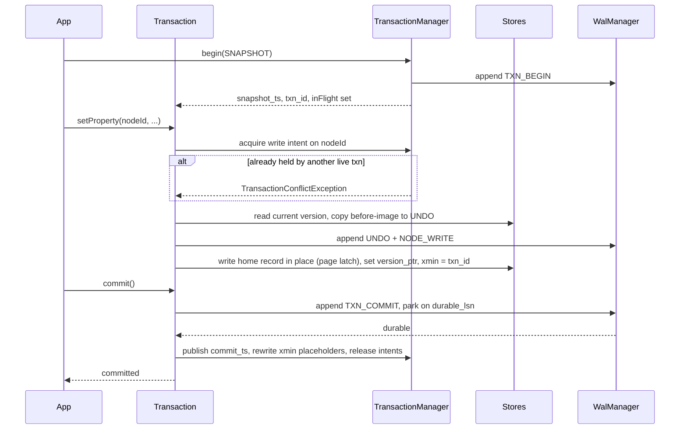

# Transactions, ACID and Copy-on-Write

Isolation, visibility, conflicts and version lifetime. The log mechanics are in [WAL.md](WAL.md);
this file is about what a transaction *means*.

---

## 1. Guarantees

> **Implementation status.** Atomicity, durability and rollback are implemented, and isolation is
> **single-writer serialisable**: one writer at a time, many concurrent readers, no reader sees half a commit. The
> MVCC machinery described in this file — version chains, undo segments, `xmin` visibility, snapshot isolation,
> concurrent writers, vacuum — is **not implemented**. The `xmin` and `version_ptr` fields exist in the record
> layouts and are written as zero. See [reports/PHASE_STATUS.md](reports/PHASE_STATUS.md) section 2.

| Property | Mechanism | Notes |
|----------|-----------|-------|
| **Atomicity** | WAL undo + CLRs | A transaction is all-or-nothing across all seven record kinds, the dictionaries and the indexes |
| **Consistency** | Invariant checkers plus cascade rules | The engine enforces structural invariants (bidirectional edges, degree counters, no orphan property blocks); application-level constraints are out of scope |
| **Isolation** | MVCC snapshot isolation, optionally serializable | See §3 |
| **Durability** | WAL group commit with `fdatasync` | See [WAL.md §4](WAL.md#4-group-commit) |

Default isolation is **snapshot isolation**. Read-committed and serializable are selectable per
transaction.

---

## 2. Timestamps

One global 64-bit counter, and it is the **LSN**.

| Concept | Value |
|---------|-------|
| `snapshot_ts` | The `durable_lsn` (or current append LSN, for read-your-writes within the process) at transaction begin |
| `commit_ts` | The LSN of the transaction's `TXN_COMMIT` record |
| `xmin` on a record | The `commit_ts` of the transaction that created that version |
| `oldest_valid_ts` | The minimum `snapshot_ts` over all active transactions; anything older may be vacuumed |

Using the LSN as the timestamp means commit order and log order are the same order by construction.
There is no second counter to keep in step, and recovery does not have to reconstruct one.

---

## 3. Isolation Levels

| Level | Reads see | Write conflicts | Anomalies possible |
|-------|-----------|-----------------|--------------------|
| `READ_COMMITTED` | Latest committed version as of each statement | First-updater-wins | Non-repeatable read, phantom |
| `SNAPSHOT` (default) | Everything committed at or before `snapshot_ts` | First-updater-wins, abort the later | Write skew, phantom |
| `SERIALIZABLE` | As snapshot, plus SSI conflict tracking | Also aborts on dangerous read-write dependency structures | None |

`SERIALIZABLE` is implemented with Serializable Snapshot Isolation: track read/write dependencies
between concurrent transactions and abort a transaction that sits at the pivot of a dangerous
structure. It is a Phase 5 stretch item; the visibility machinery it needs is built in Phase 5's
core, so it does not require a format change.

### 3.1 Visibility rule

For a record version with `xmin` and a `version_ptr` chain:

```java
boolean visible(long xmin, long snapshotTs, Set<Long> inFlight) {
    return xmin <= snapshotTs && !inFlight.contains(xmin);
}
```

If the home record is not visible, follow `version_ptr` into the undo chain until a visible version
is found. If the chain ends, the element did not exist at that snapshot.

`inFlight` is the set of transactions that had begun but not committed at snapshot time — needed
because a commit LSN can be lower than a later-started transaction's snapshot while the commit was
still in flight. It is a small array copied at begin, not a shared structure consulted under a lock.

**Cost**: for the overwhelmingly common case of reading current data, visibility is **one 64-bit
compare** against a field that is in the same cache line as the record you already read. No chain
walk, no side table.

---

## 4. Transaction Lifecycle



**The `xmin` placeholder problem.** A record's `xmin` must be the commit timestamp, but that is not
known until commit. Two standard options:

- Write `txn_id` into `xmin` with a high bit set meaning "uncommitted", and have readers consult a
  small commit table to resolve it. Cheap write, slightly costlier read.
- Rewrite every touched record at commit. Cheap read, costlier commit, and it re-dirties pages.

**Chosen: the first.** `xmin` holds `txn_id | UNCOMMITTED_BIT` until commit; a hash map of recently
committed transactions (`txn_id -> commit_ts`) resolves it, and a background pass lazily rewrites
`xmin` to the real commit timestamp so the map stays small. Reads of long-settled data never touch
the map. This is the standard approach and it keeps commit at one log append.

### 4.1 Rollback

Walk the transaction's `prev_lsn` chain, apply undo, emit CLRs, release write intents. Identical to
recovery's undo pass, and it uses the same code — which is the only way to be confident that the
recovery path is exercised.

---

## 5. Undo Segments and Version Chains

Undo records live in `UNDO` segments, 64 bytes each:

```
offset size field
0      8    txn_id
8      8    begin_ts           xmin of the version this record supersedes
16     8    end_ts             commit_ts of the superseding txn; the version is valid in [begin, end)
24     8    prev_version       UNDO id of the next-older version, or NULL_ID
32     8    target_id          the element this version belongs to
40     2    kind
42     2    payload_len
44     4    flags              INLINE, BLOB, DELETE_MARK
48     16   payload            before-image, inline, or a BLOB id + length
```

For a 64-byte node record the before-image does not fit inline, so `payload` holds a `BLOB` id. For
a property-only change the payload records just the changed entries, which is why `payload_len`
exists.

The chain is doubly useful:

1. **Rollback and recovery undo** read it backwards from the newest.
2. **Snapshot reads** read it backwards until `begin_ts <= snapshot_ts`.

One structure, two consumers. Contrast with engines that keep undo and MVCC versions separate.

### 5.1 Vacuum

A background worker reclaims:

- Undo records whose `end_ts < oldest_valid_ts` — no live snapshot can need them.
- Dead home records (deleted and invisible to every snapshot): free the slot, the property block, the
  adjacency blocks, and any uniquely-owned blobs.
- Mirror adjacency entries left behind by a lazily deleted node
  ([RELATIONSHIP_STORAGE.md §6.2](RELATIONSHIP_STORAGE.md#62-delete-an-edge)).

Vacuum is incremental, WAL-logged and interruptible. A reader whose snapshot has been vacuumed past
gets `SnapshotTooOldException` rather than wrong data — the check is `snapshot_ts >=
oldest_valid_ts`, evaluated once at read time.

---

## 6. Conflict Detection

**Write intents, detected eagerly.** A striped table maps `ElementId -> txn_id` for elements
currently being written. Acquiring an intent that is already held by a live transaction throws
`TransactionConflictException` immediately, rather than at commit.

Eager detection is chosen deliberately: it fails fast, it keeps the abort cheap (less work has been
done), and it makes the failure attributable to a specific statement, which is enormously easier to
debug than a commit-time abort.

The table is memory-only and its loss is harmless — after a crash there are no live transactions.

**Granularity** is per element, not per page. Two transactions writing different nodes in the same
page never conflict logically; they serialise only on the page latch, for the duration of a memcpy.

**Deadlock** is impossible, because intents are never waited on: a conflict is an immediate abort,
not a block. This is a deliberate simplification. If waiting is added later (for `SERIALIZABLE` with
locking rather than SSI), it needs a wait-for graph and a detector.

---

## 7. Where Copy-on-Write Actually Applies

The requirement list asks for CoW. CoW in its usual sense — never overwrite; write the new version
elsewhere and flip a pointer — is **incompatible** with "an id decodes to a fixed offset", because
its whole mechanism is relocation. That tension has to be resolved explicitly rather than papered
over.

**Resolution: keep the home location canonical; use CoW everywhere it costs no lookup.**

| Where | CoW used? | How |
|-------|-----------|-----|
| Element home records | **No** | In-place, made atomic and crash-safe by the WAL. This is what preserves the addressing invariant. |
| Segment superblocks | **Yes** | A/B double buffer, atomic flip by `sb_sequence` + CRC. Immune to torn writes with no log record. |
| Store manifest | **Yes** | Same A/B mechanism; the metadata commit point. |
| Dirty pages in the cache | **Yes** | A dirty page is a shadow copy until write-back; the copy is never the addressed location. |
| Old row versions | **Yes** | Copied to `UNDO` before overwrite. This *is* CoW — the copy is of the old version, and it is what serves snapshot reads. |
| Property blocks that change size | **Yes** | New block allocated, old retained until no snapshot needs it. |
| Adjacency block sealing | **Yes** | The sorted/compressed block is written to a new block; the old one is freed after the flip. |
| Index pages (Phase 7) | **Yes** | A CoW B+tree: page splits write new pages and update the parent, which the `INDEX` kind's id indirection makes free (index ids are internal and are never held by applications). |
| Snapshots and backups | **Yes** | `FICLONE` reflink clones a segment file in O(1) on btrfs/XFS; a whole-store snapshot is a reflink of `seg/` plus a WAL position. |

So: the durability properties CoW is usually reached for (torn-write immunity, atomic metadata
commit, consistent snapshots, readers never blocked by writers) are all present. The one place it is
*not* used is the one place where it would cost an indirection on every read forever.

### 7.1 If a pure CoW store is ever required

There is a coherent variant: make the id name a **logical** slot and keep a per-segment page table.
It buys relocation-without-reference-rewriting (so no compaction id churn) and costs one extra
lookup per read. It is the classic trade.

Should that ever be needed, it can be added as a **second `kind` family** rather than a rewrite —
the kind field already selects the addressing policy. Do not do this speculatively.

---

## 8. Conventions and Gotchas

- **`xmin` with the high bit set means uncommitted.** Never compare `xmin` to a snapshot without
  masking and resolving.
- **A transaction sees its own writes.** Visibility short-circuits on `xmin == myTxnId`.
- **Never hold a page latch across a WAL append.** Append first, then latch, copy, unlatch.
- **Undo before overwrite, always.** The order is: append undo record, write the home record. A
  reversed order loses the old version on a crash between the two.
- **Read-only transactions still need a snapshot** and still register in the active set, because that
  is what holds back `oldest_valid_ts`. A forgotten read-only transaction blocks vacuum indefinitely
  — the store logs a warning past a configurable age.
- **Conflicts abort the *later* writer, not the earlier one.** No transaction is ever silently rolled
  back after doing work it thinks succeeded.
- **`SnapshotTooOldException` is a normal outcome**, not a bug. Long analytical traversals must either
  retry or run with a pinned snapshot (which holds back vacuum, and is a deliberate choice).

---

## 9. Test Setup

- `VisibilityTest`: a matrix over (writer state, reader snapshot) covering insert, update, delete,
  and their combinations; assert exactly the expected version is returned.
- `SnapshotIsolationTest`: the classic anomaly suite — dirty read, non-repeatable read, phantom,
  lost update, write skew — asserting which are prevented at each level.
- `ConflictTest`: two transactions writing the same node; assert the second gets
  `TransactionConflictException` at the write, not at commit, and that the first commits cleanly.
- `RollbackTest`: perform every mutation type, roll back, assert the store is byte-identical to
  before (compare segment checksums), including the FSB.
- `RollbackEqualsRecoveryTest`: perform a transaction, roll it back; separately perform the same
  transaction and crash; assert both end states are identical. This is the test that proves the undo
  path is shared.
- `VacuumTest`: assert undo is reclaimed exactly when the last snapshot needing it ends, and never
  earlier; assert a pinned snapshot holds it.
- `SnapshotTooOldTest`: pin a snapshot, force vacuum past it, assert the exception rather than wrong
  data.
- `LongRunningReaderTest`: a reader open for the duration of 10^6 writes; assert it sees a stable
  view and that memory and undo growth are bounded and reported.
- Concurrency stress under `jcstress` or a custom harness for the visibility and latch protocols.

---

## 10. Progress Assessment

- [x] `Transaction` with begin/commit/rollback, read-your-writes, and auto-commit for single operations
- [x] Single-writer lock plus a reader-excluding latch held only for the commit apply step
- [x] Rollback by discarding the page overlay, with allocator state restored from the bitmap
- [ ] `TransactionManager`: timestamps, active set, in-flight snapshot capture
- [ ] `xmin` placeholder scheme plus the recent-commit map and the lazy rewrite pass
- [ ] Visibility check and version-chain walk
- [ ] `UndoStore` and undo record layout
- [ ] Undo-before-overwrite ordering in every store
- [ ] Write-intent table with striping and eager conflict detection
- [ ] `READ_COMMITTED` and `SNAPSHOT` levels
- [ ] Vacuum worker with cascade reclamation
- [ ] `SnapshotTooOldException` and the retention horizon
- [ ] `SERIALIZABLE` via SSI (stretch)
- [ ] Tests per §9

---

## 11. Key Classes Reference (target)

| Class | Package | Purpose |
|-------|---------|---------|
| `TransactionManager` | `io.metaloom.graph.core.txn` | Timestamps, active snapshots, commit publication |
| `Transaction` | `io.metaloom.graph.core.api` | Per-transaction state and the mutation API |
| `Snapshot` | `io.metaloom.graph.core.txn` | `snapshot_ts` plus the in-flight set; the visibility predicate |
| `LockTable` | `io.metaloom.graph.core.txn` | Striped write-intent table |
| `UndoStore` | `io.metaloom.graph.core.store.undo` | Before-images and version chains |
| `Vacuum` | `io.metaloom.graph.core.txn` | Reclamation of undo and dead versions |

---

_Git HEAD revision: `c016a41`_
_Last updated: 2026-08-13 (synced with the Phase 0 to 3 implementation)_
