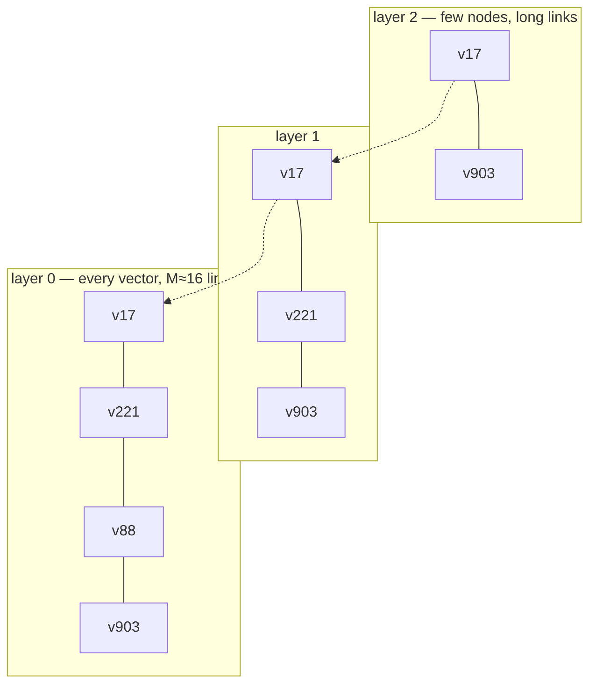

# VECTOR.md — vector data in the graph

An exploration, not a commitment. Vectors are already **storable** in this engine and are not
**searchable**: a `float[]` property round-trips through `ValueCodec`, and nothing can answer "which
nodes have an embedding close to this one". This file works out what tying that in would mean — what
the index would be keyed on, where it would live, and which of four possible shapes is worth building
first.

> **Do not put here**: how a property value is encoded ([PROPERTY_STORAGE.md](PROPERTY_STORAGE.md)),
> how the two existing B+trees work ([INDEX.md](INDEX.md)), the task list this came out of
> ([INDEX_TASKS.md](INDEX_TASKS.md)).

---

## 0. Status

| | |
|---|---|
| **Storable** | Yes — `ValueCodec.T_VECTOR_F32`, `Properties.getVector`, `float[]` of any length |
| **Where** | Always the blob store: 13 bytes inline (tag, `int` dimension, `long` blob id) plus a blob extent |
| **Indexed** | Only for exact equality, in the ordinary property tree. No ANN index — [INDEX.md §11](INDEX.md) |
| **Equality lookup** | Works — the value is hashed by content, see §1.3 and [INDEX_TASKS.md IDX-1](INDEX_TASKS.md#idx-1--a-float-property-is-indexed-under-a-non-deterministic-key) |
| **Cypher surface** | A vector comes back as a list of doubles; there is no distance function and no `CALL` |
| **Decision** | Nothing is decided. §7 recommends a staged answer, of which stage 0 is not an index |

---

## 1. What exists today

### 1.1 Storage

`ValueCodec` treats a vector as a blob escape, unconditionally — unlike a string or a byte array,
which stay inline below `MAX_INLINE_BYTES` (255):

```java
case float[] vector -> {
    if (blobs == null) { throw new IllegalStateException("Vectors require a blob store"); }
    // ... little-endian raw bytes ...
    w.u8(tag(T_VECTOR_F32, 0));
    w.i32(vector.length);
    w.i64(blobs.store(raw));
}
```

So a node's property block holds 13 bytes for the vector, and the payload is one `BLOB` extent chain.
At the default 8 KiB page an extent carries 8,160 payload bytes, which means:

| Dimensions | Raw bytes | Extents | Reads to fetch the vector |
|---|---|---|---|
| 384 | 1,536 | 1 | property block + 1 |
| 768 | 3,072 | 1 | property block + 1 |
| 1,536 | 6,144 | 1 | property block + 1 |
| 3,072 | 12,288 | 2 | property block + 2 |

**One caveat that matters for any scan design**: `BlobStore.store` LZ4-compresses when that is
"worthwhile". Normalised f32 embeddings are close to incompressible, so in practice the flag will read
`COMPRESSION_NONE` and the bytes on the page *are* the vector — but a scan that assumes it can address
a blob extent as a raw `float` array must check the header rather than assume it.

### 1.2 The Cypher and wire surface

`GraphAccess` and `CypherWireValues` both convert `float[]` to a list of doubles, because Cypher has
no vector type. That is a correct choice for display and a bad one for transport: a 768-dim embedding
becomes 768 boxed doubles and roughly double the bytes on the wire. Returning embeddings to a client
in bulk would want a value type in the wire codec ([WIRE.md](WIRE.md)); returning *ids and scores*,
which is what an ANN query actually does, would not.

There are no distance functions in `Functions.java`, and `CALL` is explicitly rejected by the parser —
"CALL is not supported: this build has no procedure mechanism". Both matter for §6.

### 1.3 The defect underneath all of it, and the decision it forced

`IndexCatalog.valueHash` used to fall through to `value.hashCode()` for `float[]`, which is the
identity hash, so every vector property was indexed under a key nothing could reproduce: the lookup
missed the node, the delete missed the entry, and a unique constraint on the key never fired. Full
write-up in
[INDEX_TASKS.md IDX-1](INDEX_TASKS.md#idx-1--a-float-property-is-indexed-under-a-non-deterministic-key).

It is recorded here because fixing it forced the question this file has to answer anyway — **should a
vector be in the property tree at all?** — and the answer taken was **yes, hashed by content**. A
`float[]` hashes by `Arrays.hashCode`, a list by its elements' hashes, and the candidate verification
walks lists element-wise so it agrees. The alternative was to skip vectors at the maintenance hooks and
document them as unindexed; it was rejected because a value type the tree silently ignores is a second
kind of silent miss, and because equality maintenance is what keeps `verify(FULL)` honest about a store
holding embeddings.

**That is exact equality and nothing more**, which §2 explains is nearly meaningless as a *search*: it
finds the node written from a byte-identical array. It is worth having anyway — it makes maintenance
sound and it costs one hash of the array on write — and it is not a step towards ANN. Everything from
§2 on stands unchanged.

---

## 2. Why the existing indexes cannot answer the vector question

The property tree is keyed on `(keyId << 32) | valueHash(value)` and is scanned by prefix. That
answers "which nodes have exactly this value". For an embedding that question is nearly meaningless:
two embeddings of the same face from the same model differ in the low bits of every component, so an
exact-match probe returns the one node that was written from the identical array and nothing else.

A range index would not help either, and it is worth being explicit about why, because "add an
order-preserving key" is the natural next thought. Nearest-neighbour search in 768 dimensions is not a
range query in any coordinate: the nearest vector by cosine distance can be larger than the query in
every single component. There is no ordering of the key space that makes a B+tree scan return
neighbours. **An ANN index is a genuinely different structure, not a differently-keyed tree.**

So the honest answer to "would it just be vector properties plus another index" is: **yes to the
first half and no to the second.** The declaration and maintenance machinery is shared with the other
indexes; the structure underneath is not.

---

## 3. What the index would be declared on

This is the part of the question with a clean answer.

### 3.1 Node vectors: `(label, property key)`

An ANN index cannot be implicit the way the label and property trees are. Three reasons, each of which
alone is decisive:

- **Dimension has to be fixed.** `float[]` carries its length per value; an index over vectors of
  mixed length is not an index. Declaring it is where the dimension gets pinned and where a
  mismatched write gets refused.
- **The metric has to be chosen.** Cosine, dot product and L2 give different neighbours, and the
  choice belongs to the model that produced the vectors, not to the store.
- **Building it is expensive.** Indexing every `float[]` property that happens to be written would
  make an unrelated bulk load pay for an ANN build nobody asked for.

So the declaration is `createVectorIndex(label, key, dimensions, metric, params)` — which is the same
declaration machinery as
[INDEX_TASKS.md IDX-7](INDEX_TASKS.md#idx-7--composite-label-property-indexes), a catalog list of
declared `(labelId, keyId)` pairs plus a backfill scan, exactly as `addUniqueConstraint` scans before
it declares. Build IDX-7 first and this reuses it.

**Put the producing model in the declaration too.** Two models produce vectors of the same length in
the same datatype and mean completely different things by them, and a distance between two of them is
a plausible-looking number with no meaning at all. Nothing stops two models writing
`:Person.embedding` at different times — an upgrade is exactly when it happens — and an index that
silently mixes them returns confident nonsense. So the identity of an index is
`(label, key, dimensions, metric, model)`, not just the pair it is declared on, and declaring the new
model's index beside the old one is what makes a model upgrade a re-index rather than a migration:
both are queryable, and the old one is dropped once its replacement has been shown to be better.

Either record the model and refuse a write that does not name it, or document that the application
owns that discipline. The first is cheap, and this engine's whole culture is to make the silent
failure impossible rather than to warn about it.

### 3.2 Relationship vectors: `(relationship type, property key)`

Structurally the same, with one hard limit inherited from the storage design: **a lightweight edge has
no property block and no id**, so it cannot carry a vector at all
([RELATIONSHIP_STORAGE.md §4](RELATIONSHIP_STORAGE.md)). Only a materialised relationship can, which
means a relationship vector index is an index over `REL` records — the same restriction that makes
[INDEX.md §6](INDEX.md) say there is no unique constraint on a relationship property.

That is not a reason to rule it out, but it is a reason to sequence it second: the node index is the
one with a use case (embeddings hang off entities), and the relationship version is a small addition
once anything at all indexes materialised relationships
([INDEX_TASKS.md IDX-6](INDEX_TASKS.md#idx-6--a-relationship-type-index)).

---

## 4. Four ways to build it

### 4.1 Option A — brute force over a label scan

No index. `nodesByLabel(label)` gives the candidate set; for each, read the property block, read the
blob, compute the distance, keep a top-k heap.

This is not a straw man. It is exact rather than approximate, it needs no new structure, no
maintenance hook and no compaction story, and for a hundred thousand vectors it is a few hundred
milliseconds — which is fine for the "find similar assets" query nobody issues at a thousand per
second.

Its cost is entirely reads, and they are scattered: one property block plus one blob extent per
candidate, in whatever order the blob allocator handed extents out. For a million 768-dim vectors that
is roughly 3 GB fetched through two levels of indirection per vector.

**Which suggests the one structural improvement worth making before any ANN work**: give an index its
own contiguous vector storage.

### 4.2 The fixed-stride vector segment, and the constraint nobody expects

A declared index knows its dimension, so its vectors are **fixed-size records** — precisely the shape
this engine is built around. A new `Kind` (codes 8..15 are free) whose stride is the vector size gives
a scan that is sequential, and gives the addressing invariant back: a vector id decodes arithmetically
to a byte offset, so an ANN structure holding candidate ids fetches their vectors with **zero probes**
([ID_ENCODING.md](ID_ENCODING.md)).

But [GRAPH_STORAGE_CONTEXT.md §5.1](GRAPH_STORAGE_CONTEXT.md) requires that every record stride divide
`PAGE_SIZE`, and `PAGE_SIZE` is 4, 8 or 16 KiB — all powers of two. **So a vector record stride must
be a power of two.** Every existing stride obeys this (64, 32, 512) and it has never bitten anyone,
because no record size has been application-chosen before. Vectors are:

| Vectors | Raw bytes | Legal stride | Waste |
|---|---|---|---|
| 512 × f32 | 2,048 | 2,048 | none |
| 1,024 × f32 | 4,096 | 4,096 | none |
| **768 × f32** | 3,072 | 4,096 | **25%** |
| 768 × f16 | 1,536 | 2,048 | 25% |
| 768 × int8 | 768 | 1,024 | 25% |
| 384 × f32 | 1,536 | 2,048 | 25% |

768 is the most common embedding width in circulation and it is the one that does not fit. Three
honest responses: pad and accept 25 percent, quantise (int8 at 1,024 bytes is a quarter of padded f32
and is what production ANN does anyway, at a small recall cost), or pack several vectors per page with
an explicit intra-page offset — which breaks the address function and should not be done.

**Recommendation: pad, and store the true dimension in the index declaration.** Quantisation is a
second-order optimisation that can be added as a second element type once anything works at all, and
it changes the metric's behaviour, which is not a decision to bundle into a layout choice.

### 4.3 Option B — IVF: centroids as nodes, membership as edges

Cluster the vectors into `√n`-ish centroids; each vector belongs to one; a query finds the `p` nearest
centroids and scans only their posting lists.

The reason this fits *this* engine unusually well: a posting list is a **contiguous run of vectors**,
and everything in [SSD_IO.md](SSD_IO.md) and the adjacency design is built around preferring one
sequential read to many random ones. Reading 1/100th of the vectors as a few sequential runs is close
to the best case the storage layer has.

It is also the cheapest to build correctly. Clustering happens outside the write lock; the writes are
bulk appends; there is no concurrent-structure problem; and a badly-clustered index degrades to
Option A rather than to wrong answers.

Its weakness is the standard one: recall falls at cluster boundaries, and a vector near the edge of
its cluster is missed unless `p` is raised. That is tunable per query, which is the right place for it.

### 4.4 Option C — HNSW built out of the store's own primitives

The observation that makes this tempting: **HNSW is a graph**, and this is a graph store whose fastest
operation is "enumerate the neighbours of this node".



Every HNSW link is a **lightweight edge** — no properties, 8 bytes per direction, no `REL` record. At
`M = 16` a node's layer-0 neighbour list is 32 directed entries, which fits in a **single 512 byte
adjacency cell** with room to spare ([RELATIONSHIP_STORAGE.md §5](RELATIONSHIP_STORAGE.md): one cell
holds 400 directed entries). The layer is the relationship type. Traversing the graph during a search
is the engine's core path, delta-compressed and already measured.

And it inherits, free, three things most ANN libraries do not have: **crash safety** (the WAL),
**snapshot isolation** (a search runs at a fixed LSN while writers commit underneath), and
**transactional maintenance** (an index update rolls back with the data update it belongs to, exactly
as the B+tree hooks do).

Three costs, none of them small:

1. **Build is write-bound and writers do not scale.** This engine serialises writers on one lock by
   design ([TRANSACTIONS.md](TRANSACTIONS.md)). An HNSW insert performs a search — hundreds of
   distance computations, each needing a vector read — *inside* the write path. Building over ten
   million vectors single-threaded is the kind of number that turns into hours, and
   [reports/SCALE.md](reports/SCALE.md) is the cautionary precedent for finding that out after
   building it.
2. **Deletion is HNSW's known weak spot.** Removing a node from the layer graph without breaking
   connectivity means tombstoning and periodic rebuild — which this engine actually has a home for,
   since compaction already rebuilds both B+trees wholesale via `resetTrees` rather than relocating
   pages.
3. **The vectors themselves still need §4.2**, so this is additive to that work, not an alternative.

### 4.5 Option D — do not build it here

Approximate nearest-neighbour search is a solved, commodity problem with mature implementations —
HNSW libraries, Lucene, and a shelf of purpose-built vector stores — all of which have had far more
tuning than anything written here would get, and none of which is difficult to keep beside a graph
store as a **derived, rebuildable cache**: the vectors live in the graph, the ANN index is populated
from them, and it can be dropped and rebuilt at any time because it was never the system of record.

That is the option to beat, and it sets the bar high. An index built here does not have to be *as
fast* as a specialist library — it has to be worth the second implementation, in a codebase whose one
measured comparison against an incumbent store concluded that a 2.4x win was not worth adopting a
second system.

**The case for building it anyway is not performance — it is the combined query.** "The twenty nearest
embeddings *that are reachable in two hops from this node and carry the tag X*" is something the
split architecture cannot do well: the external index knows nothing about the graph predicate, so it
must over-fetch and let the caller filter, and it has no way to know how far to over-fetch. A vector
index living inside the graph can apply the predicate *during* the search, because the graph traversal
and the vector search are the same walk over the same store. If that query is not on the roadmap,
Option D is the correct answer and the rest of this file is interesting rather than useful.

### 4.6 Comparison

| | A — brute force | B — IVF | C — HNSW | D — external |
|---|---|---|---|---|
| New `Kind` needed | no | yes (§4.2) | yes (§4.2) | no |
| Recall | exact | tunable, good | best | best |
| Build cost | none | one clustering pass | high, single-threaded | outside |
| Query cost at 10^6 | full scan | ~1% of vectors, sequential | ~0.1%, random | outside |
| Fits the write model | yes | yes | **poorly** | n/a |
| Graph-predicate pushdown | yes | yes | yes | **no** |
| Effort | S | M | L | none |

---

## 5. How it plugs into the engine

Whichever structure is chosen, the wiring is the same and is already specified by the existing
indexes:

- **Kind.** A `VEC` kind for the vectors (§4.2). Codes 8..15 are unused. An IVF posting list or an
  HNSW layer graph needs no new kind at all — they are `ADJ` and `INDEX` pages, or actual nodes and
  lightweight edges.
- **Declaration.** A list of declared indexes in the catalog page, alongside the unique-constraint list
  at offset 64. **Not** between offsets 24 and 32 — [INDEX.md §2.1](INDEX.md) records what that cost
  last time.
- **Maintenance.** The same four hooks on `IndexCatalog` — `onNodeCreated`, `onNodeDeleted`,
  `onPropertiesChanged`, `onLabelsChanged`. All four are already called from inside the caller's
  transaction, so an index write commits or rolls back with its data write. `onLabelsChanged` is the
  interesting one: adding `:Person` to a node that already carries an embedding must index it.
- **Snapshot isolation.** Free, and for the same reason as the B+trees: index pages are read through
  `SegmentFile.readSlice`, so a view sees them as of its own LSN ([TRANSACTIONS.md §5](TRANSACTIONS.md)).
- **Compaction.** Node ids move, so anything storing them must be rebuilt. `resetTrees()` is the
  precedent and the right pattern — an ANN structure is rebuilt, not patched up, and rebuilding is
  what an HNSW wants periodically anyway.
- **Blob interaction.** If a `VEC` kind holds the vectors, the property block should hold a `VEC` id
  rather than a blob id for indexed vectors — otherwise every vector is stored twice. That is a
  property-block format decision and belongs in [PROPERTY_STORAGE.md](PROPERTY_STORAGE.md) before any
  of this is built.

---

## 6. The query surface

There is no procedure mechanism: `CypherParser` rejects `CALL` with "this build has no procedure
mechanism", so the neat form —

```cypher
CALL vector.query('Person', 'embedding', $q, 10) YIELD node, score
```

— needs a parser feature before it needs an index. Three options, in increasing order of how much they
ask of the planner:

1. **A function plus `ORDER BY … LIMIT`.** `ORDER BY vector.cosine(n.embedding, $q) LIMIT 10` is the
   most natural Cypher and the worst fit: the planner is "a fixed order rather than a cost model"
   ([INDEX.md §7](INDEX.md)), so it cannot recognise this as a top-k and would evaluate the distance
   over every candidate — which is Option A with extra steps. It is, however, exactly the right
   *semantics*, and a good stage 0: correct answers immediately, with the index as a later optimisation
   of a query that already works.
2. **A dedicated clause or a minimal `CALL`.** Explicit, unambiguous, and honest about the fact that
   the access path is chosen by the user rather than by a planner that cannot choose.
3. **Java API only.** `store.nearest(label, key, query, k)`, with the Cypher surface deferred. Fastest
   to build and enough to evaluate whether any of this is worth having.

Whichever is chosen, add the distance functions to `Functions.java` regardless — `vector.cosine`,
`vector.dot`, `vector.l2`. They are useful on their own for re-ranking a small candidate set, they are
what a brute-force query needs, and they are the ground truth any ANN index must be tested against.

---

## 7. Recommendation

Staged, with a decision point after each stage rather than a plan that commits to the end:

| Stage | What | Why it is first |
|---|---|---|
| **0** | ~~Fix [IDX-1](INDEX_TASKS.md#idx-1--a-float-property-is-indexed-under-a-non-deterministic-key)~~ **done**; still open: add `vector.cosine` / `dot` / `l2`; brute-force nearest-k over a label scan | No format change, no new structure, and it makes vector queries *possible* — which is the difference that matters. It is also the ground truth for everything after it |
| **1** | Decide whether a use case exists that Option D cannot serve — specifically a graph predicate applied during the search | This is the actual decision, and it is not a technical one. Writing a second ANN implementation needs a reason a commodity library cannot supply |
| **2** | The `VEC` kind and contiguous fixed-stride storage (§4.2), with the true dimension in the declaration | Turns the brute-force scan from scattered blob reads into a sequential one, and is a prerequisite for both B and C |
| **3** | IVF (§4.3) | Cheapest real index, fits the write model and the I/O model, degrades to stage 2 rather than to wrong answers |
| **4** | HNSW (§4.4), only if IVF's recall is measurably insufficient | The build-time cost against a single-writer engine is the risk, and it should be measured on a real corpus before it is built |

**Do not start at stage 3 or 4.** Every measured surprise this project has had —
[reports/SCALE.md](reports/SCALE.md)'s 59-of-61 GiB, the codec that turned out 7.8x slower than the
JDK — came from building the sophisticated thing before measuring the simple one.

---

## 8. What it would have to be tested against

The repository's existing culture applies directly, and one test class matters more than the rest:

- **A brute-force reference model.** `ReferenceModelTest`'s argument — "an index that agrees with
  itself proves nothing" — is even stronger for an approximate index. Exact top-k computed in memory,
  compared against the index, reported as **recall@k** rather than as pass/fail, with a floor the
  build fails below. Its workload already writes a vector property, so the exact-equality half of this
  is in place and an ANN index would be extending a harness rather than starting one.
- **Dimension and metric mismatch are refused**, not silently accepted: a 512-dim write into a 768-dim
  index, and a query vector of the wrong length.
- **Maintenance completeness**: create, update the vector, relabel, delete — each followed by a query
  that must not return the stale answer. This is where the four hooks earn their place, and where
  [IDX-1](INDEX_TASKS.md#idx-1--a-float-property-is-indexed-under-a-non-deterministic-key)'s dangling
  entry came from.
- **`verify(FULL)`** over a store with a declared vector index, since `NoDanglingRefs` is what catches
  an index entry pointing at a freed slot.
- **Compaction**: ids move, the index still answers — the case `resetTrees` exists for.
- **Crash**: an index update and its data update land together or not at all, in the existing fault
  matrix.

---

## 9. Open questions

1. **Does the combined graph-plus-vector query exist as a requirement?** Everything in §7 stage 1
   turns on it. Without it, an off-the-shelf ANN index beside the store covers the need (§4.5).
2. **Is 768 dimensions the target?** It is the width that does not fit a power-of-two stride, and
   knowing the answer changes §4.2's recommendation between "pad" and "no waste at all".
3. **Where does the vector live once indexed** — blob, `VEC` segment, or both? Both is a doubling and
   should be a deliberate choice, not a default.
4. **Does an ANN build have to happen under the write lock?** An offline build that produces a
   structure installed by one short transaction would sidestep §4.4's worst cost entirely, and is
   probably the only way HNSW is affordable here.

---

_Git HEAD revision: `3a05a2a`_
_Last updated: 2026-08-16_
