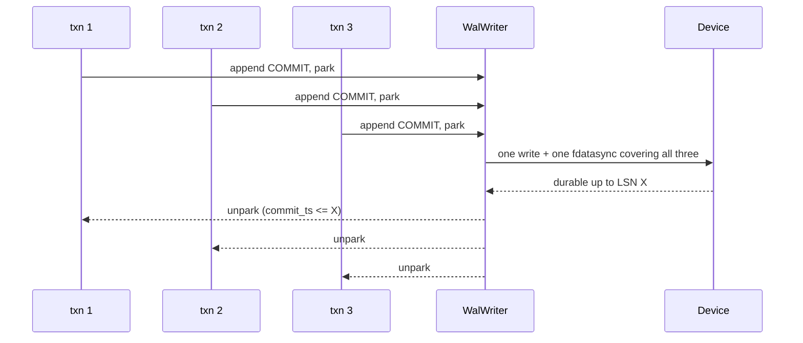
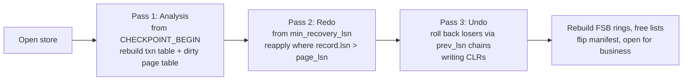

# Write-Ahead Log, Recovery and Checkpoints

The WAL is what makes the store **interruption safe**: a power loss, a `kill -9` or a full disk
leaves a store that recovers to exactly the last committed transaction.

Isolation and MVCC are in [TRANSACTIONS.md](TRANSACTIONS.md). This file covers the log itself.

---

## 1. Model

**Implemented model: redo-only, no-steal, force-at-commit.** A writer mutates private page copies; at commit the
redo records are fsynced *before* the copies are applied to the mapped files. Uncommitted data therefore cannot
reach a data file, so recovery is a single redo pass with no undo at all.

This departs from the ARIES design below, deliberately. With a `MAP_SHARED` mapping the kernel may write a dirty
page at any moment, so a steal policy would need an undo record to be durable before a page the engine does not
control could reach the device — a guarantee mmap cannot give. Making uncommitted data unreachable sidesteps it.
The cost is that a transaction is bounded by memory. Revisiting this requires the direct-I/O engine of Phase 6.

The ARIES design below remains the target for the day the engine stops writing through a mapping:

ARIES: **physiological logging**, **steal**, **no-force**, **fuzzy checkpoints**, three-pass
recovery.

| Property | Choice | Why |
|----------|--------|-----|
| Log content | Physiological — logical within a page, physical about which page | Smaller than full-page images; robust against reordering within a page |
| Buffer policy | Steal (dirty pages may be written before commit) | Bounded memory for large transactions |
| Commit policy | No-force (pages need not be written at commit) | Commit costs one sequential append, not scattered random writes |
| Undo | Logical undo via undo records in `UNDO` segments | Doubles as the MVCC version chain — one mechanism, two uses |
| Checkpoint | Fuzzy | No stalls; the store never stops to checkpoint |

**LSN = the byte offset of the record in the logical, gapless log stream.** One monotonically
increasing 64-bit counter, which also serves as the commit timestamp (see
[TRANSACTIONS.md §2](TRANSACTIONS.md#2-timestamps)). Having one counter instead of an LSN and a
separate CSN removes an entire class of ordering bug.

---

## 2. Record Format

WAL segment files are `wal/wal-%016x.log`, named by the LSN of their first byte, 64 MiB,
**preallocated** with `fallocate` so that appending never extends a file (an extend is a metadata
write and a latency spike).

Every record:

```
offset size field
0      8    lsn              byte offset of this record; self-identifying
8      8    prev_lsn         previous record of the same transaction, or 0
16     8    txn_id
24     4    length           total record length including this header
28     2    type             see §3
30     2    flags            bit0 COMPENSATION, bit1 LAST_OF_TXN
32     4    crc32c           over bytes 0..27 and 40..length
36     4    reserved
40     N    payload
       pad  to an 8-byte boundary
```

40-byte header. The CRC covers the header and the payload but not itself; a record is valid only if
its CRC matches **and** its `lsn` equals its own file offset. That second check is what makes a
partially-overwritten preallocated file unambiguous: stale bytes from a previous life of the file
carry the wrong LSN and are rejected without needing an explicit end-of-log marker.

Records are written into a shared, page-aligned ring buffer and flushed in 4 KiB blocks with
`O_DIRECT`. A partial trailing block is rewritten on the next flush (the same 4 KiB block is written
again with more data), which an SSD handles as a single-page overwrite.

---

## 3. Record Types

| Type | Payload | Applied to |
|------|---------|------------|
| `TXN_BEGIN` | snapshot ts, isolation level | — |
| `TXN_COMMIT` | commit ts | — |
| `TXN_ABORT` | — | — |
| `ALLOC_SLOT` | kind, segment, slot, new gen | FSB, superblock high-water |
| `FREE_SLOT` | kind, segment, slot, new gen | FSB, record LIVE flag |
| `NODE_WRITE` | id, 64-byte after-image, undo id | Node data page |
| `REL_WRITE` | id, 64-byte after-image, undo id | Rel data page |
| `PROP_WRITE` | block id, cell count, after-image bytes | Prop data page(s) |
| `ADJ_APPEND` | block id, entry offset, packed edge | Adjacency block |
| `ADJ_REWRITE` | block id, full 8 KiB after-image | Adjacency block (used on seal) |
| `BLOB_WRITE` | extent id, byte range, bytes | Blob extent |
| `DICT_INTERN` | dictionary, id, string | Dictionary B+tree and reverse array |
| `INDEX_OP` | index id, key, value, op | Index page |
| `CLR` | undone record's LSN, undo-next LSN | Whatever the compensated record touched |
| `CHECKPOINT_BEGIN` | active txn list, dirty page table | — |
| `CHECKPOINT_END` | `min_recovery_lsn` | Manifest |
| `SEGMENT_CREATE` | kind, segment number | Manifest |
| `COMPACT_STEP` | source, destination, page range, forwarding entries | Both segments, forwarding map |

`ADJ_REWRITE` is the one full-page record type. It exists because sealing a block rewrites it
entirely and a delta would be larger than the page. Everything else is small: a node insert is
roughly 110 bytes of log for 64 bytes of data.

### 3.1 Adding a record type

1. Add the enum constant with an explicit numeric value; never renumber.
2. Add an encoder and a `redo(...)` and, if the operation is undoable, an `undo(...)`.
3. Redo **must be idempotent**: recovery applies a record only if `record.lsn > page_lsn`, but the
   implementation must be safe if that check is ever wrong.
4. Add a round-trip test and a recovery test that crashes immediately after the record.

---

## 4. Group Commit



One thread performs the flush for the whole batch; the others park on a `durable_lsn` watermark. Any
transaction whose commit LSN is at or below `durable_lsn` is committed.

`wal.sync.mode`:

| Mode | Guarantee | Use |
|------|-----------|-----|
| `fsync_on_commit` | No committed transaction is ever lost | Default |
| `group_commit(ms)` | Commits may lose up to *ms* of work on power loss; never corrupt | Throughput-oriented |
| `async` | Durability off | Tests and bulk import only; the store refuses to open a production flag with it |

Even in `async` mode the **ordering** rules are preserved, so the store is always recoverable to
*some* consistent point — it never becomes corrupt, only stale.

---

## 5. Durability Sequencing

The one ordering rule, and the one place it is implemented:

> A data page may be written to its segment only after every WAL record with
> `lsn <= page_lsn` is durable.

Implemented in `PageCache.writeBack`:

```java
long need = pma.pageLsn(pageIndex);
wal.awaitDurable(need);        // usually already satisfied
io.write(segment, pageOffset, page);
pma.setChecksum(pageIndex, crc32c(page));
```

Additional sequencing:

- **Superblock and manifest flips** are durable-barriered on both sides: the new copy is written and
  synced before the old copy is considered superseded. Because the choice between A and B is by
  `sb_sequence` plus CRC, no separate barrier record is needed.
- **`MemorySegment.force()`** is the flush for a mapped page in the mmap engine. It is a
  `msync(MS_SYNC)` and must be issued per dirty range, not per file. With the direct or uring engine
  the write itself is the flush and only the WAL is fsynced.
- **Never rely on `FileChannel.force` to flush a `MAP_SHARED` mapping.** The PoC's commented-out
  `fc.force(false)` calls would not have provided durability even if they were enabled.

---

## 6. Recovery



**Pass 1, analysis.** Start at `checkpoint_lsn` from the manifest. Read forward to the end of the
log. Build the transaction table (which transactions were live and what their last LSN was) and the
dirty page table (which pages may not have reached disk, and the earliest LSN that must be replayed
for each). End of log is the first record that fails the CRC check or whose `lsn` does not match its
file offset.

**Pass 2, redo.** Start at the minimum `rec_lsn` over the dirty page table. Replay every record
whose page's `page_lsn` is lower than the record's LSN — including records from transactions that
later aborted, which is what makes redo idempotent and order-free. This restores the exact page
contents as of the crash.

**Pass 3, undo.** Transactions live at the crash are losers. Walk each loser's `prev_lsn` chain
backwards, applying undo, writing a **Compensation Log Record** for each undone action. CLRs carry
an `undo_next_lsn` so a crash *during* recovery does not redo work already undone — recovery is
itself restartable, any number of times.

**Post-pass.** Rebuild the in-memory free rings and segregated free lists from the FSBs, recompute
`live_count` consistency, then write a checkpoint and flip the manifest so the next open replays
nothing.

### 6.1 Detecting a torn or truncated log

- A record whose CRC fails: end of log.
- A record whose `lsn` field does not equal its own offset: end of log (stale preallocated bytes).
- A record whose `length` would run past the segment: end of log.
- A missing WAL segment file between `wal_min_lsn` and the end: **fatal**, the store refuses to open
  rather than silently recovering to a wrong point.

### 6.2 Page-level corruption

Redo verifies the PMA checksum before applying. A page whose checksum fails **and** which is fully
covered by redo records is reconstructed. A page whose checksum fails and which is not fully covered
raises `PageCorruptException` naming segment, page and slot range, and the store opens read-only for
salvage unless `repair=true`, in which case the affected slots are marked dead and reported.

---

## 7. Checkpoints

Fuzzy checkpoints; nothing stalls.

1. Write `CHECKPOINT_BEGIN` carrying the active transaction table and the dirty page table.
2. Ask the page cache to write back all pages dirty at that moment, in **segment and page order** so
   the writes are sequential rather than scattered.
3. Write `CHECKPOINT_END` carrying `min_recovery_lsn` (the minimum `rec_lsn` remaining).
4. Flip the manifest with the new `checkpoint_lsn` and `wal_min_lsn`.
5. Delete WAL segments entirely below `wal_min_lsn`.

Triggered by `checkpoint.interval.sec` or `checkpoint.wal.bytes`, whichever comes first, and by a
clean `close()`.

**WAL retention.** `wal_min_lsn` is the minimum of: the checkpoint's `min_recovery_lsn`, the oldest
active transaction's begin LSN, and (if configured) a replication or backup retention floor. A log
segment is deleted only when it is entirely below that.

---

## 8. Conventions and Gotchas

- **The log is the only ordering authority.** If you find yourself reasoning "the page write happens
  before the other page write so it is fine", stop and add a log record.
- **Redo must be idempotent, undo must be logical.** A physical undo that assumes the page still
  looks the way it did will break under steal.
- **Never log a Java object.** Payloads are byte-exact after-images or explicit field lists; a
  serialisation format in the log is a compatibility trap.
- **`prev_lsn` chains are per transaction, not per page.** Getting this wrong makes undo silently
  skip records.
- **CLRs are redo-only.** They are never undone; that is the entire point.
- **Preallocated WAL segments contain garbage, not zeros.** Never treat a zero record header as end
  of log — validate the LSN and the CRC.
- **Do not fsync per record.** Group commit exists so that a 10,000 TPS workload does 200 fsyncs, not
  10,000.
- **The WAL is written with `O_DIRECT` and 4 KiB alignment.** Buffers come from the native layer's
  aligned allocator; a misaligned buffer silently falls back to buffered I/O on some kernels and
  loses the guarantee.

---

## 9. Test Setup

- `WalRecordTest`: encode/decode round trip for every record type; CRC detects a single-bit flip at
  every byte position.
- `WalWriterTest`: concurrent appenders produce a gapless, monotonically increasing LSN stream;
  `durable_lsn` never advances past what has been synced.
- `RecoveryTest` matrix: for each record type, crash immediately before the record, immediately
  after, and mid-flush of the containing block; assert the store recovers and the last committed
  transaction is intact.
- `RecoveryIdempotenceTest`: run recovery, kill it at a random point, run it again — repeat 100
  times; the end state must be identical to a single clean recovery.
- `TornWriteTest`: simulate a torn 8 KiB page write (first 4 KiB new, second 4 KiB old) via the fault
  injection engine; assert redo repairs the page.
- `LogRetentionTest`: assert no WAL segment required by `wal_min_lsn` is ever deleted, under a
  workload with a long-running transaction.
- `CheckpointTest`: assert that after a checkpoint plus a clean close, reopening replays zero
  records.
- **Real power-loss test** (manual, documented in [TESTING.md §6](TESTING.md#6-crash-and-fault-injection)):
  a physical or VM-level power cut under load, with a post-condition checker.

---

## 10. Progress Assessment

- [x] `WalRecord` encoding, CRC32C, self-identifying LSN
- [x] `WalWriter`: preallocated segments, rotation, LSN allocation, `durable_lsn` watermark
- [x] `WalSyncMode`: `FSYNC_ON_COMMIT`, `GROUP_COMMIT`, `ASYNC`
- [x] Page-image redo records with run coalescing
- [x] Recovery: single redo pass, uncommitted tail discarded
- [x] Checkpoint, manifest advance and log trimming
- [x] End-of-log detection by CRC and self-LSN mismatch
- [x] Tests: redo after losing the data files, uncommitted work discarded, rollback, recovery idempotence,
      torn log tail, checkpoint makes replay unnecessary
- [ ] `O_DIRECT` aligned writes (Phase 6)
- [ ] Group commit with parking and a batch fsync thread (the current implementation is time-based, not queued)
- [ ] Undo handlers and CLRs — not needed under no-steal; required if the policy changes
- [ ] Fuzzy checkpointing (the current checkpoint flushes everything)
- [ ] Read-only salvage mode
- [ ] The full fault-injection matrix

---

## 11. Key Classes Reference (target)

| Class | Package | Purpose |
|-------|---------|---------|
| `WalManager` | `io.metaloom.graph.core.wal` | Facade: append, await durable, recover, checkpoint |
| `WalRecord` | `io.metaloom.graph.core.wal` | Header layout, CRC, type dispatch |
| `WalWriter` | `io.metaloom.graph.core.wal` | Ring buffer, LSN allocation, group commit |
| `WalReader` | `io.metaloom.graph.core.wal` | Forward scan with validation, end-of-log detection |
| `Recovery` | `io.metaloom.graph.core.wal` | Analysis, redo, undo passes |
| `Checkpointer` | `io.metaloom.graph.core.wal` | Fuzzy checkpoint and retention advance |

---

_Git HEAD revision: `c016a41`_
_Last updated: 2026-08-13 (synced with the Phase 0 to 3 implementation)_
